<p align="center">
  <a href="https://trendshift.io/repositories/151023?utm_source=trendshift-badge&amp;utm_medium=badge&amp;utm_campaign=badge-trendshift-151023" target="_blank" rel="noopener noreferrer"></a> <a href="https://trendshift.io/repositories/151023?utm_source=trendshift-badge&amp;utm_medium=badge&amp;utm_campaign=badge-trendshift-151023" target="_blank" rel="noopener noreferrer"></a>
</p>

<div align="center">

<h1>CCFA-Skills</h1>

**A skill family for shaping the research storyline of CCF-A papers.**

[Simplified Chinese](README.md) · [English](README.en.md) · [Traditional Chinese](README.zh-TW.md)

**[Latest updates · v0.13.0](#latest-updates)**


---

*“The structure of the prose becomes the structure of the scientific argument.”*<br>
George D. Gopen and Judith A. Swan, [*The Science of Scientific Writing*](https://www.cs.tufts.edu/comp/150FP/archive/george-gopen/sci.html)

*“The very process of science is centered around communication.”*<br>
Yann LeCun and James M. Manyika, [*Learning Abstractions*](https://www.amacad.org/publication/daedalus/learning-abstractions-conversation-yann-lecun)

</div>

## Table of contents

- [Quick start](#quick-start)
- [Why a family of skills](#why-a-family-of-skills)
- [The family and its 18 core skills](#the-family)
- [Day and night controls](#day-and-night-controls)
- [From idea to submission](#from-idea-to-submission)
- [Keeping the writing natural](#keeping-the-writing-natural)
- [Review and submission checks](#review-and-submission-checks)
- [Visual examples](#visual-examples)
- [Figures that fit the paper](#figures-that-fit-the-paper)
- [Distinct roles, shared story](#distinct-roles-shared-story)
- [Working files and repository](#repository)
- [Latest updates](#latest-updates)
- [Maintenance and validation](#maintenance-and-validation)
- [Star history](#star-history)

At two in the morning, the experiment finally finishes. The new result is better than expected, yet reopening the manuscript reveals the harder problem. The sharp question that began the project is buried beneath related work. The method section no longer quite matches the mechanism in the code. A new experiment answers the previous review, but pulls the argument in another direction. Every part seems to have improved, while the paper as a whole has become less clear.

Many promising projects are weakened not by a poor idea, but by what happens to that idea over time. Literature accumulates, result tables expand, and the author repeatedly switches between researcher, writer, and reviewer. The original insight gradually disappears beneath local revisions. One long prompt cannot reliably preserve all these relationships because retrieval must remain faithful to sources, experiments to protocols, writing to the argument, and review to independent judgment.

CCFA-Skills grew from this problem. We treat a paper as a research storyline that must remain coherent while it changes, not as a document waiting to be filled. Eighteen specialized skills accompany the work from idea, literature, and experiments to writing, visualization, review, rebuttal, and submission. As the work passes between them, the link between question, evidence, and conclusion remains intact, so the paper can evolve without forgetting why it deserved to be written.

<p align="center">
  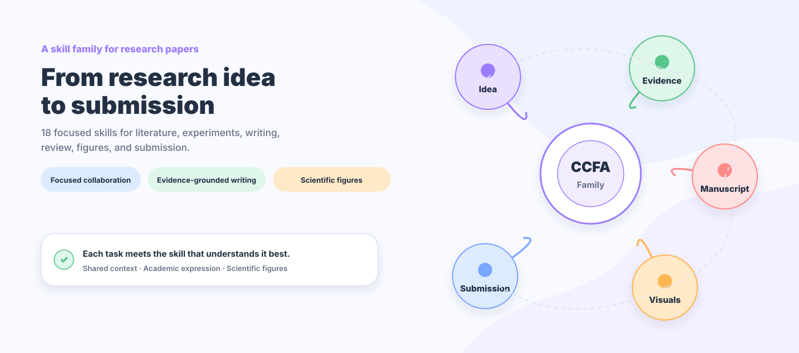
</p>

## Quick start

Choose the agent you use:

[Codex](docs/getting-started/CODEX.md) · [Claude Code](docs/getting-started/CLAUDE_CODE.md) · [Cursor](docs/getting-started/CURSOR.md) · [Gemini CLI](docs/getting-started/GEMINI_CLI.md) · [Other agents](docs/getting-started/OTHER_AGENTS.md) · [Automatic updates](docs/getting-started/AUTO_UPDATE.md)

Download and extract the lean package from the [0.13.0 Release](https://github.com/mikubaka88/CCFA-Skills/releases/tag/v0.13.0). It retains skills, original paper text, the figure library and sibling templates; full paper PDFs are available as an optional offline pack. Use the local installer described in the [installation matrix](docs/INSTALLATION_MATRIX.md) to preview and apply the installation. Personal preferences remain separate, and existing personal edits are checked first. Updates also retire unchanged managed files removed from the selected inventory.

The complete GitHub repository also supports one-line installation. This route still obtains the repository's full paper resources:

```powershell
npx skills add mikubaka88/CCFA-Skills --global --agent codex --skill '*' --yes --copy
```

This command installs the 18 skills. For bundled LaTeX templates or a partial installation, follow the [installation matrix](docs/INSTALLATION_MATRIX.md) to include the required sibling resources. With `--copy`, pulling source updates also requires refreshing the installed copies; see the [update guide](docs/getting-started/AUTO_UPDATE.md).

Then describe the research problem in ordinary language:

```text
Review and rank these three ideas, and identify the most likely rejection reason for each.
Find recent work, benchmarks, and published baselines for temporal visual reasoning.
Design the main experiments, ablations, and robustness evidence for this paper without inventing results.
Rewrite the method section in a CVPR style while preserving equations, terminology, and citations.
Draw the method architecture through prompt preparation, GPT Image generation and same-prompt refinement; deliver PNG.
```

## Why a family of skills

The difficulties of paper research are connected, but they do not require the same kind of reasoning.

| What researchers encounter | How CCFA-Skills responds |
|---|---|
| Retrieval, experiments, writing, and review compete inside one conversation | The skill best suited to the current question leads; adjacent capabilities join only when useful |
| Literature facts, experimental values, and manuscript claims drift apart | Sources, experiment design, and whole-paper consistency remain distinct responsibilities |
| A revision begins to sound like a review response full of caveats and internal status language | Writing forms the argument; Humanization restores direct and natural academic prose |
| Each review round changes its focus, obscuring whether the manuscript actually improved | Current publication readiness and progress over the previous version are considered separately |
| Diagrams become mechanical boxes; data figures drift from their templates | Three-stage GPT Image diagrams, faithful reuse of selected JSON/Python data templates |
| More installed skills create more noise instead of better work | Only capabilities relevant to the present question enter the conversation |

## What we value

- **The research question comes before the tool.** Judging an idea is different from developing it. Designing evidence is different from drawing a figure. Each step remains centered on the question it must answer.
- **Evidence keeps its provenance.** Literature, protocols, values, claims, figures, and citations do not collapse into plausible prose. A missing fact stays missing until it is found or verified.
- **A paper should sound academic, not defensive.** Humanization removes ritual caveats, mechanical enumeration, excessive em dashes, and internal process language while preserving material limitations and disclosures.
- **Review remains independent from revision.** The Reviewer judges; the Writer revises. Diagnosis comes before repair, so the manuscript does not argue with its own evaluation.
- **Scientific figures should explain and invite attention.** Quantitative plots keep their selected reproducible templates. Method diagrams use references and article content in the three-stage raster workflow.
- **Exemplars provide direction rather than a template.** When users supply target papers, CCFA learns their narrative rhythm, paragraph roles, and evidence organization without copying sentences or forcing one style onto every project.

## The family

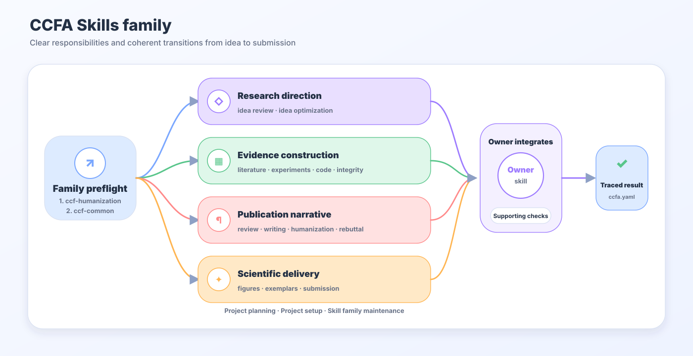

Every CCFA task activates `ccf-humanization` first, then `ccf-common`, before the specialist, including retrieval, review, visuals, experiments, and maintenance. Humanization keeps communication direct and evidence-faithful; Common applies scope, collaboration, evidence, and file rules. Reuse active rules across contributors and refresh only changed or missing context. Detailed rewriting and experiment checks depend on the actual task, without duplicate preflight reports. Specialists retain ownership and integrate necessary contributions.

### The 18 core skills

| Research moment | Skill | What it contributes |
|---|---|---|
| Family coordination | `ccf-common` | Understands requests, coordinates responsibilities, and protects evidence and privacy boundaries |
| Project direction | `ccf-pipeline-orchestrator` | Clarifies goals, stages, decisive milestones, and the next move |
| Project beginning | `ccf-project-scaffolder` | Prepares the paper workspace, templates, and research-material structure |
| Idea judgment | `ccf-idea-reviewer` | Judges idea value, novelty, and mechanism; excludes experiments by default |
| Idea development | `ccf-idea-optimizer` | Turns a rough direction into a problem, insight, method, and evidence path |
| Literature search | `ccf-literature-searcher` | Finds related work, datasets, benchmarks, and published baselines |
| Frontier tracking | `ccf-literature-monitor` | Watches new papers, nearby work, and changes in the field |
| Experiment design | `ccf-experiment-designer` | Designs main comparisons, ablations, robustness studies, and result structures |
| Research engineering | `ccf-research-engineer` | Selects codebases, implements mechanisms, reproduces results, and diagnoses training |
| Integrity | `ccf-integrity-auditor` | Checks claims, values, terminology, figures, and citations together |
| Paper review | `ccf-paper-reviewer` | Provides independent scientific review, version comparison, and readiness judgment |
| Paper writing | `ccf-paper-writer` | Drafts, rewrites, polishes, and compresses manuscript text |
| Academic voice | `ccf-humanization` | Removes defensive and mechanical prose without weakening rigor |
| Author response | `ccf-rebuttal-writer` | Organizes rebuttals, response letters, and revision records |
| Scientific visuals | `ccf-visual-composer` | Renders data templates, three-stage diagrams and existing-figure edits |
| Submission | `ccf-submission-checker` | Checks templates, page limits, anonymity, PDFs, and supplementary material |
| Exemplar learning | `ccf-paper-to-exemplar` | Distills controllable writing patterns from papers supplied by the user |
| Family maintenance | `ccf-skill-forger` | Improves skills, resolves conflicts, and validates releases |

### Use the capabilities the task needs

The 18 skills serve different occasions. Six produce research work: idea development, retrieval, engineering, experiments, writing and figures. Four assess ideas, manuscripts, integrity and submission packages. Monitoring, exemplars, scaffolding, orchestration and rebuttals enter at their relevant stage. Humanization and Common provide the shared preflight; the forger maintains the family. Establish shared rules once, then load relevant guidance. One owner integrates the result, with actual subagents used for complete independent questions.

The complete responsibility map:

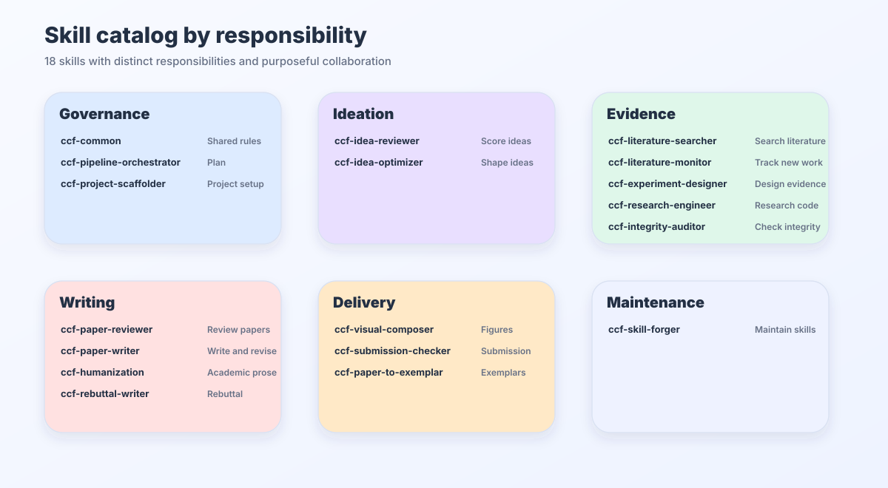

## Day and night controls

When you are tightening an abstract, you may want a quick edit. Three days before submission, you may be happy to wait for another assistant to check the key conclusions. The day and night configurator lets you make those choices and remembers them for later.

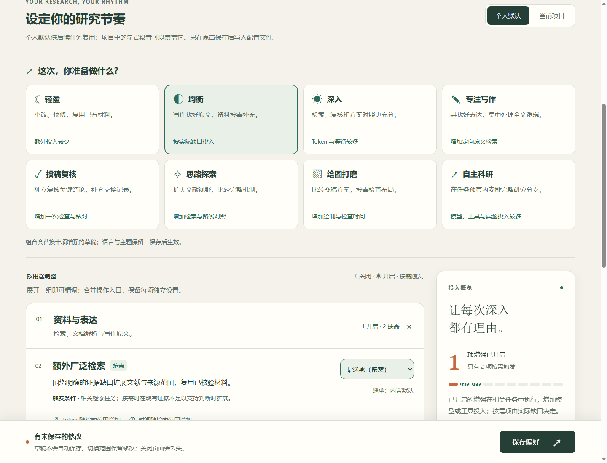

*The 0.12.0 configuration page; 0.12.1 adds a red drafting control under Sources & expression. Adjust the options, then click “Save preferences” to apply them.*

Choose from eight modes that match the work in front of you. The eleven settings are organized into four expandable groups: **Sources & expression**, **Review & delivery**, **Exploration & alternatives**, and **Strategy experiments**. The ten regular enhancements each have one selector for **Inherit · ☾ Off · ◐ Auto · ☀ On**, combining the previous switch, Auto button, and inheritance action. Settings remain independent, with explanations of their additional work. Simplified Chinese, Traditional Chinese, English, and light, dark, and system themes remain available.

From the repository root, run this command with Python 3.10+; no extra dependencies are needed:

```bash
python ccf-common/scripts/preferences.py serve
```

Your browser will open the local configurator. Start with the mode closest to your task, then adjust it:

| Mode | When to use it | Effect on tokens and time |
|---|---|---|
| **Light** | Small edits and local repairs | All ten optional enhancements are off, reducing unrequested extensions |
| **Balanced** | Everyday research with help when a gap matters | Keeps writing-example search on; broader search and complex-page parsing add effort when needed |
| **Deep** | Consequential work that benefits from more comparison and checking | Adds independent review, retrieval, figure candidates, and reporting, usually increasing tokens and waiting |
| **Focused writing** | Drafting sections, revising paragraphs, and improving the argument | Spends extra effort on finding and reading strong original passages, with conditional complex-page parsing |
| **Submission review** | Checking important judgments and omissions before submission | An independent second review adds reading and analysis; handoff details are added when useful |
| **Idea exploration** | Comparing mechanisms and finding worthwhile questions | Broader search and route comparisons add reasoning; complete research branches run when useful |
| **Figure design** | Comparing layouts and choosing a clearer presentation | Adds figure candidates; Python figures mainly add layout and rendering work, while image generation adds its own waiting |
| **Autonomous research** | Research iterations with an established task and budget | Favors complete research branches and broader search; parallel work may reduce waiting while increasing total compute |

Choosing a mode replaces the eleven choices in the draft while keeping your language and theme. Click **Save preferences** to apply it. **Inherit** removes one override: project settings follow personal preferences, and personal settings follow built-in defaults. Deep retains its existing conditional maintenance-rule iteration; all eight modes keep research policy evolution off until you select it separately. A mode does not authorize training, budgets, or material uploads. Actual effort depends on the task, inputs, and tools.

Three controls target different work: **Find strong writing examples** defaults to On: substantive drafting and expression rewriting reuse matching originals and search for other well-written passages. Select by actual quality and fit without requiring multiple papers. Reuse applicable searches for the same question; minor corrections do not trigger fresh retrieval. Auto remains available for searching only when examples leave a gap. **Complete research branches** defaults to Off, and **Research policy evolution** defaults to Off. Enable policy comparisons deliberately with a task budget. Existing sparse configurations inherit new defaults without being rewritten.

**Caution: results-pending drafting.** The eleventh setting is a red Inherit / Off / On control without Auto. It defaults to Off, and all eight presets keep it off. Enabling it permits marked conditional analysis and missing-result slots and may introduce hallucinations. The automatic whole-draft consistency pass adds reading and revision tokens and time; it does not start experiments. See [the drafting workflow](#draft-before-missing-results-are-filled) for how existing results and empty experiment sections are handled.

To give a paper its own settings, start the configurator with its directory. Replace the example path with yours:

```bash
python ccf-common/scripts/preferences.py serve --project "path/to/paper"
```

Choose **Personal defaults** or **This project** before saving. Personal defaults carry into future tasks. Explicit project settings take priority, while unset options continue to inherit. You might keep everyday work light and enable independent review only for a paper nearing submission. Preferences live outside installed skill folders and survive skill updates.

**Regular enhancements control additional effort; the red control selects results-pending drafting.** Even with Light selected, an explicitly requested full review, several research directions, and necessary verification still happen. The Humanization → Common preflight always applies. Opening the page does not call a model or start a research task.

<details>
<summary>Configuration files and offline use</summary>

Personal preferences live at `$CODEX_HOME/ccfa/preferences.json`, or `~/.codex/ccfa/preferences.json` if `CODEX_HOME` is unset. Project settings live at `.ccfa/preferences.json` inside the paper directory. An installed copy can run its own `ccf-common/scripts/preferences.py`. Add `--no-browser` to print the local launch URL without opening a browser.

After downloading the repository, you can also open the [static configuration page](ccf-common/assets/configurator/index.html) to import, edit, and export JSON. That page exports a file only. Rename the export to `preferences.json` and place it in the appropriate directory above to apply it. See the [preference contract](ccf-common/references/preferences.md) for details.

</details>

## From idea to submission

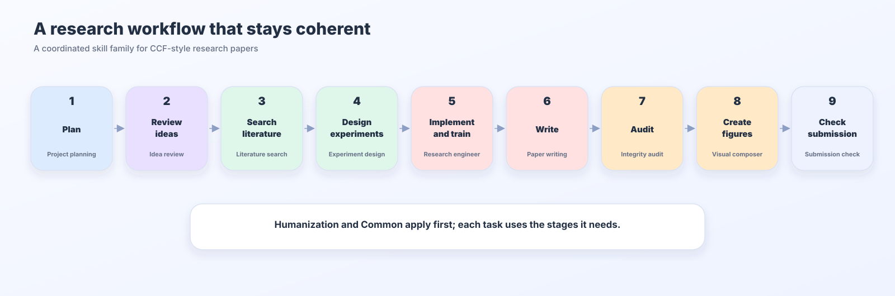

You can enter with a rough idea, a difficult result table, a method that needs clearer explanation, or a nearly finished manuscript. CCFA-Skills starts from the current question and uses the prerequisites needed to complete it.

### Develop the mechanism and implement it

The [idea optimizer](ccf-idea-optimizer/SKILL.md) develops unmet needs and unexplained phenomena into research questions. Ask what information, representation, objective or computation prevents the desired behavior before choosing components. Technical reports, conferences, journals, preprints and earlier foundational results can supply useful mechanisms. Explore different explanations, operations and predictions, then preserve a promising selected route until new evidence warrants reopening it. Foundational questions can be developed on their scientific merits.

The [research engineer](ccf-research-engineer/SKILL.md) inspects the existing project, selects a suitable codebase, reuses applicable baselines and maps the mechanism to model structure and gradient paths. Training changes follow measured bottlenecks. Diagnostic short runs answer specific implementation questions; full-method comparisons retain their corresponding conditions. Experiment design uses comparisons, factor combinations and interaction ablations that can distinguish the explanations at issue.

> Implement this mechanism in the existing project while preserving its training and evaluation interfaces. Inspect reusable code and baselines first, then identify the modules to change. Preserve the target method and profile slow training before choosing an optimization.

### Let experiments inform the next decision

An autonomous campaign runs a baseline, tests a concrete hypothesis, reads actual observations and decides whether to keep, discard, repair or explore another mechanism. The research objective and comparison conditions remain explicit while the approach can change with findings. A useful negative result can eliminate an explanation; an execution failure calls for diagnosis. Current best candidates and promising exploratory routes remain distinct.

The lightweight research runner executes specified commands, tracks run-count and execution-time budgets, protects locked files, retains raw logs and supports controlled rollback. The host agent proposes hypotheses, edits candidates and continues the research. Existing run records prevent an experiment ID from being silently repeated, while necessary candidate replication remains available. Parallel branches share the campaign allowance, retained raw baselines support comparisons, and final confirmation is recorded separately. An unconfirmed worker shutdown preserves the pending run and files so rollback cannot race with continuing writes.

Experiment records can retrieve earlier mechanisms, distinguish implementation failures from valid negative findings, and compare candidates against an agreed quality floor, including lower-cost alternatives of comparable quality. Optional research-policy evolution compares search, context or tool-use strategies on separate development, selection and held-out tasks before reusing a better policy. It follows the task's explicit budget; maintenance-rule iteration retains its separate purpose.

> Autonomously study the retrieval stopping criterion using the project's evaluation script and data split. Allow at most 6 runs including the baseline and failures, at most 60 seconds per run and 240 seconds of total experiment execution. Use no paid services. Inspect existing results, choose experiments that distinguish mechanisms, retain raw records, and deliver the best candidate and unresolved questions.

The [autonomous research guide and commands](ccf-pipeline-orchestrator/references/autonomous-research.md) explain setup, execution and recovery. A campaign begins with an explicit research task and finite budget; ordinary manuscript edits, concept reviews and plan-only requests keep their own scope. The [configurator](#day-and-night-controls) controls optional additional effort.

## Keeping the writing natural

Writing starts from what the paragraph needs to explain. Reuse matching original passages and, by default during substantive drafting or expression repair, search for other well-written examples for the same question. One source may help organize motivation and another explain a mechanism. Select by the actual passage's clarity and fit, preserve the user's scientific content and compose one coherent author voice.

[Humanization](ccf-humanization/SKILL.md) examines how each sentence develops the argument. State supported facts directly, retain conditions and genuine uncertainty, and remove empty defenses, imagined reviewer objections and internal status narration. A sentence that calls a proposal “verifiable and implementable” still needs to explain the operation; an index that supports offline incremental updates states a real technical property. Semicolon or repeated `rather than` diagnostics locate passages for contextual reading, not automatic word deletion. Keep meaningful longer sentences, supported closing emphasis and broader significance. Em dashes remain a sparing choice without a whole-paper quota; explicit user punctuation and rhythm preferences take priority. The [prose guidance](ccf-paper-writer/references/prose-quality-guardrails.md) explains these passage-level decisions.

> Revise this paragraph by clarifying how its reasons and evidence connect. Preserve the numbers, experimental conditions, and limitations that affect the conclusion.

### Make writing exemplars reusable

`ccf-paper-to-exemplar` records how a paper explains its science, with source locations, writing functions and declared coverage. It supports a whole paper or a selected section or passage. A one-off rewrite stays with the writer and needs no card. A reusable analysis becomes a card; an explicit registration request makes a completed card discoverable in the personal library.

Project entries live in `.ccfa/exemplars/`; user entries live under the personal configuration root in `ccfa/exemplars/`. Registration references existing cards and originals, retains source identity and version, and rejects unfinished skeletons. The writer queries metadata before reading matched cards and original passages. Changed sources invalidate their entries. Personal registration leaves installed skill files unchanged.

Whole-paper mode retains all eight established analysis categories. Explicit defaults remain supported, including multiple cards and project selection over inherited user defaults. Defaults prioritize matching examples; ordinary registration preserves the selection.

```bash
python ccf-paper-to-exemplar/scripts/personal_library.py query --project . --function motivation
python ccf-paper-to-exemplar/scripts/personal_library.py set-default --project . --id paper-a-motivation
```

Ask to distill a paper's introduction into a reusable exemplar and register it for the current project. In a later writing task, ask the writer to find personal examples that explain the same scientific relation. See the [exemplar skill](ccf-paper-to-exemplar/SKILL.md) for registration commands.

### Keep long revisions connected

Long revisions carry the paper's throughline, target sections, necessary neighbors and located original passages together. Related work explains scientific relationships; results connect observations to their interpretation. Only the prompt module relevant to the current task is loaded. Source observations and adaptation advice stay distinct, and source sentences or scientific claims are not transplanted into a new paper.

The [writing execution helper](ccf-paper-writer/references/writing-execution.md) binds localized changes to the current manuscript version and permitted edit scope. Changes to declared scientific inputs identify the passages and figures that need rechecking. Optional expensive reviews reuse only completed results with matching inputs, guidance, model parameters and actual coverage; interrupted calls are reconciled before reuse. A short edit stays direct.

> Revise this paper's results and discussion. Keep the full-paper throughline and necessary neighbors, and explain the differences using the actual results. Prepare the current material, apply localized edits, then recheck the affected arguments and figures.

### Draft before missing results are filled

The red [results-pending control](#day-and-night-controls) supports a coherent draft from the supplied problem, mechanism, argument and clearly marked conditional analysis, with result slots filled later. Preserve existing positive and negative results, and honor an explicit request to leave experiments empty. After drafting, check the abstract, body, tables, figure captions and conclusion together so planned outcomes and measured findings remain distinct. Full scientific explanations come before requested page fitting.

## Review and submission checks

Route by the requested judgment: “Is this direction worth pursuing?” uses `ccf-idea-reviewer` without needing an explicit score request; “Does this manuscript support its conclusions?” uses `ccf-paper-reviewer`. A full PDF can still receive concept-only review. Idea ratings cover problem value, novelty, insight, mechanism, elegance, and audience fit; experiments are assessed separately only when requested.

Structured review reports use detailed output by default and brief output on explicit request. Manuscript reports develop contributions, strengths, concerns, prior art, method and evidence, reviewer perspectives, ratings, and action priorities. Idea reports develop problem value, novelty, mechanism logic, and development advice; experiments are outside their default scope. Findings carry specific evidence locations and stable IDs for revision tracking. Percentile ranks require a real comparable corpus. See the [manuscript report format](ccf-paper-reviewer/references/fixed-output-format.md) and [idea-review protocol](ccf-idea-reviewer/references/strict-idea-review.md).

Full manuscript reviews keep 14 ordered sections, writing reviews keep 9, and explicitly requested brief reports use 5 blocks. The generic scientific scorecard has seven criteria: novelty, soundness, evidence, significance, clarity, reproducibility, and ethics/limitations. Evidence expectations follow contribution type; confidence and source coverage are separate. Markdown reports can be checked directly for section order, rating fields, and concern-ID references. Explicit venue or user formats retain priority.

Manuscript re-review answers two different questions:

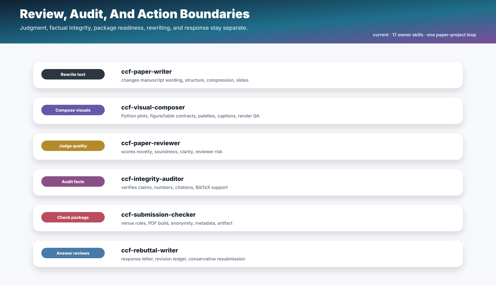

- **Is the current manuscript ready for its target venue?** This measures the remaining distance to the publication standard.
- **Did the revision make genuine progress?** This compares what the new version resolved and what new problems it may have introduced.

### Add an independent domain reading when needed

An independent specialist first reads the manuscript without the lead score, earlier verdict or drafting history. The main reviewer checks the returned evidence, merges duplicate issues and integrates the findings into one report. A concern does not automatically require a new experiment. Rebuttals answer the actual question, with thanks, concessions and revision promises when warranted.

The existing independent-review control keeps Off, On and Auto behavior: Off adds no unsolicited call, On can add one substantive scientific or full-paper reading, and Auto reserves it for a consequential unresolved judgment or a pre-submission check. Explicit requests take priority. This reading replaces an equivalent extra check and adds input/output tokens and elapsed time. The [preparation helper and workflow](ccf-paper-reviewer/references/plain-expert-review.md) organize the material; the host must execute the call with an available GPT-6 instance and fresh context. When that capability is unavailable, the main review continues.

> Ask an independent specialist to review this manuscript before seeing earlier comments. Identify the issues that matter to the judgment, then have the main reviewer combine the findings into one report. Select an actual GPT-6 instance when the host supports it.

### Use the matched venue edition

Submission checks connect the template, manuscript and required forms for the same venue, year, track and stage. Recent adaptation entrypoints include:

| Venue | Guidance and local checks |
| --- | --- |
| ACL 2027 | [Long/short papers and ARR review versus ACL commitment](ccf-paper-writer/references/venue-guides/acl.md) |
| ICML 2027 | [Contribution type, Impact and AI Disclosure Statements](ccf-paper-writer/references/venue-guides/icml.md) |
| CVPR 2027 | [Template, main-text budget, anonymity, LLM Usage Statement and author checks](ccf-paper-writer/references/venue-guides/cvpr.md); [template bundle](ccf-latex-templates/CVPR/2027/main.tex) |
| ICLR 2027 | [Edition-specific template, stage and AI-use guidance](ccf-paper-writer/references/venue-guides/iclr.md) |
| ECCV | [Venue guide and edition profile](ccf-paper-writer/references/venue-guides/eccv.md) |
| ECOOP | [Venue guide and edition profile](ccf-paper-writer/references/venue-guides/ecoop.md) |
| IMC | [Venue guide and edition profile](ccf-paper-writer/references/venue-guides/imc.md) |
| ACSAC | [Venue guide and edition profile](ccf-paper-writer/references/venue-guides/acsac.md) |

The [venue index](ccf-paper-writer/references/venue-guides/index.md) covers the wider collection. Source/PDF preflight and manual author requirements remain separate checks.

## Visual examples

These are research visuals rather than release-announcement graphics. Each figure uses a visual language suited to its reading context.

### Paper method architecture

The retained DynTrace example uses a layered layout to explain its computational relationships and information flow. Inputs and visual processing sit at the bottom, geometry-grounded evidence and the DTV/DTG branches form the middle, and token integration, the MLLM, and the answer appear at the top. Connections follow computational dependencies so readers can trace the complete method.

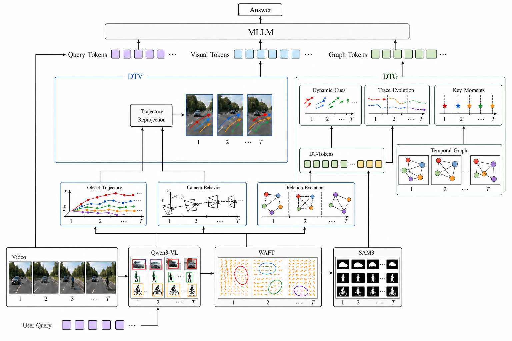

<details>
<summary>Reference figure, source, and composition principles</summary>

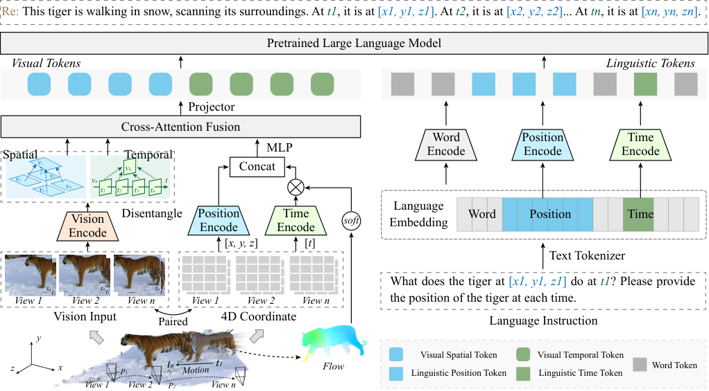

Reference: Hanyu Zhou and Gim Hee Lee, [*LLaVA-4D: Embedding SpatioTemporal Prompt into LMMs for 4D Scene Understanding*](https://arxiv.org/abs/2505.12253), Figure 2; see also the [OpenReview page](https://openreview.net/forum?id=URpbmVEsqB). The screenshot is included only for non-commercial study of academic composition and visual style. Copyright remains with the authors; please contact the maintainer for removal if it raises any rights concern.

- A paper figure should make its inputs, representations, operations, branches, integration, and output easy to follow.
- Video frames, optical flow, masks, 3D trajectories, DT-Tokens, and the temporal graph carry method meaning rather than decoration.
- Ordinary English uses natural capitalization; Qwen3-VL, WAFT, SAM3, DTV, DTG, MLLM, 3D, and 4D retain their canonical forms.

</details>

### PPT/Poster

The two earlier visual explorations remain below. They are better suited to slides, project posters, and README overviews, so they are not presented as top-conference method figures.

#### GPT Image 2 concept draft

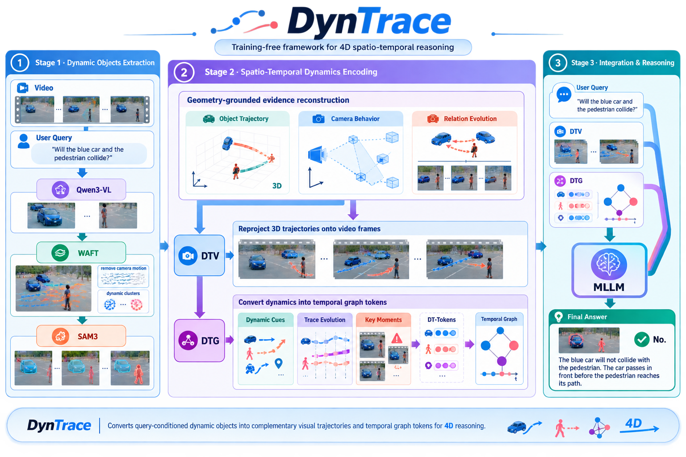

#### Reference-guided PPT/Poster

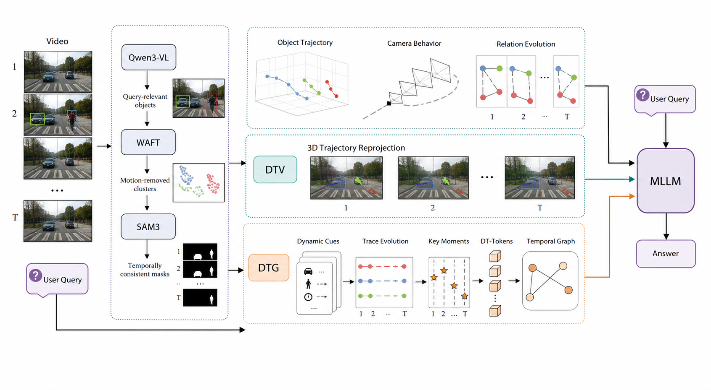

Reference composition organizes headings, color fields and visual anchors for presentation or poster reading.

### Data-analysis figures

Analysis figures begin with the paper's claim, section, observation units and final physical size. **43 chart grammars, 16 analytical purposes and 16 fusion plans** cover distributions and tails, matched gains, error structure, ranking changes, resource trade-offs and related questions. Each design explains its data requirements, reasoning, common misreadings and possible complementary views. Choose a coherent, information-rich analysis unit; combine panels when their relationship helps the reader.

All previews below use independently generated synthetic data and generic labels to demonstrate analysis and layout.

**Density and grouped response:** sensor load, a selected region, quantile ranges and a P95 trend in a compact linked analysis.

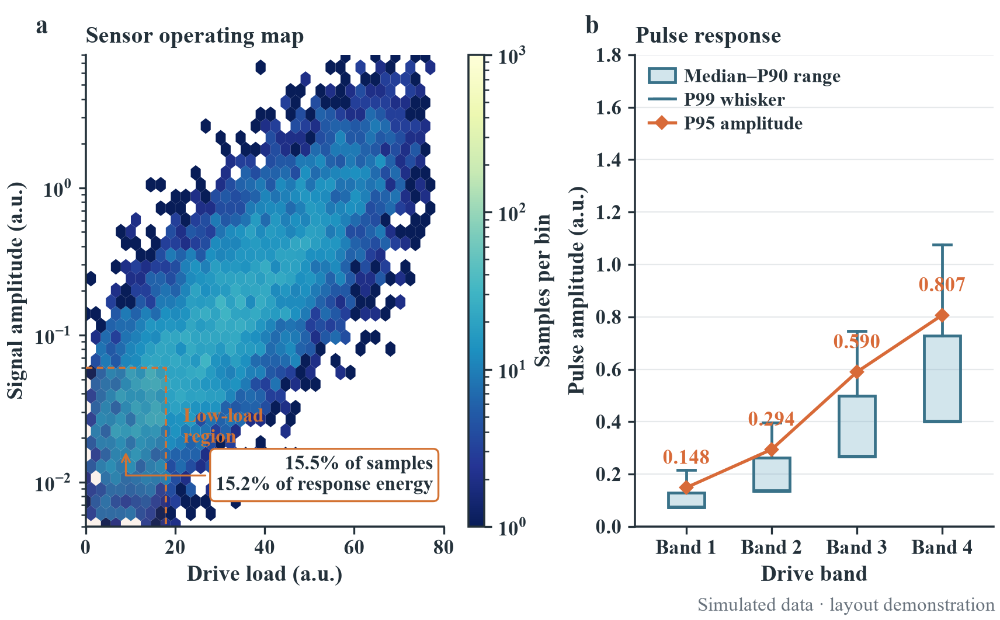

**Process and category comparison:** fictional units show recovery trajectories, interval bands and category bars with lines.

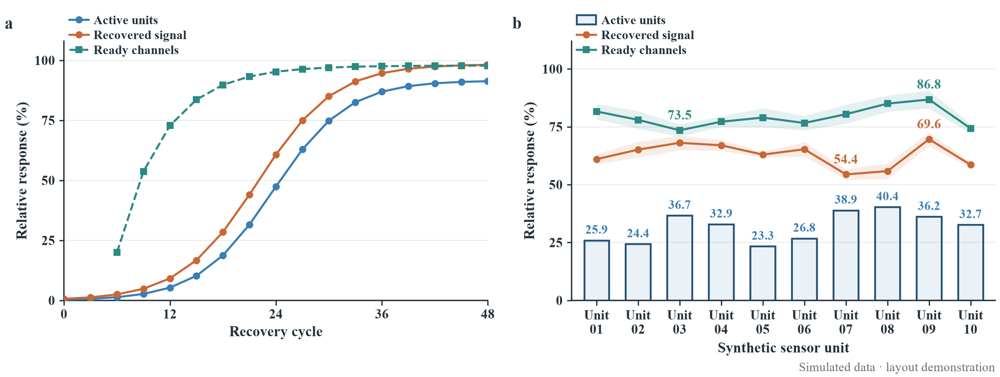

**Joint distribution and marginals:** one set of simulated observations provides both the relationship and its two marginal counts.

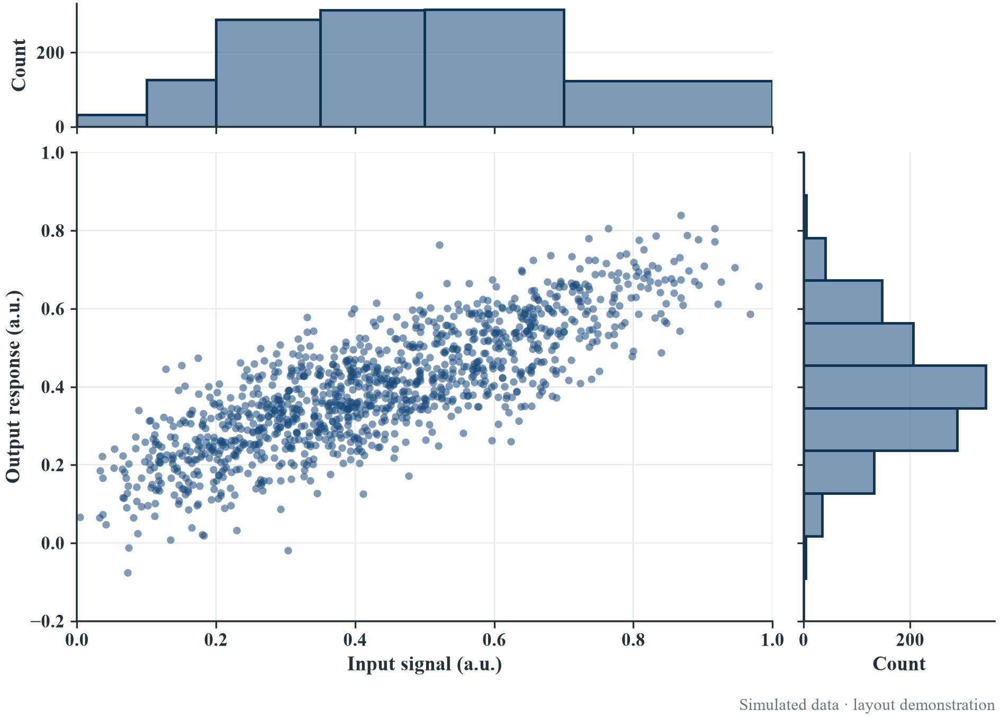

**Response surface and linked slices:** the heatmap and its row/column profiles come from the same synthetic grid.

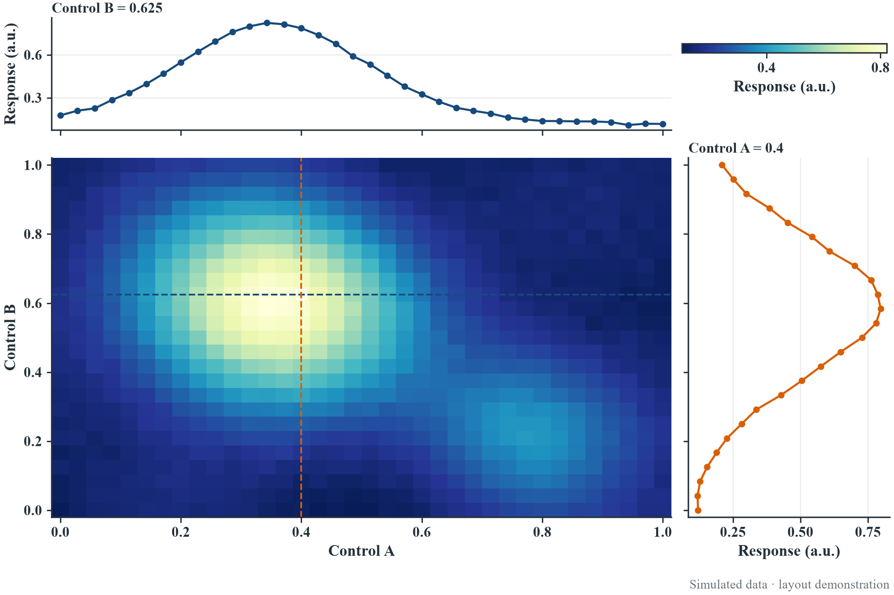

<details>
<summary>Paired effects and biological analysis examples</summary>

**Paired effects:** matched changes, a difference distribution, subgroup intervals and temporal response explain the simulated effect.

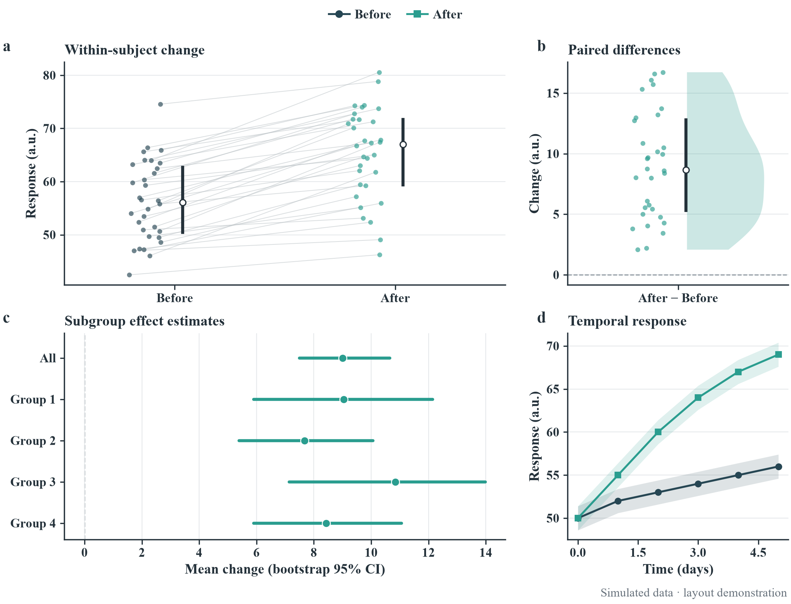

**Biological analysis:** synthetic cell groups, expression, screening and pathway activity share one coordinated composition.

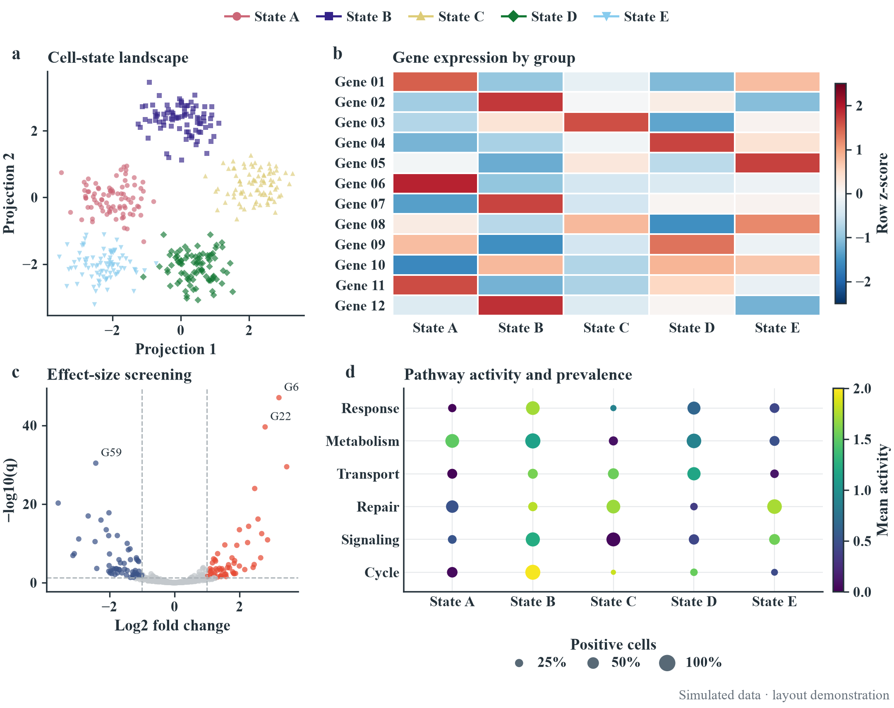

</details>

Reuse the [saved specifications](assets/visual-showcase/analysis-showcase.json); run `python tools/build_analysis_showcase.py` to render the same inputs and layouts.

Equally suitable designs can vary naturally without a seed setting or usage quota. Once selected, the accepted data and composition guide later edits. The [design and fusion guide](ccf-visual-composer/references/figure-design-library.md) links the paper-study coverage, source records, categories and local paper-search tools. Dated coverage counts remain in the [version history](CHANGELOG.md#v0130).

```bash
python ccf-visual-composer/resources/python/ccfa_figure_library.py route "distribution tails"
python ccf-visual-composer/resources/python/ccfa_figure_library.py explain ecdf
python ccf-visual-composer/resources/python/ccfa_figure_library.py demo --fusion paired_benefit --out ccfa-workfiles/figures/paired-effect/build/figure
```

Real observations load from CSV, TSV or JSON, with filtering and ordering applied to matched rows together. Three linked layouts provide joint distributions with marginals, position-aligned tracks, and matrices with row/column slices. They share the actual observations or grid while keeping distinct units. Compositions preserve entity colors, comparable axes, actual bin edges and stated denominators.

The [complete example table](ccf-visual-composer/references/figure-examples.md) preserves all original templates and the requested density/grouped-response and process/category reference pairs. Invoke an example by ID, then adapt its message and data to the current paper.

<details>
<summary>Nine complete Python layouts and their analytical purpose</summary>

[Six-design overview](assets/analytical-figures-gallery.png) · [Complete examples and invocation guide](ccf-visual-composer/references/figure-examples.md)

| Template | What it helps explain |
| --- | --- |
| `mechanism_overview` | How the mechanism connects to performance and resource use |
| `benchmark_atlas` | Results across tasks, repeated runs and cost trade-offs |
| `ablation_interactions` | Component contributions and interactions |
| `scaling_robustness` | Behavior across scale, training budgets and perturbations |
| `representation_diagnostics` | Embeddings, attention and feature relationships |
| `biological_atlas` | Cell groups, expression and differential screening |
| `paired_effects` | Changes within samples and effects across subgroups |
| `calibration_errors` | Calibration, confusion and error structure |
| `sensitivity_dynamics` | Density and threshold fractions, boxes with P95, state evolution and category bars/lines; also available as two horizontal panel pairs |

The original 13 components and 30 additions form the 43-grammar router. A useful panel can be replaced or combined with another supported view while keeping the design's statistical meaning.

</details>

Python plotting uses NumPy and Matplotlib. Gallery values are simulated: only `--demo` creates examples; real tasks use `--data` with supplied observations. The tools preserve p-value, adjusted-p-value and q-value distinctions and check intervals, probabilities, axis ranges and labels.

```powershell
python -m pip install numpy matplotlib
python ccf-visual-composer/resources/python/ccfa_analysis_templates.py --demo all --out ccfa-workfiles/figures/analysis-demo
```

For the sensitivity pair, replace `--demo all` with `--demo sensitivity_dynamics --panel-pair sensitivity`; change `sensitivity` to `dynamics` for state evolution and category comparison, retaining the `--out` path. The [plotting guide](ccf-visual-composer/references/python-plot-recipes.md) covers real-data bindings, type and palette parameters. Repeated runs update the same task directory; extra candidates and independent review use the existing switches.

> Arrange these results as a compact analysis figure. Decide which relationships need comparison before choosing a design. Set type at the final paper width, align related elements, keep method colors consistent, retain relevant uncertainty, and deliver PNG with reusable Python/JSON sources.

[Earlier numerical examples and their source files](ccf-visual-composer/references/figure-examples.md#早期-svg-与展示图保留原文件) remain in the library.

## Figures that fit the paper

A selected data template keeps its JSON specification and Python renderer. Replace supplied scientific data while retaining layout, type scale, palettes, layers and statistical definitions. Explicit dimensions take effect, and colors or shapes follow object identity across plots. A fixed 132 × 84 mm input comparison produced pixel-identical outputs through the corrected library path and direct template rendering. New designs use input-data and chart-type routing; an accepted template is reused directly.

New/redrawn method, architecture and flow diagrams use three stages. First understand the scientific message, actual objects and relationships, then prepare P from the user prompt, references and article. Generate G0 with P and those materials, then refine G0 with the same P into G1. The last two stages are two actual image calls; refinement remains required when additional candidates are off. GPT Image chooses the complete compact composition, with no vector skeleton or SVG/PPT shape reconstruction.

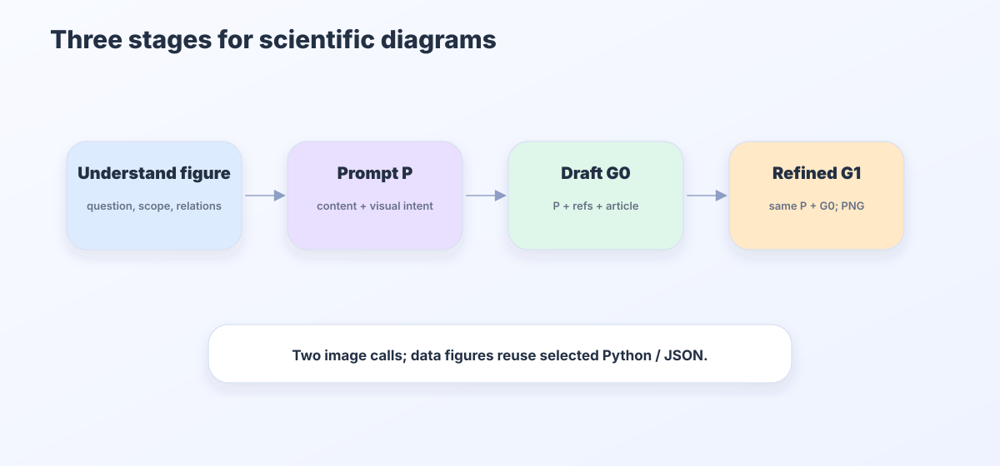

Local edits preserve the current image or authoring source and refresh affected exports. Numerical figures use Python and deliver PNG with reusable Python/JSON sources; PDF/SVG exports require an explicit request. Method diagrams deliver PNG and remain raster images when placed in PPTX or PDF. Existing editable source files remain available for local maintenance. Image models can add needed illustrations or mechanism components without redrawing the data.

Type and strokes are set for the final paper width. Use Times New Roman or selected Comic Sans MS, bold titles, legends and axis text, darker same-hue bar/box borders and compact aligned layouts. Related panels share entity colors and comparable axes or color scales; distinct units retain separate labels. CJK fallbacks preserve Chinese glyphs. The 14 existing palettes and six additions—AAAS, NEJM, Lancet, JCO, Tol bright and Tol muted—remain available as color choices, with consistent roles across a figure.

## Distinct roles, shared story

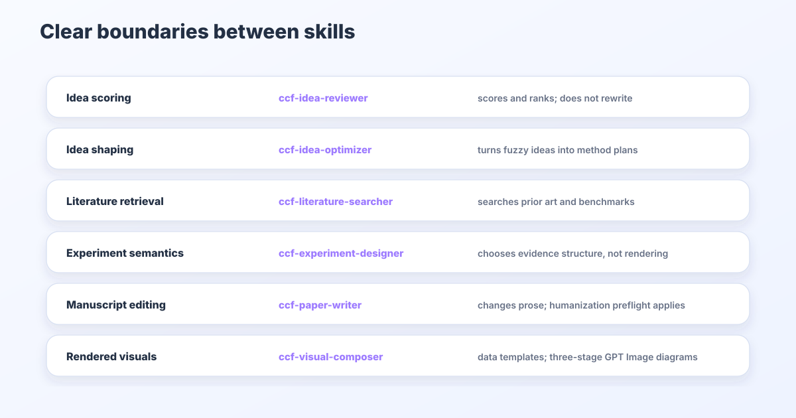

Each artifact has one owner responsible for integration and delivery. Work backward from the result to its prerequisites: closest-work evidence for novelty judgments, supported claims and citations for substantive writing, and actual data semantics and topology for figures. Relevant specialists resolve missing, conflicting or stale inputs; valid completed work is reused. Internal contributions return focused findings, while requested reviews keep their fixed report and scoped coverage. The [cooperation routes](ccf-common/references/routing.md) explain which capabilities contribute to each outcome.

### Keep the goal through long conversations

A long task can retain a short record of the goal, important constraints, current route and next action. Check it when changing direction, accepting another assistant's work or recovering context. If a response drifts, return to actual files and observations, preserve valid work and resume with a bounded action that can be checked. New evidence can justify a route change while retaining the research objective. The [continuity rules](ccf-common/references/continuity.md) describe recovery and progress checks.

### Give each agent a complete question

Delegate independent retrieval, mechanism exploration or checks whose result can be assessed as a unit. Keep a tightly connected problem, insight and method under one author, then integrate helpers' evidence into the same argument. Return local defects to the original helper when its context remains useful; regroup work when fragmented ownership is rebuilding the same assumptions. Shared files have a clear owner, and findings based on an older version are reconciled before use. Higher reasoning effort does not require finer task splitting.

Other skill families can provide document, code, context or evaluation tools while the task retains its goal, canonical paths and integrating owner. Reuse active Humanization and Common rules, load only relevant guidance, and check affected dependencies after integration. Save tokens on repeated retrieval, duplicate reports and irrelevant context while completing necessary groundwork. See [task modes](ccf-common/references/task-modes.md) and [handoff rules](ccf-common/references/handoff-modes.md).

## Repository

```text
CCFA-Skills/
├── ccf-common/                 # Shared family guidance
├── ccf-*/SKILL.md              # Entry points for 18 skills
├── ccf-*/references/           # References read when needed
├── ccf-*/scripts/              # Reproducible operations
├── assets/                     # README visuals and figure examples
├── evaluation/                 # Regression and ablation results
├── tools/build_ccfa_diagrams.py
└── 实验结果.md
```

Longer guidance lives in `references/`, while repeatable work belongs in `scripts/`. Iterative artifacts keep stable names so that a new version replaces the previous one instead of leaving behind a trail of indistinguishable attempts.

The file contract leads all 18 skill entrypoints. Explicit paths, this artifact's existing mappings, and established task folders take priority. New tasks use a dedicated project-root `ccfa-workfiles/<purpose>/<artifact-id>/`, outside generic `output/` folders. Examples include `figures/method-overview/`, `reviews/paper-short-title/`, and `literature/retrieval-memory/`. If the name belongs to unrelated material, use a stable `ccfa-workfiles-<project-id>/` rather than merging or overwriting contents.

Create `source/` (reusable authoring files), `assets/` (reference/icon assets), `cache/` (downloads/extractions), and `build/` (current previews/logs) only when needed. Skills working on the same artifact share its directory and update current files. Avoid ambiguous new names such as `temp`, `misc`, or `final-final`. Remove only verified disposable files created by the task; retain original evidence, editable sources, requested outputs, and necessary comparison baselines. Failed builds preserve usable results. Existing folders are not migrated to adopt the new default; see the [artifact contract](ccf-common/references/artifact-contracts.md).

Repeated rendering or conversion can use [temporary-output tracking](ccf-common/references/artifact-contracts.md#optional-tracking-for-repeated-builds) to clean only released, unchanged task-owned files. Ordinary edits do not need that helper.

Chinese output uses explicit UTF-8 I/O with optional BOM support on input. Shell pipes, Unicode filenames, and glyph coverage are checked separately. Family validation includes Chinese and uncommon-character regressions and reports decoding errors rather than masking them with replacement characters. Figures retain the chosen Latin font and use an available CJK fallback.

<a id="latest-updates"></a>

## Latest updates

Current version: **0.13.0**. Detailed usage lives with each capability above; dated changes are kept in the [changelog](CHANGELOG.md#v0130).

- **2026-11-28:** Six independently synthetic examples with saved specifications; see [data-analysis figures](#data-analysis-figures).
- **2026-11-27:** Analysis previews refreshed and functional guidance consolidated by topic, with version history kept in [CHANGELOG](CHANGELOG.md#v0130).
- **2026-11-26:** Shorter shared entrypoints and connected [personal writing exemplars](#make-writing-exemplars-reusable), including scoped cards, metadata queries and explicit project/user defaults.
- **2026-11-25:** Six venue adaptations and reference collections; see [submission entrypoints](#use-the-matched-venue-edition).
- **2026-11-14:** Faithful selected-template data rendering and the [three-stage diagram workflow](#figures-that-fit-the-paper).
- **2026-11-12:** [CVPR 2027 guidance and template](ccf-paper-writer/references/venue-guides/cvpr.md), plus coordinated writing, experiment and figure checks.

## Maintenance and validation

Run the basic documentation and family checks from the repository root:

```powershell
python ccf-common/scripts/check_v04.py
python ccf-common/scripts/check_path_privacy.py
python ccf-common/scripts/check_markdown_links.py
python ccf-common/scripts/check_sources.py
```

The [CI workflow](.github/workflows/validate.yml) is the complete regression command list for configuration, writing, review, figures, research execution and installation. The [behavioral smoke-test guide](evaluation/behavioral/README.md) explains content and natural-request routing probes. These cover different checks; actual model quality and token use are measured from task execution.

The [0.12.0 content comparison](evaluation/behavioral/results/0.12.0-smoke.md) retains its four tasks, actual outputs and anonymous comparison. The [historical experiment record](实验结果.md) preserves v0.9.0 results with their original models and conditions.

## Commitments

- Never invent experimental results, citations, method components, or venue rules.
- Read only the private manuscript or unpublished material needed for the task.
- Use external retrieval and image generation with user authorization and minimal disclosure.
- Respect the user's decision to disable any skill.
- Explain the rubric, comparison target, evidence, and uncertainty behind every automated score.

## Acknowledgments

Thanks to [Research-Paper-Writing-Skills](https://github.com/Master-cai/Research-Paper-Writing-Skills) for contributing to the open ecosystem of academic-writing skills.

## Star history

[](https://github.com/mikubaka88/CCFA-Skills/stargazers)

<a href="https://www.star-history.com/?repos=mikubaka88%2FCCFA-Skills&amp;type=date">
  <picture>
    <source media="(prefers-color-scheme: dark)" srcset="https://api.star-history.com/svg?repos=mikubaka88/CCFA-Skills&amp;type=Date&amp;theme=dark" />
    <source media="(prefers-color-scheme: light)" srcset="https://api.star-history.com/svg?repos=mikubaka88/CCFA-Skills&amp;type=Date" />
    
  </picture>
</a>

The chart updates through Star History and the count badge through Shields.io. Service and GitHub image caches can delay changes; the chart is typically cached for about 24 hours, so it is not a second-by-second live feed. Click the chart for the interactive page.

[View the 2026-08-13 historical snapshot (available offline)](assets/ccfa-skills-star-history.svg)
