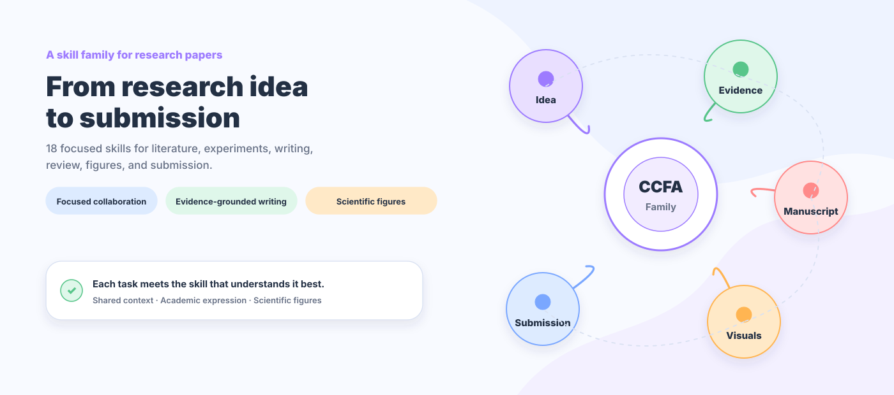
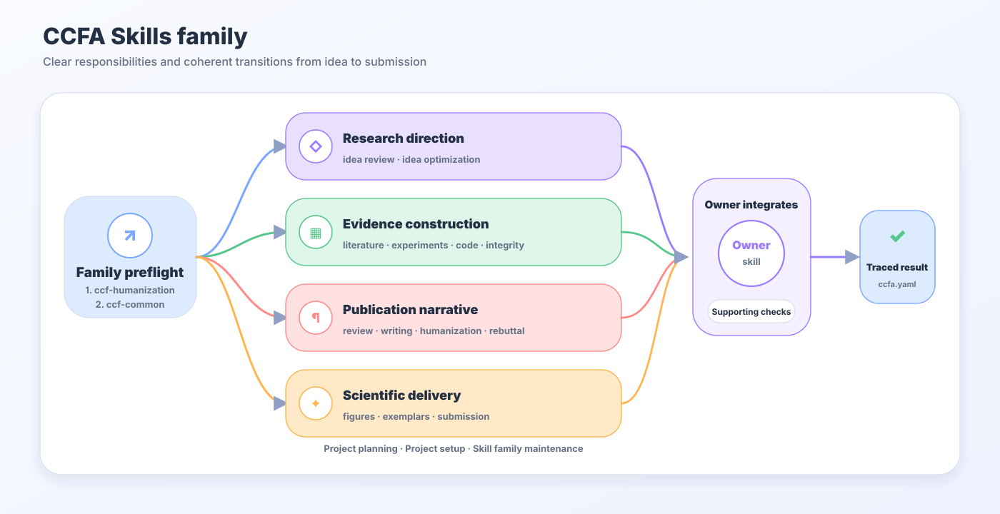
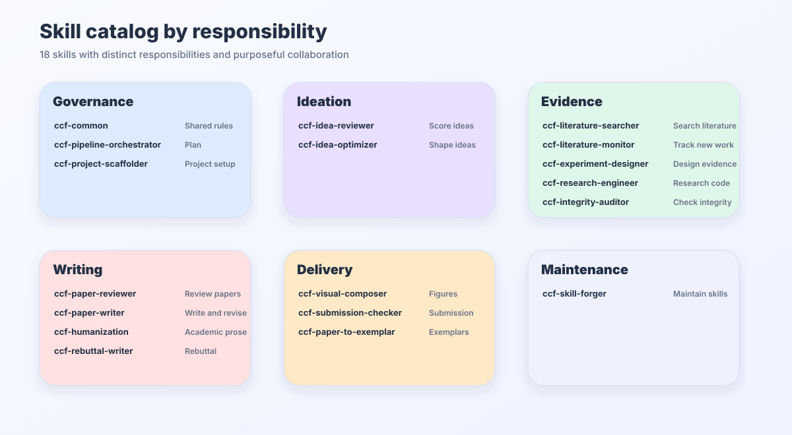
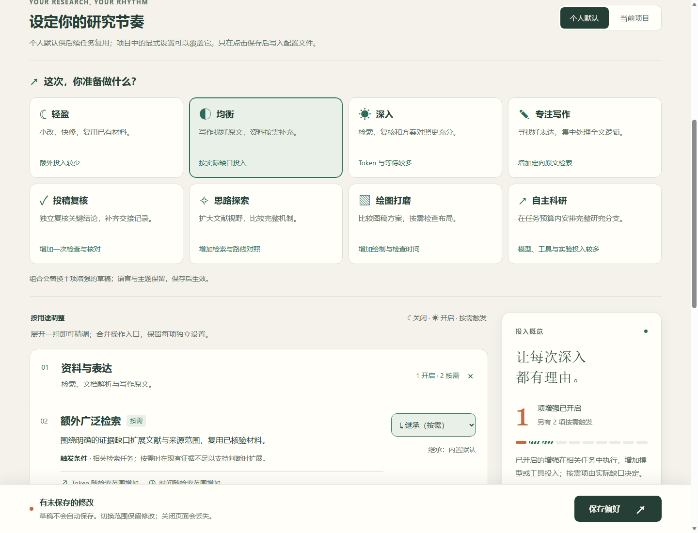
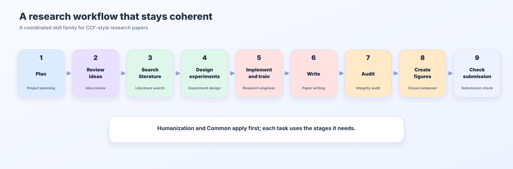
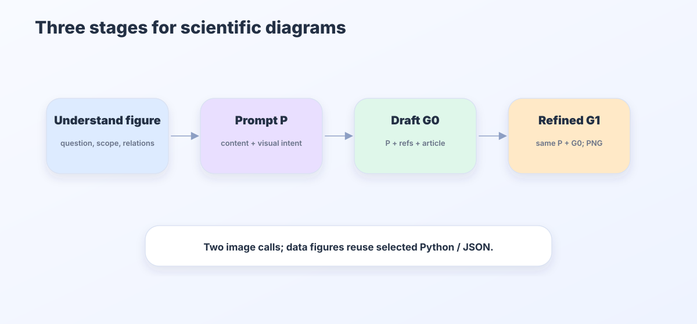
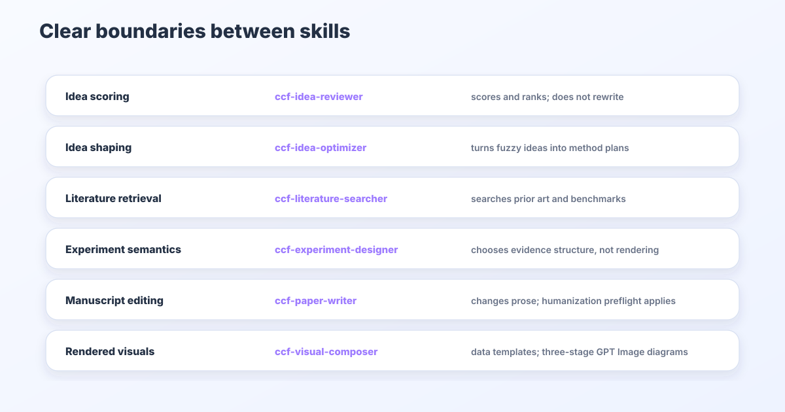
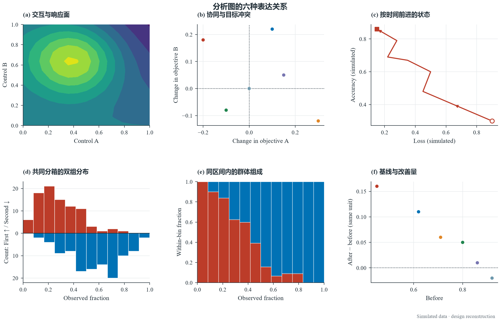
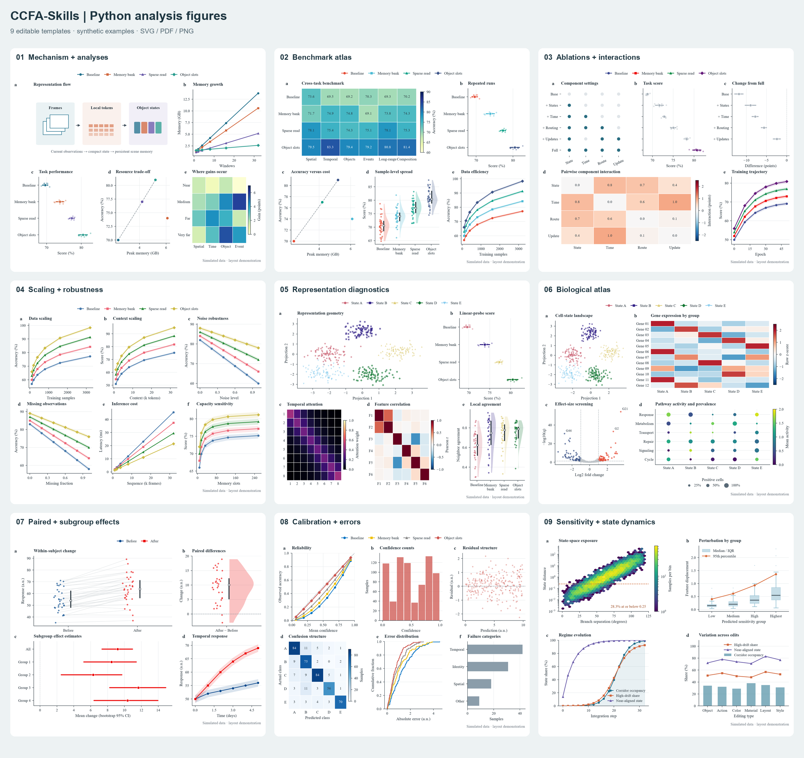

<p align="center">
  <a href="https://trendshift.io/repositories/151023?utm_source=trendshift-badge&amp;utm_medium=badge&amp;utm_campaign=badge-trendshift-151023" target="_blank" rel="noopener noreferrer"></a> <a href="https://trendshift.io/repositories/151023?utm_source=trendshift-badge&amp;utm_medium=badge&amp;utm_campaign=badge-trendshift-151023" target="_blank" rel="noopener noreferrer"></a>
</p>

<div align="center">

<h1>CCFA-Skills</h1>

**A skill family for shaping the research storyline of CCF-A papers.**

[Simplified Chinese](README.md) · [English](README.en.md) · [Traditional Chinese](README.zh-TW.md)

**[Latest updates · v0.12.1](#latest-updates)**


---

*“The structure of the prose becomes the structure of the scientific argument.”*<br>
George D. Gopen and Judith A. Swan, [*The Science of Scientific Writing*](https://www.cs.tufts.edu/comp/150FP/archive/george-gopen/sci.html)

*“The very process of science is centered around communication.”*<br>
Yann LeCun and James M. Manyika, [*Learning Abstractions*](https://www.amacad.org/publication/daedalus/learning-abstractions-conversation-yann-lecun)

</div>

## Table of contents

- [Quick start](#quick-start)
- [Why a family of skills](#why-a-family-of-skills)
- [The family and its 18 core skills](#the-family)
- [Day and night controls](#day-and-night-controls)
- [From idea to submission](#from-idea-to-submission)
- [Visual examples](#visual-examples)
- [Keeping the writing natural](#keeping-the-writing-natural)
- [Figures that fit the paper](#figures-that-fit-the-paper)
- [Distinct roles, shared story](#distinct-roles-shared-story)
- [Repository and maintenance](#repository)
- [Latest updates](#latest-updates)
- [Star history](#star-history)

At two in the morning, the experiment finally finishes. The new result is better than expected, yet reopening the manuscript reveals the harder problem. The sharp question that began the project is buried beneath related work. The method section no longer quite matches the mechanism in the code. A new experiment answers the previous review, but pulls the argument in another direction. Every part seems to have improved, while the paper as a whole has become less clear.

Many promising projects are weakened not by a poor idea, but by what happens to that idea over time. Literature accumulates, result tables expand, and the author repeatedly switches between researcher, writer, and reviewer. The original insight gradually disappears beneath local revisions. One long prompt cannot reliably preserve all these relationships because retrieval must remain faithful to sources, experiments to protocols, writing to the argument, and review to independent judgment.

CCFA-Skills grew from this problem. We treat a paper as a research storyline that must remain coherent while it changes, not as a document waiting to be filled. Eighteen specialized skills accompany the work from idea, literature, and experiments to writing, visualization, review, rebuttal, and submission. As the work passes between them, the link between question, evidence, and conclusion remains intact, so the paper can evolve without forgetting why it deserved to be written.

<p align="center">
  
</p>

## Quick start

Choose the agent you use:

[Codex](docs/getting-started/CODEX.md) · [Claude Code](docs/getting-started/CLAUDE_CODE.md) · [Cursor](docs/getting-started/CURSOR.md) · [Gemini CLI](docs/getting-started/GEMINI_CLI.md) · [Other agents](docs/getting-started/OTHER_AGENTS.md) · [Automatic updates](docs/getting-started/AUTO_UPDATE.md)

Download and extract the lean package from the [0.12.1 Release](https://github.com/mikubaka88/CCFA-Skills/releases/tag/v0.12.1). It retains skills, original paper text, the figure library and sibling templates; full paper PDFs are available as an optional offline pack. Use the local installer described in the [installation matrix](docs/INSTALLATION_MATRIX.md) to preview and apply the installation. Personal preferences remain separate, and existing personal edits are checked first. Updates also retire unchanged managed files removed from the selected inventory.

The complete GitHub repository also supports one-line installation. This route still obtains the repository's full paper resources:

```powershell
npx skills add mikubaka88/CCFA-Skills --global --agent codex --skill '*' --yes --copy
```

This command installs the 18 skills. For bundled LaTeX templates or a partial installation, follow the [installation matrix](docs/INSTALLATION_MATRIX.md) to include the required sibling resources. With `--copy`, pulling source updates also requires refreshing the installed copies; see the [update guide](docs/getting-started/AUTO_UPDATE.md).

Then describe the research problem in ordinary language:

```text
Review and rank these three ideas, and identify the most likely rejection reason for each.
Find recent work, benchmarks, and published baselines for temporal visual reasoning.
Design the main experiments, ablations, and robustness evidence for this paper without inventing results.
Rewrite the method section in a CVPR style while preserving equations, terminology, and citations.
Draw the method architecture through prompt preparation, GPT Image generation and same-prompt refinement; deliver PNG.
```

## Why a family of skills

The difficulties of paper research are connected, but they do not require the same kind of reasoning.

| What researchers encounter | How CCFA-Skills responds |
|---|---|
| Retrieval, experiments, writing, and review compete inside one conversation | The skill best suited to the current question leads; adjacent capabilities join only when useful |
| Literature facts, experimental values, and manuscript claims drift apart | Sources, experiment design, and whole-paper consistency remain distinct responsibilities |
| A revision begins to sound like a review response full of caveats and internal status language | Writing forms the argument; Humanization restores direct and natural academic prose |
| Each review round changes its focus, obscuring whether the manuscript actually improved | Current publication readiness and progress over the previous version are considered separately |
| Diagrams become mechanical boxes; data figures drift from their templates | Three-stage GPT Image diagrams, faithful reuse of selected JSON/Python data templates |
| More installed skills create more noise instead of better work | Only capabilities relevant to the present question enter the conversation |

## What we value

- **The research question comes before the tool.** Judging an idea is different from developing it. Designing evidence is different from drawing a figure. Each step remains centered on the question it must answer.
- **Evidence keeps its provenance.** Literature, protocols, values, claims, figures, and citations do not collapse into plausible prose. A missing fact stays missing until it is found or verified.
- **A paper should sound academic, not defensive.** Humanization removes ritual caveats, mechanical enumeration, excessive em dashes, and internal process language while preserving material limitations and disclosures.
- **Review remains independent from revision.** The Reviewer judges; the Writer revises. Diagnosis comes before repair, so the manuscript does not argue with its own evaluation.
- **Scientific figures should explain and invite attention.** Quantitative plots keep their selected reproducible templates. Method diagrams use references and article content in the three-stage raster workflow.
- **Exemplars provide direction rather than a template.** When users supply target papers, CCFA learns their narrative rhythm, paragraph roles, and evidence organization without copying sentences or forcing one style onto every project.

## The family



Every CCFA task activates `ccf-humanization` first, then `ccf-common`, before the specialist, including retrieval, review, visuals, experiments, and maintenance. Humanization keeps communication direct and evidence-faithful; Common applies scope, collaboration, evidence, and file rules. Reuse active rules across contributors and refresh only changed or missing context. Detailed rewriting and experiment checks depend on the actual task, without duplicate preflight reports. Specialists retain ownership and integrate necessary contributions.

### The 18 core skills

| Research moment | Skill | What it contributes |
|---|---|---|
| Family coordination | `ccf-common` | Understands requests, coordinates responsibilities, and protects evidence and privacy boundaries |
| Project direction | `ccf-pipeline-orchestrator` | Clarifies goals, stages, decisive milestones, and the next move |
| Project beginning | `ccf-project-scaffolder` | Prepares the paper workspace, templates, and research-material structure |
| Idea judgment | `ccf-idea-reviewer` | Judges idea value, novelty, and mechanism; excludes experiments by default |
| Idea development | `ccf-idea-optimizer` | Turns a rough direction into a problem, insight, method, and evidence path |
| Literature search | `ccf-literature-searcher` | Finds related work, datasets, benchmarks, and published baselines |
| Frontier tracking | `ccf-literature-monitor` | Watches new papers, nearby work, and changes in the field |
| Experiment design | `ccf-experiment-designer` | Designs main comparisons, ablations, robustness studies, and result structures |
| Research engineering | `ccf-research-engineer` | Selects codebases, implements mechanisms, reproduces results, and diagnoses training |
| Integrity | `ccf-integrity-auditor` | Checks claims, values, terminology, figures, and citations together |
| Paper review | `ccf-paper-reviewer` | Provides independent scientific review, version comparison, and readiness judgment |
| Paper writing | `ccf-paper-writer` | Drafts, rewrites, polishes, and compresses manuscript text |
| Academic voice | `ccf-humanization` | Removes defensive and mechanical prose without weakening rigor |
| Author response | `ccf-rebuttal-writer` | Organizes rebuttals, response letters, and revision records |
| Scientific visuals | `ccf-visual-composer` | Renders data templates, three-stage diagrams and existing-figure edits |
| Submission | `ccf-submission-checker` | Checks templates, page limits, anonymity, PDFs, and supplementary material |
| Exemplar learning | `ccf-paper-to-exemplar` | Distills controllable writing patterns from papers supplied by the user |
| Family maintenance | `ccf-skill-forger` | Improves skills, resolves conflicts, and validates releases |

The complete responsibility map:



## Day and night controls

When you are tightening an abstract, you may want a quick edit. Three days before submission, you may be happy to wait for another assistant to check the key conclusions. The day and night configurator lets you make those choices and remembers them for later.



*The 0.12.0 configuration page; 0.12.1 adds a red drafting control under Sources & expression. Adjust the options, then click “Save preferences” to apply them.*

Choose from eight modes that match the work in front of you. The eleven settings are organized into four expandable groups: **Sources & expression**, **Review & delivery**, **Exploration & alternatives**, and **Strategy experiments**. Each regular enhancement has one selector for **Inherit · ☾ Off · ◐ Auto · ☀ On**, combining the previous switch, Auto button, and inheritance action. Settings remain independent, with explanations of their additional work. Simplified Chinese, Traditional Chinese, English, and light, dark, and system themes remain available.

From the repository root, run this command with Python 3.10+; no extra dependencies are needed:

```bash
python ccf-common/scripts/preferences.py serve
```

Your browser will open the local configurator. Start with the mode closest to your task, then adjust it:

| Mode | When to use it | Effect on tokens and time |
|---|---|---|
| **Light** | Small edits and local repairs | All ten optional enhancements are off, reducing unrequested extensions |
| **Balanced** | Everyday research with help when a gap matters | Keeps writing-example search on; broader search and complex-page parsing add effort when needed |
| **Deep** | Consequential work that benefits from more comparison and checking | Adds independent review, retrieval, figure candidates, and reporting, usually increasing tokens and waiting |
| **Focused writing** | Drafting sections, revising paragraphs, and improving the argument | Spends extra effort on finding and reading strong original passages, with conditional complex-page parsing |
| **Submission review** | Checking important judgments and omissions before submission | An independent second review adds reading and analysis; handoff details are added when useful |
| **Idea exploration** | Comparing mechanisms and finding worthwhile questions | Broader search and route comparisons add reasoning; complete research branches run when useful |
| **Figure design** | Comparing layouts and choosing a clearer presentation | Adds figure candidates; Python figures mainly add layout and rendering work, while image generation adds its own waiting |
| **Autonomous research** | Research iterations with an established task and budget | Favors complete research branches and broader search; parallel work may reduce waiting while increasing total compute |

Choosing a mode replaces the eleven choices in the draft while keeping your language and theme. Click **Save preferences** to apply it. **Inherit** removes one override: project settings follow personal preferences, and personal settings follow built-in defaults. Deep retains its existing conditional maintenance-rule iteration; all eight modes keep research policy evolution off until you select it separately. A mode does not authorize training, budgets, or material uploads. Actual effort depends on the task, inputs, and tools.

Three new controls target different work: **Find strong writing examples** defaults to On: substantive drafting and expression rewriting reuse matching originals and search for other well-written passages. Select by actual quality and fit without requiring multiple papers. Reuse applicable searches for the same question; minor corrections do not trigger fresh retrieval. Auto remains available for searching only when examples leave a gap. **Complete research branches** defaults to Off, and **Research policy evolution** defaults to Off. Enable policy comparisons deliberately with a task budget. Existing sparse configurations inherit new defaults without being rewritten.

**Caution: results-pending drafting.** The red control offers Inherit / Off / On, with no Auto mode. Every preset keeps it off. It permits marked conditional analysis and missing-result slots, with a warning about possible hallucinations. A whole-draft alignment pass adds reading and revision tokens and time, without starting experiments. An explicit request to leave experiments empty still takes precedence.

To give a paper its own settings, start the configurator with its directory. Replace the example path with yours:

```bash
python ccf-common/scripts/preferences.py serve --project "path/to/paper"
```

Choose **Personal defaults** or **This project** before saving. Personal defaults carry into future tasks. Explicit project settings take priority, while unset options continue to inherit. You might keep everyday work light and enable independent review only for a paper nearing submission. Preferences live outside installed skill folders and survive skill updates.

**These switches control additional effort only.** Even with Light selected, an explicitly requested full review, several research directions, and necessary verification still happen. The Humanization → Common preflight always applies. Opening the page does not call a model or start a research task.

<details>
<summary>Configuration files and offline use</summary>

Personal preferences live at `$CODEX_HOME/ccfa/preferences.json`, or `~/.codex/ccfa/preferences.json` if `CODEX_HOME` is unset. Project settings live at `.ccfa/preferences.json` inside the paper directory. An installed copy can run its own `ccf-common/scripts/preferences.py`. Add `--no-browser` to print the local launch URL without opening a browser.

After downloading the repository, you can also open the [static configuration page](ccf-common/assets/configurator/index.html) to import, edit, and export JSON. That page exports a file only. Rename the export to `preferences.json` and place it in the appropriate directory above to apply it. See the [preference contract](ccf-common/references/preferences.md) for details.

</details>

## From idea to submission



This is not a pipeline that everyone must enter at the beginning. You may arrive with a half-formed idea, a result table that resists interpretation, a method reviewers repeatedly misunderstand, or a PDF that is nearly ready to submit. CCFA-Skills begins where you are and brings in only the help that matters there.

## Visual examples

These are research visuals rather than release-announcement graphics. Each figure uses a visual language suited to its reading context.

### Paper method architecture

The figure below extracts the computational relationships from `output/DynTrace.pdf` and uses a layered layout to explain the mechanism and information flow. Inputs and visual processing sit at the bottom, geometry-grounded evidence and the DTV/DTG branches form the middle, and token integration, the MLLM, and the answer appear at the top. Connections follow computational dependencies so readers can trace the complete method.


**How it was made:** This retained DynTrace example comes from the paper's mechanisms and representation–operation relationships. New/redrawn diagrams now follow prompt preparation, complete GPT Image generation and same-prompt refinement, delivering PNG without vector/native reconstruction.

<details>
<summary>Reference figure, source, and composition principles</summary>


Reference: Hanyu Zhou and Gim Hee Lee, [*LLaVA-4D: Embedding SpatioTemporal Prompt into LMMs for 4D Scene Understanding*](https://arxiv.org/abs/2505.12253), Figure 2; see also the [OpenReview page](https://openreview.net/forum?id=URpbmVEsqB). The screenshot is included only for non-commercial study of academic composition and visual style. Copyright remains with the authors; please contact the maintainer for removal if it raises any rights concern.

- A paper figure should make its inputs, representations, operations, branches, integration, and output easy to follow.
- Video frames, optical flow, masks, 3D trajectories, DT-Tokens, and the temporal graph carry method meaning rather than decoration.
- Ordinary English uses natural capitalization; Qwen3-VL, WAFT, SAM3, DTV, DTG, MLLM, 3D, and 4D retain their canonical forms.

</details>

### PPT/Poster

The two earlier visual explorations remain below. They are better suited to slides, project posters, and README overviews, so they are not presented as top-conference method figures.

#### GPT Image 2 concept draft


**How it was made:** This retained DynTrace example comes from the paper's mechanisms and representation–operation relationships. New/redrawn diagrams now follow prompt preparation, complete GPT Image generation and same-prompt refinement, delivering PNG without vector/native reconstruction.

#### Reference-guided PPT/Poster


**How it was made:** Reference composition principles were added to the three-stage content so that headings, color fields, and visual anchors would read naturally in a presentation or poster.

### Data-analysis figures

The following figures come from reproducible `ccf-visual-composer` drawing recipes. Their values demonstrate visual forms and are not reported paper findings.

| Composite figure | Heatmap |
|---|---|
|  |  |
| **Volcano plot** | **Bar chart** |
|  |  |
| **Slopegraph** | **Radial chart** |
|  |  |

More examples are available in [`assets/visual-showcase/`](assets/visual-showcase/).

## Keeping the writing natural

`ccf-paper-writer` can learn from exemplars chosen by the user. It studies how an effective paper frames its problem, unfolds its method, arranges evidence, and controls pace. It does not copy source sentences or turn one paper into a template for every field.

`ccf-humanization` checks what scientific information each sentence contributes: state supported facts directly, qualify genuine uncertainty accurately, and delete empty defenses. It removes imagined reviewer objections, apologies for the contribution, repeated caveats, ritual endings, and internal status narration. Paragraphs do not need an appended limitation or future-work sentence. Observed failures, scope conditions, reproducibility details, and required disclosures remain visible; only concrete unresolved scientific decisions need a separate warning.

Route by the requested judgment: “Is this direction worth pursuing?” uses `ccf-idea-reviewer` without needing an explicit score request; “Does this manuscript support its conclusions?” uses `ccf-paper-reviewer`. A full PDF can still receive concept-only review. Idea ratings cover problem value, novelty, insight, mechanism, elegance, and audience fit; experiments are assessed separately only when requested.

Structured review reports use detailed output by default and brief output on explicit request. Manuscript reports develop contributions, strengths, concerns, prior art, method and evidence, reviewer perspectives, ratings, and action priorities. Idea reports develop problem value, novelty, mechanism logic, and development advice; experiments are outside their default scope. Findings carry specific evidence locations and stable IDs for revision tracking. Percentile ranks require a real comparable corpus. See the [manuscript report format](ccf-paper-reviewer/references/fixed-output-format.md) and [idea-review protocol](ccf-idea-reviewer/references/strict-idea-review.md).

Full manuscript reviews keep 14 ordered sections, writing reviews keep 9, and explicitly requested brief reports use 5 blocks. The generic scientific scorecard has seven criteria: novelty, soundness, evidence, significance, clarity, reproducibility, and ethics/limitations. Evidence expectations follow contribution type; confidence and source coverage are separate. Markdown reports can be checked directly for section order, rating fields, and concern-ID references. Explicit venue or user formats retain priority.

Manuscript re-review answers two different questions:


- **Is the current manuscript ready for its target venue?** This measures the remaining distance to the publication standard.
- **Did the revision make genuine progress?** This compares what the new version resolved and what new problems it may have introduced.

## Figures that fit the paper

A selected data template keeps its original JSON specification and Python renderer. Replace supplied scientific data while retaining layout, type scale, palettes, layers and statistical definitions. Do not rerun a fresh demo or substitute a similar primitive. New designs use input-data and chart-type routing to choose meaningful combinations.

New/redrawn method, architecture and flow diagrams use three stages: prepare P from the user prompt, references and article; generate G0 with P and those materials; refine G0 with the same P into G1. Refinement is required within one candidate even with additional candidates switched off. GPT Image designs the complete compact composition, without a vector skeleton or SVG/PPT shape reconstruction.



Local edits preserve the current image or authoring source and need no full restart. PNG is the diagram deliverable; document/PPTX/PDF placement retains its raster nature. Explicit numerical exports remain available. Keep Times New Roman or selected Comic Sans MS, bold titles/legends/axis text, darker same-hue bar/box edges, coherent palettes and compact aligned layouts.

## Distinct roles, shared story



Each artifact has an owner responsible for integration and delivery. Other skills contribute according to prerequisites and quality needs; role boundaries support necessary collaboration:

| Your request | Responsible skill | What it deliberately avoids |
|---|---|---|
| Is this idea worthwhile, novel, or coherent? Score or compare ideas | `ccf-idea-reviewer` | Concept review by default; missing experiments do not lower its score |
| Develop one rough idea | `ccf-idea-optimizer` | Does not make ranking its primary goal |
| Find benchmarks and published results | `ccf-literature-searcher` | Does not invent an experiment conclusion |
| Choose baselines, metrics, and ablations | `ccf-experiment-designer` | Does not alter or fabricate results |
| Review, score, and diagnose | `ccf-paper-reviewer` | Does not rewrite the manuscript while judging it |
| Rewrite, polish, and compress | `ccf-paper-writer` | Does not change the scientific problem, method, or conclusion without authorization |
| Draw figures/tables and place them in documents | `ccf-visual-composer` | Does not choose datasets, metrics, or values |

## Repository

```text
CCFA-Skills/
├── ccf-common/                 # Shared family guidance
├── ccf-*/SKILL.md              # Entry points for 18 skills
├── ccf-*/references/           # References read when needed
├── ccf-*/scripts/              # Reproducible operations
├── assets/                     # README visuals and figure examples
├── evaluation/                 # Regression and ablation results
├── tools/build_ccfa_diagrams.py
└── 实验结果.md
```

Longer guidance lives in `references/`, while repeatable work belongs in `scripts/`. Iterative artifacts keep stable names so that a new version replaces the previous one instead of leaving behind a trail of indistinguishable attempts.

Work backward from the result to its prerequisites: closest-work evidence before novelty judgments, claims and citation support before substantive writing, and data semantics/topology before scientific rendering. Use the relevant skills to resolve missing, conflicting, or stale evidence; reuse valid checks. Verify affected arguments after substantial revisions and integrate fixes before delivery. Concept review still does not require completed experiments. Internal contributions return focused findings; requested reviews retain their fixed templates and full scoped coverage. Save tokens on repeated retrieval, duplicate reports, irrelevant references, and repeated intake, while completing necessary groundwork. See [cooperation routes](ccf-common/references/routing.md) and [handoff rules](ccf-common/references/handoff-modes.md).

The file contract leads all 18 skill entrypoints. Explicit paths, this artifact's existing mappings, and established task folders take priority. New tasks use a dedicated project-root `ccfa-workfiles/<purpose>/<artifact-id>/`, outside generic `output/` folders. Examples include `figures/method-overview/`, `reviews/paper-short-title/`, and `literature/retrieval-memory/`. If the name belongs to unrelated material, use a stable `ccfa-workfiles-<project-id>/` rather than merging or overwriting contents.

Create `source/` (reusable authoring files), `assets/` (reference/icon assets), `cache/` (downloads/extractions), and `build/` (current previews/logs) only when needed. Skills working on the same artifact share its directory and update current files. Avoid ambiguous new names such as `temp`, `misc`, or `final-final`. Remove only verified disposable files created by the task; retain original evidence, editable sources, requested outputs, and necessary comparison baselines. Failed builds preserve usable results. Existing folders are not migrated to adopt the new default; see the [artifact contract](ccf-common/references/artifact-contracts.md).

Chinese output uses explicit UTF-8 I/O with optional BOM support on input. Shell pipes, Unicode filenames, and glyph coverage are checked separately. Family validation includes Chinese and uncommon-character regressions and reports decoding errors rather than masking them with replacement characters. Figures retain the chosen Latin font and use an available CJK fallback.

<a id="latest-updates"></a>

## Latest updates: keep every revision part of the same paper

### Drawing pipeline repair · 2026-11-14

A selected template can drift when a fresh demo resamples data, dimensions are ignored/rescaled, or presentation settings and layers disappear. The data route now reuses the chosen JSON/Python, replaces complete scientific data, locks named templates, honors explicit size and matches series style by identity. In one fixed-input132×84 mm regression, the repaired call matches direct template rendering pixel for pixel.

First establish what the reader should understand, the necessary objects and their actual relations, then expand the prompt. New/redrawn diagrams require P from user prompt/references/article, GPT Image generation G0, then same-P refinement G1. The third stage is part of one candidate, independent of the additional-candidate switch. Vector skeletons and SVG/PPT shape reconstruction are retired from this route; local edits retain the current image/source. Typography, color, compactness and scientific checks remain active.

### CVPR 2027 and workflow repairs · 2026-11-12

The template, manuscript and submission check should follow the same rules. This update adds the complete year-specific [official CVPR 2027 kit](ccf-latex-templates/CVPR/2027/main.tex) and [guide](ccf-paper-writer/references/venue-guides/cvpr.md), with local checks for mode, page geometry, anonymity, main-text length and the required LLM Usage Statement. Enrollment and author eligibility remain explicit author checks.

Substantive drafting and expression repair now consistently use matched real paper passages. Compose the scientific point and sentence relationships first, then remove empty labels and unnecessary qualifications; preserve the author's closing significance. Research design starts with missing information, representation, objectives or computation before choosing a mechanism. Experiments distinguish explanations, including declared factor combinations and interaction ablations when useful.

Numerical drawing defaults to PNG, with explicit format exports when requested. New method diagrams remain rasters, including inside a requested PPTX. Copy-install instructions now include the visual reference assets. Humanization and Common still run first, with details loaded as needed.

**v0.12.1 · Updated 2026-10-31**

Sometimes the research argument is ready before the final runs finish. The red **Results-pending drafting** control lets you complete a connected manuscript with conditional analysis and unfilled result slots. Anticipated analysis may introduce hallucinations, so this control defaults to off and every preset keeps it off. Actual positive and negative results stay intact. Before delivery, the writer checks the abstract, body, tables, captions and conclusion together, keeping expected outcomes distinct from observations.

This patch also fixes categorical figure overlays and entity colors, completes standalone-skill dependencies, and makes interrupted installations resumable. Final-test use is tracked across campaign directories, while scoped reviews reuse still-valid inputs. Writing-context selection and trimming remain unchanged.

By the fifth revision, the results have changed, the method has grown, and the introduction still answers the old question. Each passage makes sense on its own, yet together they seem to belong to different papers. Another polish can make the sentences sound more formal without recovering the argument.

Version 0.12.0 connects preparation before writing with the work that follows an edit. Recover the paper's message, write with the target, necessary neighbors and suitable original passages, then follow the arguments affected by the change. Time spent on the prose should make the same research question clearer.

This follow-up connects the details to execution: paired analyses align by sample identity, chart combinations check their data, and font sizes reach templates and linked layouts. Research tasks can explicitly replicate an evaluated candidate, share a campaign budget and record final confirmation separately. Humanization and Common still run first, with detailed rules loaded for the current task. Small content trials complement execution regressions so that a successful check reflects the actual workflow.

The public version, prior local version and candidate each completed four content tasks before anonymous comparison. All 12 answers retained the declared facts, with tied ratings on these tasks. The measured change is about 47% less text in the two required entrypoints; this trial establishes neither model-token savings nor general prose superiority. The [tasks, outputs and results](evaluation/behavioral/results/0.12.0-smoke.md) are available for inspection.

### Resilience: remember the purpose as the conversation grows

Suppose your original request was to find a promising research direction within your current compute budget. Several rounds later, the assistant has added modules and experiments until the plan is beyond your resources. Each step has an explanation, but together they have taken the work away from your goal.

Long tasks can now keep a short record of your goal, important constraints, current approach, and next action. When changing direction, accepting another assistant's work, or recovering context, the assistant checks that record. If an answer goes off course, it returns to actual files and evidence, preserves sound work, and resumes with a small step that can be checked. New evidence can still justify a change of direction, with a clear explanation of why.

This is our practical approach to degraded or inconsistent model behavior: make goals harder to lose and errors harder to carry forward. The [continuity rules](ccf-common/references/continuity.md) describe how it works.

### Multiple agents: give each assistant a useful question to answer

When exploring a direction, assistants can first develop mechanisms independently and then exchange relevant evidence. When checking a paper, one can verify citations while another examines numbers and conclusions, with one person or agent responsible for bringing the findings back into the manuscript. Each contributor has a concrete question and returns sources that can be checked.

Delegate complete questions. One author carries the problem, insight, and method through a connected argument; helpers take on independent evidence checks, mechanism comparisons, or implementation work with a defined use for each result. Return local gaps to the original helper and regroup work that has become fragmented. Shared files have a clear owner, and findings from an older version are checked before reuse. Hosts with real subagents can apply these rules without splitting work more finely merely because reasoning effort is higher. See [task modes](ccf-common/references/task-modes.md) and [handoffs](ccf-common/references/handoff-modes.md).

### Autonomous research: let each experiment inform the next

An overnight experiment fails. The code may be broken, the comparison may not distinguish two explanations, or the observation may contradict the hypothesis. Knowing which layer to revisit keeps a research project moving.

This update connects the research loop to actual execution: run a baseline, change the research code for a specific hypothesis, inspect measured results, then keep, discard, repair, or explore another mechanism. The objective and comparison conditions stay explicit while evidence can change the route. A better metric still needs scientific interpretation, and a crashed program is not a negative scientific result. Existing skills contribute where needed, without a new review panel after every run.

An experiment can rule out a mistaken explanation without setting a new high score. Keep that finding: the best measured candidate and directions worth exploring serve different purposes. A lesson from one project should be checked on other tasks before becoming a shared rule.

The lightweight runner handles sequential experiments, attempt and execution-time limits, protected-file checks, raw logs, and scoped restoration. The host agent proposes hypotheses, edits candidates, and continues the investigation. The runner starts no model service or background research task on its own; training and other work are performed by the specified command. Reusing an experiment ID returns its record instead of silently rerunning it. Active context keeps the goal, best candidate, and relevant failure conditions, with raw evidence available when needed.

> Investigate retrieval stopping rules autonomously. Use the project's evaluator and data split. Run at most six attempts including the baseline and failures, with 60 seconds per attempt and 240 seconds of cumulative experiment execution. Use no paid service. Inspect existing results first, choose experiments that distinguish mechanisms, and deliver the best candidate with the original records and unresolved questions.

See the [research-loop guide and commands](ccf-pipeline-orchestrator/references/autonomous-research.md). An explicit research request and its budget activate this mode; ten preference controls govern optional work, and maintenance evolution still concerns skill maintenance. Ordinary edits, concept reviews, and plan-only requests retain their existing scope. Runner tests check execution and recovery; research quality and total token gains still need comparisons on real projects.

### Personal preferences: spend time on what matters to you now

The same researcher needs different help at different stages. A sentence edit should be straightforward. An unexplained result may deserve a few more papers. Before submission, an independent look at the central claims may be worth the wait.

The [day and night configurator](#day-and-night-controls) makes those preferences visible, adjustable, and reusable. Ten enhancements sit in four task groups, with one four-state selector each. Eight modes cover everyday work, writing, submission review, ideas, figures, and autonomous research. Choose a suitable combination, adjust it, and save; the page explains where the additional tokens and time go. Three languages, day and night themes, and existing configuration inheritance remain available.

### Ideas and writing: make each revision move the substance forward

A new module should explain what it changes and what would be lost without it. Ideas shown to be unworkable can be dropped, while promising hypotheses can first be distinguished through theory, counterexamples, or observations. We removed conflicting instructions that forced another rescue attempt or repeated scoring, giving exploration room to move beyond small variations while keeping a chosen direction steady.

Writing starts with the paragraph's point. It checks whether one sentence gives a reason, evidence, or an inference for the next, then improves order and wording. This release adds diagnostics for English and Chinese semicolons and clusters of `rather than`, helping locate passages where the argument may be hard to follow. Necessary scientific comparisons and limitations stay intact. See [idea development](ccf-idea-optimizer/SKILL.md), [prose guidance](ccf-paper-writer/references/prose-quality-guardrails.md), and [Humanization](ccf-humanization/SKILL.md).

### Writing handoffs: keep empty caveats from coming back

Our follow-up audit found that some artificial prose came from conflicting instructions. Writing would remove a defensive sentence, then a review template would demand a limitation at the end. A literature search could find that an idea was already covered and still require a rescue route. We removed these conflicts. Writing, ideation, and experiment planning now share a practical rule: explain the object, operation, and relationship. Design the study around the current question, identify a specific gap in review, and close the issue once it is resolved.

Calling a proposal “verifiable and implementable” adds little without explaining what it does. Saying an index supports offline incremental updates conveys a technical property worth keeping. New diagnostics flag clusters of abstract labels, repeated comparisons, and defensive prose inside tables for contextual inspection. Your explicitly selected punctuation and rhythm conventions take precedence over generic surface preferences. You can ask:

> Revise this paragraph by clarifying how its reasons and evidence connect. Preserve the numbers, experimental conditions, and limitations that affect the conclusion.

### Write with the right material and preserve the whole argument

We reread the material the writer sees before drafting. Some guides forced different papers into one story, some discouraged ordinary academic phrasing, and some exemplar cards presented editorial suggestions as source facts. Writing now reuses matched original passages and searches for other well-written examples when needed. Different sources can inform motivation and method explanation; the actual passages determine their usefulness. Preserve the research content and coherent longer sentences while learning common phrasing and argument structure. Em dashes remain a sparing choice without a default whole-paper quota.

Writing guidance now reaches the material prepared before drafting. Long revisions keep the paper's throughline, target sections, necessary neighbors and located original passages together. Related work develops the scientific relationships; results explain the observations. Only the applicable prompt module is loaded, with room for the author's supported emphasis and concluding significance.

When several contributors revise a paper, an old draft should not overwrite their work. The new [writing execution helper](ccf-paper-writer/references/writing-execution.md) checks the manuscript version and edit boundaries, then uses declared dependencies to locate passages and figures affected by changed results. Optional expensive reviews reuse only completed results with matching inputs, guidance, model parameters and actual coverage. Interrupted calls require reconciliation. A short edit stays direct, with no new preference or model call.

> Revise this paper's results and discussion. Keep the full-paper throughline and necessary neighbors, and explain the differences using the actual results. Prepare the current material, apply localized edits, then recheck the affected arguments and figures.

### Independent reading: let another specialist see the paper first

Before submission, it helps to have a reader who has not seen the earlier reviews. This release connects that reading to the existing independent-review control. A short prompt asks a specialist to read the manuscript and assess its contribution and argument. The main reviewer then checks the findings, merges duplicates and returns the existing single report. The first reading receives no lead score, earlier verdict or drafting history, and a concern does not automatically require a new experiment.

Off adds no unsolicited call. On can add one independent reading for a substantive scientific or full review; Auto reserves it for a consequential unresolved judgment or a pre-submission check. An explicit request takes precedence. This uses the existing control and replaces an equivalent extra check rather than adding another review round. It costs another reading's input/output tokens and elapsed time. The [preparation helper and workflow](ccf-paper-reviewer/references/plain-expert-review.md) organize the material; the host executes the actual call and confirms an available GPT-6 instance with a fresh context. When that capability is unavailable, the main review continues. A prepared request is not a completed assessment.

> Ask an independent specialist to review this manuscript before seeing earlier comments. Identify the issues that matter to the judgment, then have the main reviewer combine the findings into one report. Select an actual GPT-6 instance when the host supports it.

### From a worthwhile question to a working method

Idea development starts from unmet needs and unexplained phenomena. Technical reports, conferences, journals, preprints, and earlier foundational results can supply useful mechanisms. Recorded sampling broadens the inspiration pool; explanations, interventions, and predictions distinguish candidates. Strong existing routes stay available, and foundational questions need not invent an immediate application.

The new [ccf-research-engineer](ccf-research-engineer/SKILL.md) handles codebase selection, implementation, reproduction, and training diagnosis. It inspects the existing project, reuses applicable baselines, maps the mechanism to code and gradients, and measures bottlenecks before optimizing. Diagnostic short runs keep their identity; full-method results require the corresponding execution.

> Implement this mechanism in the existing project while preserving its training and evaluation interfaces. Inspect reusable code and baselines first, then identify the modules to change. Preserve the target method and profile slow training before choosing an optimization.

Other skill families contribute needed capabilities while the task keeps its goal, paths, and integrating owner. Repeated rendering or conversion can use [temporary-output tracking](ccf-common/references/artifact-contracts.md#optional-tracking-for-repeated-builds): only released, unchanged files owned by the task are eligible for cleanup. Ordinary edits do not need this helper.

This audit followed instructions from entrypoints into references, review rules, and execution scripts. Rebuttals answer the question directly, using thanks, concessions, or revision promises when warranted. Concept reviews and results-pending drafts retain their intended scope. Search indexes help locate originals; reviewers judge the effect of the prose instead of penalizing a sentence pattern by itself.

The research runner checks retained raw baseline measurements before comparisons. If worker termination is unconfirmed, it preserves the pending run and candidate files so that rollback cannot race with a continuing process. Necessary repeats of the same candidate remain allowed, and earlier failures and valid negative results remain available for deciding whether to repair an implementation or revise a hypothesis.

Experiment records now support the next decision: retrieve older mechanisms, separate implementation failures from valid negative results, enforce agreed quality floors, and admit lower-cost candidates at comparable quality. Optional policy evolution compares task-owned search, context, or tool-use strategies on separate development, selection, and held-out tasks before reusing the better policy.

### Figures: make them readable on the paper page

A complex analysis figure should help the reader follow one question across its panels: what the method changes, where it helps, and where it fails. Nine runnable Python templates now bring these relationships onto the same page. They cover analyses inside a main figure, quantitative comparisons, ablations, and biological data, with a reproducible layout ready for further refinement.



New/redrawn method diagrams use the three-stage GPT Image workflow; numerical plots use Python. Both deliver PNG by default. Numerical PDF/SVG exports require a request; existing editable sources support local edits. New diagram placement in PPTX keeps the raster. Use Times New Roman or the selected Comic Sans MS, bold titles/legends/axis text, darker same-hue substantial bar and box borders, light fills, and compact aligned layouts.

Chart selection now begins with the question the reader needs to understand. **43 chart grammars, 16 analytical purposes, and 16 fusion plans** cover tails and distributions, matched gains, error structure, ranking changes, resource trade-offs, and related questions. Each design explains why the arrangement works, what data it needs, what readers might misinterpret, and which complementary view can share the figure. These explanations give later revisions and new combinations a scientific starting point.

The library keeps two levels of coverage explicit: **54,890 paper metadata records** support recent-paper lookup, while **78 design cards from 43 papers** document figures actually inspected—75 directly inspected cards and three reused visual records, including 25 cards added in this update. The coverage manifest records editions, article scopes, and gaps. Runnable reconstructions adapt analytical relationships and layouts with labeled simulated values; real tasks supply their own observations.

Chart selection begins with this paper's claim, section, observation units, matched samples and final figure size. Equally suitable designs can vary naturally without a seed setting or a global usage quota. Once accepted, the concrete data and composition remain the starting point for later edits. Compositions preserve shared entity colors, aligned comparable axes, actual bin edges, and stated denominators.

```bash
python ccf-visual-composer/resources/python/ccfa_figure_library.py route "distribution tails"
python ccf-visual-composer/resources/python/ccfa_figure_library.py explain ecdf
python ccf-visual-composer/resources/python/ccfa_figure_library.py demo --fusion paired_benefit --out ccfa-workfiles/figures/paired-effect/build/figure
```

Real observations can come directly from CSV, TSV or JSON records, with filtering and ordering applied to matched rows together. Three linked layouts add joint distributions with marginals, position-aligned tracks, and matrix-linked row/column slices. They share actual observations or grids while retaining distinct units.

The [complete example table](ccf-visual-composer/references/figure-examples.md) keeps the original nine templates and the requested density/perturbation and dynamics/category panel pairs. Invoke an example by ID, then adapt its message, data and geometry to the current paper.

The [figure design and fusion guide](ccf-visual-composer/references/figure-design-library.md) covers the categories, real-data inputs, paper studies, and local paper search. The original nine whole-figure templates remain useful starting layouts:



| Template | What it helps explain |
| --- | --- |
| `mechanism_overview` | How the mechanism connects to performance and resource use |
| `benchmark_atlas` | Results across tasks, repeated runs, and cost trade-offs |
| `ablation_interactions` | Component contributions and interactions |
| `scaling_robustness` | Behavior across scale, training budgets, and perturbations |
| `representation_diagnostics` | Embeddings, attention, and feature relationships |
| `biological_atlas` | Cell groups, expression, and differential screening |
| `paired_effects` | Changes within samples and effects across subgroups |
| `calibration_errors` | Calibration, confusion, and error structure |
| `sensitivity_dynamics` | Density and threshold fractions, boxplots with P95, state evolution, and category bars/lines on one axis; also available as two horizontal panel pairs |

These nine templates compose the original 13 reusable panel types, including interval comparisons, curve bands, heatmaps, dot matrices, distributions, embeddings, density maps, binned summaries, and category comparisons. The new 30 components join them in the 43-grammar router. Swap a panel when the question changes without rebuilding the whole figure. Typography and strokes follow the final physical width; related panels align, repeated legends are consolidated, and each entity keeps its color. Comparable quantities share axes or color ranges, while different units retain separate labels. Times New Roman remains the default, with CJK fallbacks and explicit font choices; the destination's submission rules take precedence.

All 14 existing palettes remain available alongside six additions: AAAS, NEJM, Lancet, JCO, Tol bright, and Tol muted. These are palette choices, not journal mandates. Related results retain the same color mapping. Numerical plots deliver PNG and retain Python/JSON sources, with PDF/SVG exports on explicit request. Method diagrams deliver PNG and remain raster images when placed in PPTX; existing editable sources can be maintained locally. Python renders the numerical plots first, with illustrations or mechanism components added locally when needed; image models do not redraw the data.

The gallery uses simulated values. Only an explicit `--demo` request creates synthetic examples. Real tasks load supplied data with `--data`, without filling missing results or silently changing values to make a plot work. The tools retain p-value, adjusted-p-value, and q-value distinctions and check intervals, probabilities, axis ranges, and labels.

Try the gallery from the repository root:

```powershell
python -m pip install numpy matplotlib
python ccf-visual-composer/resources/python/ccfa_analysis_templates.py --demo all --out ccfa-workfiles/figures/analysis-demo
```

Python numerical plotting uses NumPy and Matplotlib. Earlier numerical SVG examples remain available as existing sources. The [plotting guide](ccf-visual-composer/references/python-plot-recipes.md) explains template selection, real-data input, typography, and palettes. Repeated runs update the same task directory. Additional candidates and independent review retain their existing switches.

For the two sensitivity panels, replace `--demo all` above with `--demo sensitivity_dynamics --panel-pair sensitivity`. Change `sensitivity` to `dynamics` for the state-evolution and category-comparison pair, retaining the same `--out` path.

> Arrange these results as a multi-panel analysis figure. Decide which relationships need side-by-side comparison before choosing a template. Set type at the final paper width, align related panels, keep method colors consistent, retain relevant uncertainty, and deliver PNG with reusable Python/JSON sources.

### Files and context: pick up where you left off

After editing a figure or moving to another skill, you should still be able to find its source and current result. Skills now share clearly named working directories, update current files during ordinary revisions, and pass along the locations of relevant evidence. Original material, editable sources, and useful validation records are retained. Disposable files are cleaned up within the task that created them. Detailed instructions load when needed, reducing repeated copies of the entire history. See [Repository](#repository) for directory examples.

The family now includes 18 skills and retains the existing review structure, with personalization expanded to eleven settings. We hope that the next time you open your project, you can reconnect with the work sooner and save your attention for the questions worth solving.

[Full changelog](CHANGELOG.md) · [Earlier ICLR 2027 adaptation](ccf-paper-writer/references/venue-guides/iclr.md)

## Maintenance and validation

```powershell
python ccf-common\scripts\check_v04.py
python ccf-visual-composer\scripts\test_plot_recipes.py
python ccf-visual-composer\scripts\test_analysis_panels.py
python ccf-visual-composer\scripts\test_analysis_templates.py
python ccf-common\scripts\check_path_privacy.py
python ccf-common\scripts\check_markdown_links.py
python ccf-common\scripts\check_sources.py
python ccf-common\scripts\test_preferences.py
python ccf-common\scripts\test_continuity.py
python ccf-common\scripts\test_artifact_scope.py
python ccf-paper-writer\scripts\test_manuscript_patch.py
python ccf-paper-writer\scripts\test_writing_context.py
python ccf-paper-writer\scripts\test_writing_review_cache.py
python ccf-paper-writer\scripts\test_writing_runtime.py
python ccf-paper-reviewer\scripts\test_prepare_expert_review.py
python ccf-pipeline-orchestrator\scripts\test_research_loop.py
node --check ccf-common/assets/configurator/app.js
node ccf-common/scripts/test_configurator.js
```

These checks validate the static structure of all 18 skills, configuration and reference paths, and existing script regressions. They do not replace comparisons of actual model quality or token use. The [historical experiment record](实验结果.md) preserves v0.9.0 results for the models and execution routes measured at that time.

Historical experiments retain their original versions and conditions. Structural checks, scenario cases and script regressions describe their own coverage; they do not establish a percentage gain in current-model quality or token use.

## Commitments

- Never invent experimental results, citations, method components, or venue rules.
- Read only the private manuscript or unpublished material needed for the task.
- Use external retrieval and image generation with user authorization and minimal disclosure.
- Respect the user's decision to disable any skill.
- Explain the rubric, comparison target, evidence, and uncertainty behind every automated score.

## Acknowledgments

Thanks to [Research-Paper-Writing-Skills](https://github.com/Master-cai/Research-Paper-Writing-Skills) for contributing to the open ecosystem of academic-writing skills.

## Star history

[](https://github.com/mikubaka88/CCFA-Skills/stargazers)

<a href="https://www.star-history.com/?repos=mikubaka88%2FCCFA-Skills&amp;type=date">
  <picture>
    <source media="(prefers-color-scheme: dark)" srcset="https://api.star-history.com/svg?repos=mikubaka88/CCFA-Skills&amp;type=Date&amp;theme=dark" />
    <source media="(prefers-color-scheme: light)" srcset="https://api.star-history.com/svg?repos=mikubaka88/CCFA-Skills&amp;type=Date" />
    
  </picture>
</a>

The chart updates through Star History and the count badge through Shields.io. Service and GitHub image caches can delay changes; the chart is typically cached for about 24 hours, so it is not a second-by-second live feed. Click the chart for the interactive page.

[View the 2026-08-13 historical snapshot (available offline)](assets/ccfa-skills-star-history.svg)
