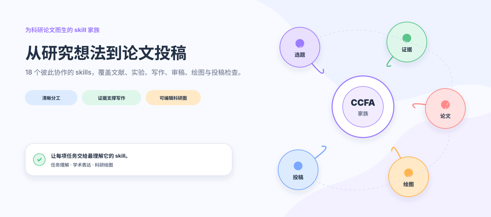
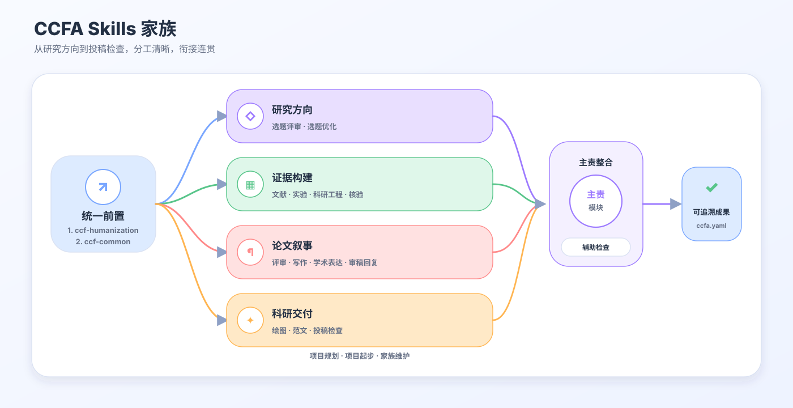
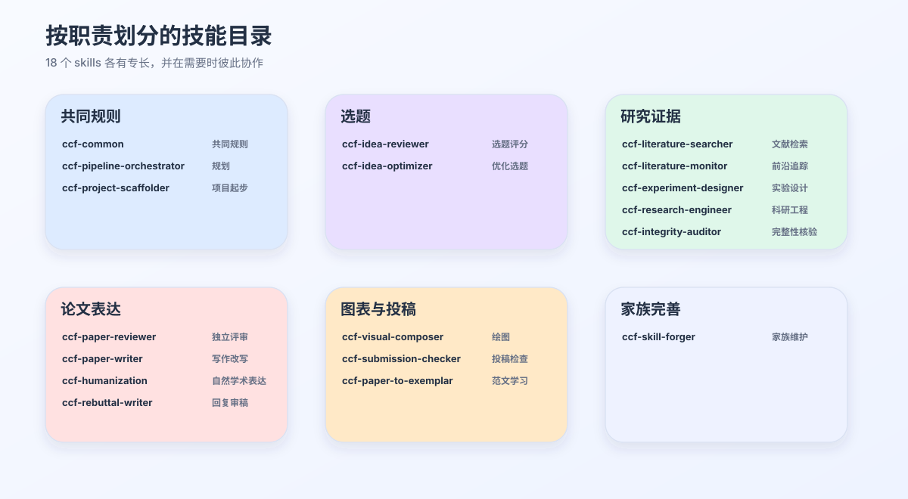
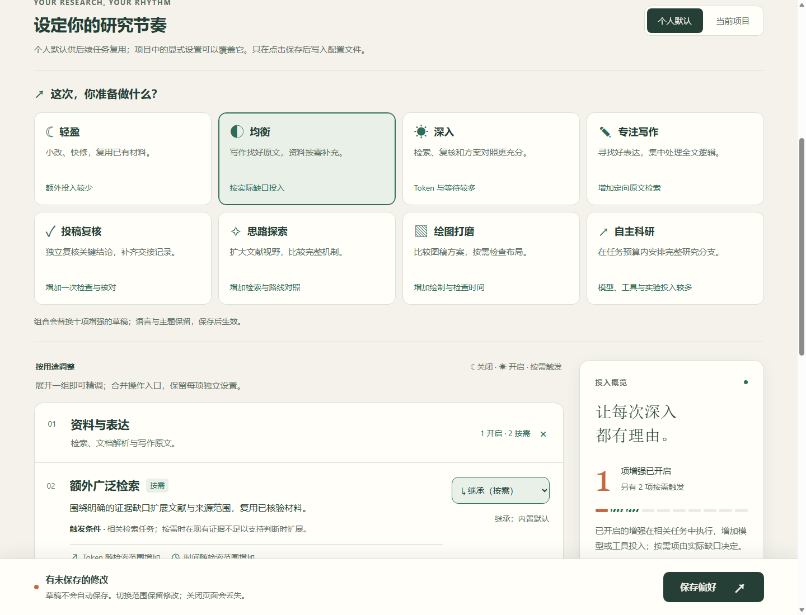
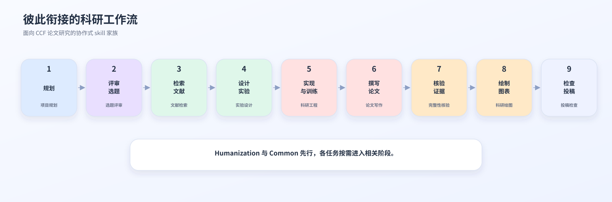
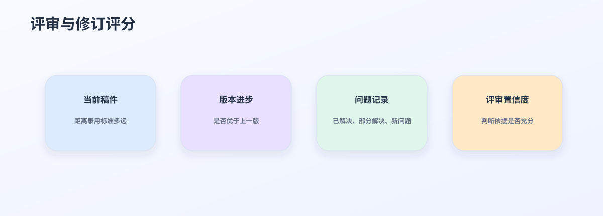
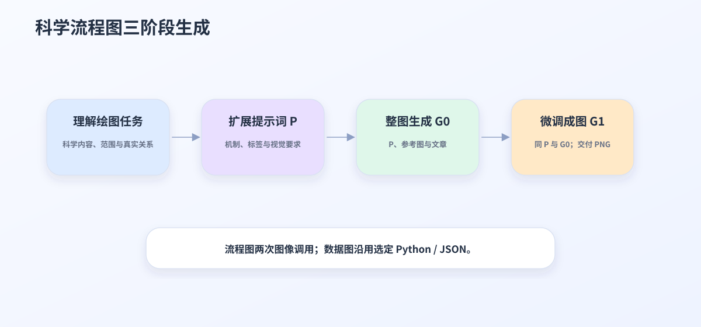
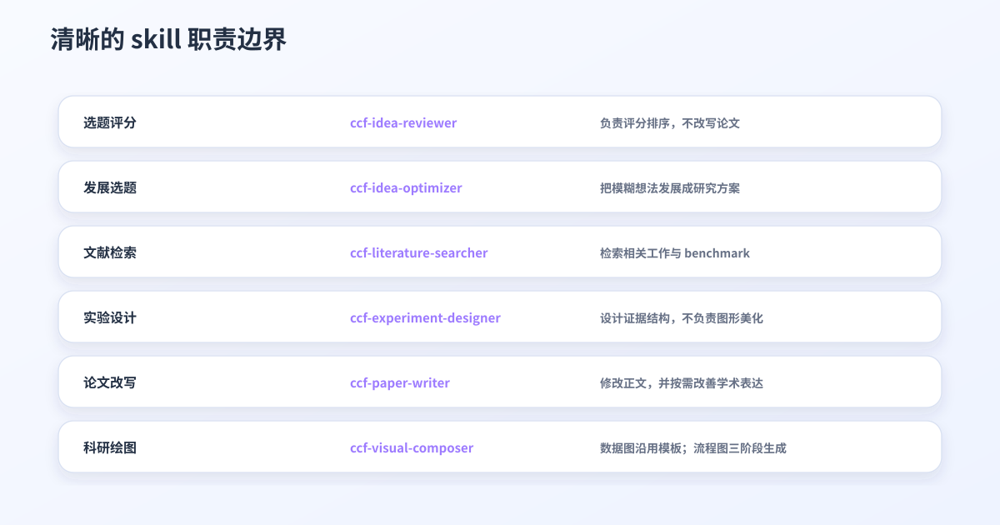
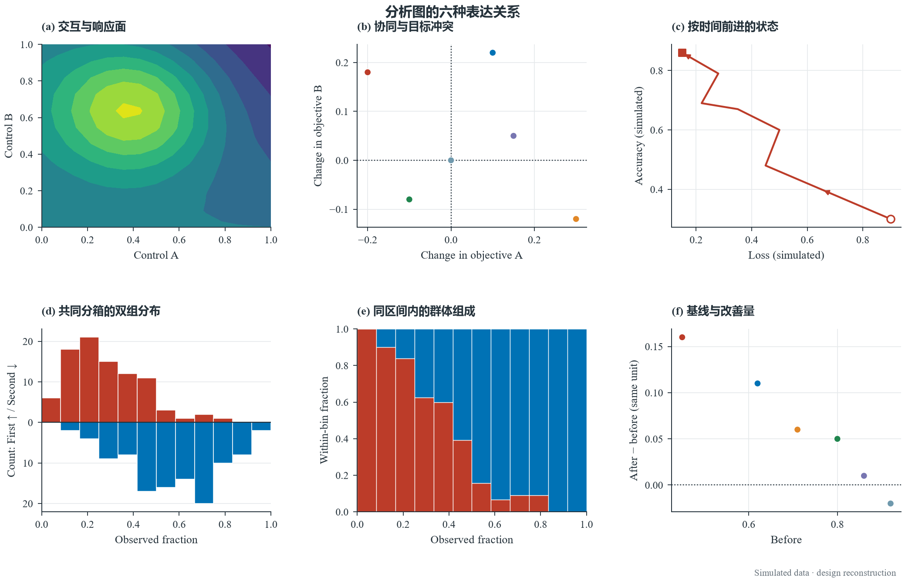
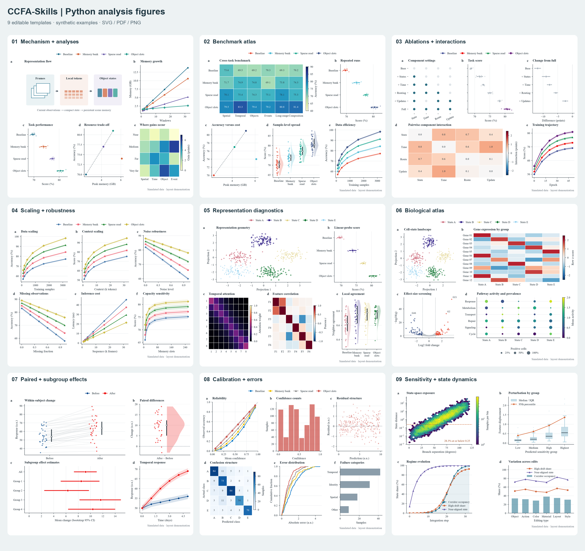

<p align="center">
  <a href="https://trendshift.io/repositories/151023?utm_source=trendshift-badge&amp;utm_medium=badge&amp;utm_campaign=badge-trendshift-151023" target="_blank" rel="noopener noreferrer"></a> <a href="https://trendshift.io/repositories/151023?utm_source=trendshift-badge&amp;utm_medium=badge&amp;utm_campaign=badge-trendshift-151023" target="_blank" rel="noopener noreferrer"></a>
</p>

<div align="center">

<h1>CCFA-Skills</h1>

**A skill family for shaping the research storyline of CCF-A papers.**

[简体中文](README.md) · [English](README.en.md) · [繁體中文](README.zh-TW.md)

**[最新更新 · v0.12.1](#latest-updates)**


---

*“The structure of the prose becomes the structure of the scientific argument.”*<br>
George D. Gopen and Judith A. Swan, [*The Science of Scientific Writing*](https://www.cs.tufts.edu/comp/150FP/archive/george-gopen/sci.html)

*“The very process of science is centered around communication.”*<br>
Yann LeCun and James M. Manyika, [*Learning Abstractions*](https://www.amacad.org/publication/daedalus/learning-abstractions-conversation-yann-lecun)

</div>

## 目录

- [快速开始](#快速开始)
- [为什么需要一个 skill 家族](#为什么需要一个-skill-家族)
- [家族架构与核心 skills](#家族架构)
- [日月配置台](#日月配置台)
- [从 idea 到投稿](#从-idea-到投稿)
- [绘图示例](#绘图示例)
- [写作如何保持自然](#写作如何保持自然)
- [让图既好看，也能继续修改](#让图既好看也能继续修改)
- [各司其职，彼此接力](#各司其职彼此接力)
- [安装、维护与验证](#仓库结构)
- [最新更新](#latest-updates)
- [Star 旅程](#star-旅程)

凌晨两点，实验终于结束，新的结果比预期更好。可是重新打开稿件时，真正棘手的问题才显现出来：最初那个清晰而有力的研究问题已经埋进冗长的 related work，方法描述与代码中的实际机制出现偏差；新补的实验回应了上一轮审稿意见，却让论证分成几条彼此疏离的线索。每个局部似乎都更完善了，整篇论文反而更难读懂。

许多有潜力的研究最终未能充分展现价值，并不是因为 idea 不够好，而是因为它在漫长的推进中逐渐失去了清晰的轮廓。文献越积越多，实验表格不断扩张，作者还要在研究、写作和审稿视角之间反复切换。一个无所不包的长 prompt 很难同时做好这些事情，因为检索需要忠于来源，实验需要遵循协议，写作需要围绕论证展开，审稿则必须保持独立判断。

我们因此设计了 CCFA-Skills。论文不是等待逐项填充的文档，而是一条需要在反复修改中保持连贯的研究故事线。18 个分工明确的 skills 从 idea、文献和实验出发，帮助论证逐渐成形，并贯穿写作、绘图、评审、rebuttal 与投稿。当任务从一个 skill 交给另一个 skill 时，研究问题、证据和结论之间的联系仍然会被保留下来。

<p align="center">
  
</p>

## 快速开始

选择你正在使用的 Agent：

[Codex 安装](docs/getting-started/CODEX.md) · [Claude Code 安装](docs/getting-started/CLAUDE_CODE.md) · [Cursor 安装](docs/getting-started/CURSOR.md) · [Gemini CLI 安装](docs/getting-started/GEMINI_CLI.md) · [其他 Agent](docs/getting-started/OTHER_AGENTS.md) · [自动更新](docs/getting-started/AUTO_UPDATE.md)

推荐从 [0.12.1 Release](https://github.com/mikubaka88/CCFA-Skills/releases/tag/v0.12.1) 下载轻量安装包并解压。它包含技能、原文文本、绘图库与相邻模板，完整论文 PDF 作为可选离线包单独提供。进入解压目录后，按[安装矩阵](docs/INSTALLATION_MATRIX.zh-CN.md)用本地安装器预览并安装；个人偏好保留，已有个人修改会先被识别；更新同时清理所选范围内未改动的受管退役文件。

也可以从完整 GitHub 仓库一行安装；这条路径仍会获取仓库中的完整论文资源：

```powershell
npx skills add mikubaka88/CCFA-Skills --global --agent codex --skill '*' --yes --copy
```

这条命令安装 18 个 skills。需要内置 LaTeX 模板或只安装部分技能时，请按[安装矩阵](docs/INSTALLATION_MATRIX.zh-CN.md)补齐相邻资源；使用 `--copy` 安装后，更新源码还需要重新复制，步骤见[更新指南](docs/getting-started/AUTO_UPDATE.md)。

安装后，直接说出你正在面对的研究问题：

```text
严格评审这三个选题并排序，指出各自最可能被拒的原因。
检索近三年与时序视觉推理相关的工作、benchmark 和公开 baseline。
根据这篇论文设计主实验、消融和鲁棒性证据，不要虚构结果。
把方法部分改写为 CVPR 风格，并保留公式、术语和引用。
根据论文和参考图绘制方法架构图：整理提示词、GPT Image整图生成、同提示词微调，交付PNG。
```

## 为什么需要一个 skill 家族

论文研究中的困难彼此相连，却不能由同一种思维方式解决。

| 研究者遇到的困境 | CCFA-Skills 如何回应 |
|---|---|
| 检索、实验、写作和审稿挤在同一次对话中，彼此干扰 | 由最适合当前任务的 skill 负责，其他能力按需协助 |
| 文献事实、实验数字和正文结论逐渐脱节 | 分别核对来源、实验设计与全文一致性，让每个 claim 都能找到证据 |
| 论文越改越像审稿回复，充满防御、解释和内部状态 | 写作负责形成正文，Humanization 让语言回到自然、直接的学术表达 |
| 新一轮评审不断更换关注点，难以判断修订是否真正进步 | 同时观察当前稿件的录用准备度与相对上一版的实际改进 |
| 方法图容易变成机械方框，数据图又偏离所选模板 | 流程图由GPT Image三阶段成图；数据图复用原JSON/Python与真实数据 |
| 加载的 skills 越多，结果反而越容易受到无关规则干扰 | 只加载与当前问题直接相关的能力，减少无关上下文 |

## 我们珍视什么

- **让研究问题先于工具。** 评价一个 idea 与发展一个 idea 是两种工作；设计实验与美化图表也需要不同的判断。CCFA-Skills 让每一步都回到它真正要回答的问题。
- **让证据始终有据可查。** 文献、实验协议、数值、结论、图表和引用不会被混成一团。缺失的事实保持缺失，直到它被可靠地找到或验证。
- **让论文听起来像学术，而不是辩护。** Humanization 删除防御性铺垫、机械枚举、过度破折号和内部工程措辞，同时保留真正影响结论的限制、证据与披露。
- **让评审保持独立。** Reviewer 负责判断，Writer 负责修改。先看问题，再决定如何改，避免一边审稿一边替自己解释。
- **让科研图表达清楚，也足够美观。** 数值图保持可复现；方法图先理解科学内容，再完成提示词、整图生成与微调。
- **让范文成为方向，而不是模板。** 用户提供目标论文后，系统学习它的叙事节奏、段落职责和证据组织，但不复制原句，也不把一种写法强加给所有研究。

## 家族架构



所有 CCFA 任务都先启用 `ccf-humanization`，再启用 `ccf-common`，然后进入具体技能；检索、评审、绘图、实验与维护也遵循这一顺序。前者统一自然、直接且保留真实证据的表达，后者落实协作、范围、证据和文件规则。同一任务交接时复用已生效规则，只刷新变化或丢失的部分；详细改写与实验检查按实际任务执行，不重复生成前置报告。各技能继续负责自己的产物并整合必要协作。

### 18 个核心 skills

| 研究阶段 | Skill | 它能带来什么 |
|---|---|---|
| 家族协调 | `ccf-common` | 理解请求，协调分工，统一证据与隐私规则 |
| 项目推进 | `ccf-pipeline-orchestrator` | 梳理目标、阶段、关键节点与下一步 |
| 项目起步 | `ccf-project-scaffolder` | 准备论文目录、模板与研究材料空间 |
| 选题判断 | `ccf-idea-reviewer` | 判断思路价值、创新与机制逻辑，默认不审核实验 |
| 选题发展 | `ccf-idea-optimizer` | 把模糊方向发展成问题、洞察、方法与证据路径 |
| 文献检索 | `ccf-literature-searcher` | 寻找相关工作、数据集、benchmark 与公开 baseline |
| 前沿追踪 | `ccf-literature-monitor` | 关注新论文、相近工作与研究方向的最新变化 |
| 实验设计 | `ccf-experiment-designer` | 设计主实验、消融、鲁棒性分析与结果表结构 |
| 科研工程 | `ccf-research-engineer` | 选择代码库、实现机制、复现结果并诊断训练 |
| 完整性核验 | `ccf-integrity-auditor` | 核对 claim、数值、术语、图表和引用 |
| 论文评审 | `ccf-paper-reviewer` | 给出独立科学评审、版本比较与录用准备度判断 |
| 论文写作 | `ccf-paper-writer` | 起草、改写、润色与压缩论文内容 |
| 学术表达 | `ccf-humanization` | 去除防御性和机械感，保留自然严谨的学术表达 |
| 审稿回复 | `ccf-rebuttal-writer` | 组织 rebuttal、response letter 与修订记录 |
| 科研绘图 | `ccf-visual-composer` | 复用数值图模板、三阶段生成方法图、修改已有图 |
| 投稿检查 | `ccf-submission-checker` | 检查模板、页数、匿名、PDF 与补充材料 |
| 范文学习 | `ccf-paper-to-exemplar` | 从用户提供的论文中提炼可复用的写作方法 |
| 家族维护 | `ccf-skill-forger` | 改进 skills，消除冲突，完成发布前检查 |

完整职责视图：



## 日月配置台

改一段摘要时，你可能希望快一点；距离投稿还有三天时，你愿意多花一些时间，让另一位助手再查一遍关键结论。日月配置台把这些选择留给你，也替你记住它们。



*图为 0.12.0 配置台界面；0.12.1 在资料与表达组新增红色成稿开关。调整选项后，点击“保存偏好”即可应用。*

现在可以直接按正在做的事选择八种模式。十一项设置整理在“资料与表达”“复核与交付”“探索与方案”“策略实验”四组里，需要时再展开。十项常规增强把开关、按需和恢复继承合成一个选择框：**继承 · ☾ 关闭 · ◐ 按需 · ☀ 开启**。每项仍能单独调整，并解释额外工作会花在哪里。页面继续支持简体中文、繁體中文、English，以及日光、夜航和跟随系统主题。

在仓库根目录运行（Python 3.10+，无需额外依赖）：

```bash
python ccf-common/scripts/preferences.py serve
```

浏览器会打开本地配置页。先选一个接近当前任务的模式，再按需要调整：

| 模式 | 适合什么时候用 | Token 与时间会怎样变化 |
|---|---|---|
| **轻盈** | 小改、局部修复，专注完成眼前任务 | 十项额外增强关闭，减少未要求的扩展工作 |
| **均衡** | 日常研究，希望需要时能查深一点 | 保留写作原文检索，扩展检索与复杂文档解析按需增加投入 |
| **深入** | 重要任务，希望多比较、多复核 | 增加独立复核、检索、图稿与报告，通常需要更多 token 和等待 |
| **专注写作** | 起草正文、重写段落、打磨论文逻辑 | 主要投入在好原文的查找和阅读，复杂页面按需解析 |
| **投稿复核** | 投稿前检查关键判断和遗漏 | 独立第二轮复核增加阅读与判断，必要时补充交接记录 |
| **思路探索** | 比较机制、寻找更有价值的问题 | 扩展检索和路线对照增加推理，完整研究分支按需并行 |
| **绘图打磨** | 对比布局、挑选更清楚的表达 | 增加图稿候选；Python 图主要多一次排版和渲染，图像生成另有等待 |
| **自主科研** | 已有明确任务和预算，准备推进研究迭代 | 偏好完整研究分支与扩展检索，可能缩短等待，但总计算投入增加 |

选择模式会替换十一项设置的草稿，保留语言与主题；点击**保存偏好**后才生效。选择“继承”会移除这一项的覆盖：项目设置跟随个人偏好，个人设置跟随内置默认值。“深入”保留原有的维护规则按需迭代；八种模式都将科研策略迭代保持关闭，需要时再单独开启。模式不替你授权训练、预算或材料上传，实际投入取决于任务、材料和工具。

新增的三项让投入更有针对性：**优质写作原文检索**默认开启，实质起草或表达重写时复用匹配原文，同时寻找其他写得好的文章。按实际段落质量选用，不为多篇而凑数；同一写作问题已有适用的检索结果就复用，小改不重搜。也可切到“按需”，只在范例不足时搜索；**完整研究分支协作**默认关闭，适合比较不同机制；**科研策略迭代**默认关闭，比较搜索和上下文策略时再单独开启并安排预算。旧配置无需重建，未设置的新项自动继承默认值。

**谨慎开启：结果待填成稿。** 红色选项只提供「继承／关闭／开启」，没有按需模式；八种预设均关闭它。开启后允许标记清楚的条件式分析和待填结果，可能出现些许幻觉。成稿后自动做一轮全文一致性检查，会增加阅读和修订的 token 与时间，不会启动实验。你明确要求实验留空时，仍按留空处理。

希望某篇论文有自己的配置，可以这样启动，把路径换成你的论文目录：

```bash
python ccf-common/scripts/preferences.py serve --project "path/to/paper"
```

在页面中选择“个人默认”或“当前项目”后保存。个人默认可用于后续任务，项目里明确设置的选项优先；没有调整的选项继续继承。比如，日常保持轻盈，只给准备投稿的论文开启独立复核。你的偏好保存在 skills 安装目录之外，更新 skills 后仍然保留。

**常规增强决定额外投入，红色开关单独决定结果待填起草方式。** 即使选择“轻盈”，你明确要求的完整评审、多个研究方向，以及必要的核验仍会完成。Humanization → Common 的前置步骤始终生效。打开配置页本身不会调用模型，也不会启动研究任务。

<details>
<summary>查看配置文件位置与离线用法</summary>

个人偏好保存在 `$CODEX_HOME/ccfa/preferences.json`（未设置时为 `~/.codex/ccfa/preferences.json`），项目设置保存在论文目录的 `.ccfa/preferences.json`。已安装副本也可以运行其中的 `ccf-common/scripts/preferences.py`；添加 `--no-browser` 可只打印本地访问地址。

下载仓库后，也可以打开 [静态配置页](ccf-common/assets/configurator/index.html)，导入、编辑并导出 JSON。静态页面只导出文件：请将导出的文件重命名为 `preferences.json`，放到上面对应的配置目录后生效。完整规则见 [偏好契约](ccf-common/references/preferences.md)。

</details>

## 从 idea 到投稿



这不是一条必须从头走到尾的流水线。你可以带着一个尚未成形的想法而来，也可以只带来一张难以解释的结果表、一段总被审稿人误解的方法，或一份即将提交的 PDF。CCFA-Skills 会从你所在的位置开始，只调用真正有帮助的部分。

## 绘图示例

这里展示的是实际科研成图，而不是功能宣传图。不同图面向不同阅读场景，因此使用不同的构图语言。

### 论文方法架构图

下图从 `output/DynTrace.pdf` 中提取计算关系，以分层布局呈现方法机制与信息流。输入与视觉处理位于底部，几何证据和 DTV/DTG 分支构成中层，token 融合、MLLM 与答案位于顶部。各层按计算依赖连接，便于沿信息流阅读完整方法。


**成图方式：** 保留的 DynTrace 示例由论文机制关系和表示—操作对应生成。当前流程图的新绘／重绘统一为提示词整理、GPT Image整图生成、同提示词微调三阶段，交付PNG；不做矢量或原生形状重建。

<details>
<summary>查看参考图、出处与构图原则</summary>


参考出处：Hanyu Zhou and Gim Hee Lee, [*LLaVA-4D: Embedding SpatioTemporal Prompt into LMMs for 4D Scene Understanding*](https://arxiv.org/abs/2505.12253), Figure 2；亦见 [OpenReview 页面](https://openreview.net/forum?id=URpbmVEsqB)。截图仅用于非商业的学术构图研究与风格说明，版权归原作者所有。如涉及侵权，请联系项目维护者删除。

- 论文图应当让输入、表示、操作、分支、融合与输出一目了然。
- 视频帧、光流、掩码、3D 轨迹、DT-Tokens 与 temporal graph 都承担方法含义，而不是装饰。
- 普通英语使用自然大小写；Qwen3-VL、WAFT、SAM3、DTV、DTG、MLLM、3D 与 4D 保持规范缩写。

</details>

### PPT/Poster

下面保留两张早期视觉探索。它们更适合演示文稿、项目海报或 README 概览，因此不作为顶会论文方法图示例。

#### GPT Image 2 概念稿


**成图方式：** 保留的 DynTrace 示例由论文机制关系和表示—操作对应生成。当前流程图的新绘／重绘统一为提示词整理、GPT Image整图生成、同提示词微调三阶段，交付PNG；不做矢量或原生形状重建。

#### 参考驱动的 PPT/Poster


**成图方式：** 在三阶段内容之上加入参考构图原则，让标题、色块和视觉锚点更适合演示与海报阅读。

### 数据分析图

以下图形由 `ccf-visual-composer` 的可复现绘图方案生成。图中数值仅用于展示图形语言，不代表论文实验结论。

| 组合图 | 热图 |
|---|---|
|  |  |
| **火山图** | **柱状图** |
|  |  |
| **坡度图** | **径向图** |
|  |  |

更多示例位于 [`assets/visual-showcase/`](assets/visual-showcase/)。

## 写作如何保持自然

`ccf-paper-writer` 可以学习用户指定的范文。它关注优秀论文如何提出问题、展开方法、安排证据和控制节奏，但不会复制原句，也不会把某一篇论文变成所有研究的固定模板。

`ccf-humanization` 逐句判断表达承载了什么科学信息：有事实就直接陈述，有真实不确定性就准确限定，没有信息的自辩直接删除。它清理审稿人预判、贡献自我降格、重复 caveat、机械结尾和内部版本旁白，不再要求每段补局限性或未来工作。实际失败、适用条件、复现信息与必要披露仍保留；仅对证据无法解决的具体科研决策单独提醒。

思路审核与文章审核按判断对象区分：“这个方向值得做吗”由 `ccf-idea-reviewer` 处理，无需指定评分；“稿件结论是否站得住”由 `ccf-paper-reviewer` 处理。即使输入完整 PDF，只看核心思路的请求也保持概念审核。思路评分聚焦问题、创新、洞察、机制、简洁性与受众价值，实验仅在明确要求时单独评估。

结构化审核报告默认输出详细版，明确要求简要时使用简要版。文章审核展开贡献、优缺点、相关工作、方法与证据、多视角意见、评分及修改优先级；思路审核展开问题价值、创新差异、机制逻辑与发展建议，默认不评实验。意见绑定具体位置、依据与稳定编号，复审追踪问题是否解决；不会生成缺乏真实参照集的百分位排名。详见[文章报告模板](ccf-paper-reviewer/references/fixed-output-format.md)与[思路审核协议](ccf-idea-reviewer/references/strict-idea-review.md)。

完整文章评审固定 14 节，写作专项固定 9 节，明确要求简版时使用 5 块。通用科学评分统一为新颖性、正确性、证据、意义、清晰度、可复核性、伦理与局限七维；证据要求按贡献类型解释，置信度与材料覆盖范围分开。生成报告可直接检查 Markdown 的标题顺序、评分字段和问题编号引用；会议或用户明确指定的格式继续优先。

文章复审同时回答两个不同的问题：



- **当前稿件是否足以投稿。** 它衡量论文距离目标 venue 的录用标准还有多远。
- **这次修订是否真正进步。** 它比较新旧版本解决了什么，又是否引入了新的问题。

## 让图既好看，也能继续修改

数据图选中了哪个模板，就沿用它的 JSON 和 Python 绘制代码。换真实数据时保留原来的布局、字号、配色、图层和统计定义；不再重新跑 demo、重选一个相似基础图来代替。新设计才按输入数据类型、图类型和文章要说明的关系选择组合。

论文流程图、方法图和架构图的新绘／重绘采用固定的三阶段：先用用户提示词、参考图和文章整理 P；再带着 P、参考图和文章让 GPT Image 生成整图 G0；最后用同一个 P 和 G0 做微调，交付 G1。微调属于同一候选的必需阶段，关闭额外图稿候选也会执行。整体构图交给图像模型，保留紧凑、对齐、清楚连线与高信息量，不先搭矢量骨架，也不把成图重建为 SVG 或 PPT 形状。



已有图的局部修改和调优沿用当前图像或原始源文件，无须重跑全部三阶段。流程图默认交付 PNG；放进 PPTX／PDF 时仍是原图，准确说明其实际可编辑程度。数值图的显式格式导出继续支持。Times New Roman 或选定的 Comic Sans MS、加粗的标题／图例／坐标文字、同色系深色柱箱边沿和紧凑版面都保留；配色与参考预设按内容选择。

## 各司其职，彼此接力



每个产物有一位负责整合与交付的主责技能，其他技能按前置依赖和质量需要参与。分工不限制必要协作：

| 你的请求 | 负责的 Skill | 明确不负责 |
|---|---|---|
| 思路靠谱吗、值得做吗、创新够不够、评分排序 | `ccf-idea-reviewer` | 默认只审概念，不因缺少实验扣分 |
| 发展一个模糊 idea | `ccf-idea-optimizer` | 不把排名当成主要目标 |
| 搜 benchmark 与公开结果 | `ccf-literature-searcher` | 不替实验结果作结论 |
| 设计 baseline、指标与消融 | `ccf-experiment-designer` | 不改动或虚构结果 |
| 评审、评分与诊断 | `ccf-paper-reviewer` | 不在评审过程中改写正文 |
| 改写、润色与压缩 | `ccf-paper-writer` | 不擅自改变研究问题、方法和结论 |
| 绘制图表与放入文档 | `ccf-visual-composer` | 不选择数据集、指标或数字 |

## 仓库结构

```text
CCFA-Skills/
├── ccf-common/                 # 家族共享规则
├── ccf-*/SKILL.md              # 18 个 skill 入口
├── ccf-*/references/           # 按需阅读的参考资料
├── ccf-*/scripts/              # 可复现操作
├── assets/                     # README 图片与绘图示例
├── evaluation/                 # 回归与消融结果
├── tools/build_ccfa_diagrams.py
└── 实验结果.md
```

较长的规则放在 `references/`，可重复执行的操作放在 `scripts/`。迭代过程中沿用固定文件名，由新版本覆盖旧版本，避免堆积难以辨认的过程文件。

协作从最终结果倒推前置条件：判断创新性前核对近邻工作，实质性写作前厘清主张、证据和引用，科学绘图前确认数据含义与方法结构。缺失、冲突或过期的依据交给相应技能补齐；已有且仍适用的证据直接复用。实质性改写后检查受影响的论证，解决问题后再交付；思路审核仍不要求实验完成。内部协作返回相关发现，正式审稿保留固定模板和必要的全文覆盖。节省 token 的重点是重复检索、重复报告、无关参考和重复询问，不是省略前置工作。详见[协作路由](ccf-common/references/routing.md)与[交接规则](ccf-common/references/handoff-modes.md)。

文件约束已前置到全部 18 个 skill 入口。中间文件优先沿用用户指定路径、该产物的 `ccfa.yaml` 映射和已有任务目录；新任务使用项目根目录下独立的 `ccfa-workfiles/<任务用途>/<具体产物>/`，不嵌套在通用 `output/` 中。例如 `figures/method-overview/`、`reviews/paper-short-title/`、`literature/retrieval-memory/` 分别存放方法图、论文评审和主题检索的工作文件。若同名目录已被其他用途占用，采用稳定的 `ccfa-workfiles-<项目名>/`，不混用或覆盖。

需要时才创建 `source/`（可复用源文件）、`assets/`（参考与图标）、`cache/`（下载与提取缓存）、`build/`（当前预览与构建日志）。同一产物跨 skill 共用目录，普通迭代更新原文件，不使用含义不明的 `temp`、`misc` 或 `final-final`。完成后清理本任务产生且已确认可丢弃的过程文件，保留原始数据、可编辑源文件、最终产物及必要对比证据；失败生成不覆盖可用结果。已有目录不因新命名规则被搬迁，完整规则见[产物合约](ccf-common/references/artifact-contracts.md)。

中文输出采用显式 UTF-8 读写，兼容带 BOM 的输入；终端管道、中文文件名和图形字体分别检查。家族校验已加入中文与生僻字回归，解码错误会明确报出，避免用替换字符掩盖问题。图中的中文使用可用的 CJK 后备字体，保留原定的西文字体。

<a id="latest-updates"></a>

## 最新更新：让改过的每一段，仍然属于同一篇论文

### 绘图链路修复 · 2026-11-14

选好了模板，交付图却变了样，问题可能出在调用链：重新demo会换数据，尺寸参数被忽略或二次缩放，展示参数和图层也可能丢失。现在直接复用选中的JSON/Python，完整替换科学数据；命名模板锁定，显式宽高生效，色形按对象身份保持。一个同输入的132×84 mm对照中，修复后的调用输出与直接模板渲染逐像素一致。

绘图先明确读者要理解什么、必要对象和真实关系，再扩展提示词。流程图的新绘／重绘固定为三阶段：提示词、参考图与文章整理P → GPT Image生成G0 → 同P与G0微调G1。第三阶段不受额外候选开关控制；主动矢量骨架与SVG/PPT形状重构已退出该路线。已有图的局部修改沿用当前图像／源文件。字体、加粗、配色、紧凑对齐与科学内容检查继续保留。

### CVPR 2027 与本轮修复 · 2026-11-12

准备投稿时，模板、正文和检查清单应该说同一套规则。这轮接入了 [CVPR 2027 官方模板](ccf-latex-templates/CVPR/2027/main.tex)和[对应指南](ccf-paper-writer/references/venue-guides/cvpr.md)：按年份保留完整依赖，检查模式、纸张尺寸、匿名信息、正文页数及必需的 LLM Usage Statement。注册、作者资格等事项会单独列出，方便作者最后核对。

写作也从入口处修正：实质起草和表达修复默认参考匹配的真实论文，先把观点与句间关系写顺，再处理空泛标签和无必要的限定。句尾的总结与意义仍然保留。想思路时，先问缺失的是信息、表征、目标还是计算能力，再选择机制；实验围绕能区分解释的比较设计，允许有明确含义的因素组合与交互消融。

这一轮还统一了数值绘图默认 PNG、按需数值格式导出的约定，并补齐复制安装时的图例资源。Humanization 与 Common 仍先启动，详细规则按需读取。

**v0.12.1 · 更新于 2026-10-31**

论文还没跑完，思路却已经清楚了。现在你可以在配置台单独开启红色的「结果待填成稿」：先把问题、机制、论证和条件式分析写成一篇连贯初稿，数值随后补齐。这个模式可能出现些许幻觉，因此默认关闭，所有预设也保持关闭。已有的正结果、负结果都要保留；写完自动对照摘要、正文、表格、图注和结论，把预期与实测分清，再检查冲突。

这次也修复了图层类别错位和跨图变色，补齐单技能安装依赖，让中断的更新可以接着完成。科研最终评测会记住整个任务的使用情况，局部审查会复用仍然有效的来源。写作上下文的材料选择与裁剪规则保持不变。

一篇论文改到第五轮，结果换了，方法补了，开头却还在回答旧问题。单看每一段都说得通，连起来又像几篇论文。再请助手润色，它可能把句子修得更正式，却没有找回最初的那条线。

0.12.0 把写作前的准备和修改后的衔接连在了一起：先找回全文要说什么，再带着当前章节、必要邻段和合适的原文动笔；改完之后，沿着受影响的论点继续检查。我们希望作者花在措辞上的每一分功夫，最后都能让同一个研究问题更清楚。

这轮继续把细节接到实际操作上：配对分析按样本身份对齐，组合图先检查数据是否齐全，字号贯通模板与联动布局。科研任务可以明确复测已有候选，多条分支共享预算，最终确认结果单独记录。入口也变轻了：Humanization 与 Common 继续先启动，详细规则在当前任务需要时再读。真实内容小样与执行回归一起验收，避免一句“检查通过”代替整条使用流程。

四类内容任务分别交给公开版、精简前版本和本次候选执行，再匿名比较。12 份回答都保留指定事实，评分没有拉开差距；本轮测得的是两项前置入口文字减少约 47%，没有据此宣称模型 token 节省或写作质量普遍提高。[小样题目、输出与结果](evaluation/behavioral/results/0.12.0-smoke.md)可直接查看。

### 反降智：对话再长，也要记得为什么出发

假设你最初的要求是“在现有算力下，找到一个值得做的新方向”。几轮讨论后，助手却开始堆模块、加实验，最后给出一个超出预算的计划。每一步都有解释，合起来已经偏离了你的目标。

现在，长任务会按需要保留一份简短记录，把你的目标、重要限制、当前路线和下一步放在一起。在换路线、接收其他助手的结果或恢复上下文时，先对照这些约定。发现回答错位，就回到真实文件和证据，保住已经做对的部分，从一个能检查的小步骤继续。新证据说明原路线走不通时，仍然可以改路，并交代清楚原因。

这就是我们对“反降智”的实际处理：让目标更难丢失，让一次错误更难污染后续工作。[连续性规则](ccf-common/references/continuity.md)记录了具体做法。

### 多智能体：一起工作，也要各自带回有用的东西

审视一个新方向时，可以让不同助手先独立思考机制，再交换相关证据。核对论文时，一个负责引用，一个负责数值与结论，最后由同一位负责人把发现接回稿件。这样，每个助手都有一个具体问题要回答，交回来的结果也有可以核对的出处。

分工围绕完整的问题展开。一条论证里的问题、洞察和方法由同一位作者贯穿；其他助手接手能独立完成的查证、机制比较或实现，交回的结果有明确用途。局部缺口交回原助手补齐，已经拆散的工作重新归拢。共享文件有明确负责人，旧版本上的结论先核对再采用。支持多智能体的宿主据此安排协作，推理档位高也不需要把任务拆得更碎。详见[任务模式](ccf-common/references/task-modes.md)与[交接规则](ccf-common/references/handoff-modes.md)。

### 自主科研：让下一轮实验真正接住上一轮的发现

凌晨的一次实验失败了。它可能是代码出了错，也可能是实验没能区分两个解释，或者结果确实否定了假设。下一步应该回到哪里，决定了我们是在推进研究，还是继续花时间打转。

这次把科研循环接到了实际执行：先跑基线，围绕一个具体假设修改研究代码，再读取真实结果，决定保留、放弃、修复或探索另一种机制。研究目标和比较条件保持清楚，路线可以随证据改变。一次指标提升还要回到原问题判断价值，运行失败也不会被写成科学结论。需要的专业能力继续由现有 skills 协作完成，不要求每轮再开一组评审。

有些实验没有刷新分数，却排除了一个错误解释，这样的发现也值得留下。当前最佳方案与值得继续探索的方向分别记录，让下一步有依据。一次任务里学到的经验，经过其他任务检验后，才适合写成通用规则。

新增的轻量执行脚本负责顺序实验、次数与执行时长预算、受保护文件变化检查、原始日志和受控回退。宿主 agent 负责提出假设、修改候选和继续研究；脚本不会自行调用模型服务或创建后台科研任务，训练等实际工作由指定命令执行。恢复时先看已有运行记录，同一实验 ID 不会被悄悄重跑。当前目标、最佳候选和关键失败条件留在紧凑上下文里，需要时再回读证据。

> 请围绕检索停止条件自主迭代。沿用项目的评价脚本和数据划分，最多运行 6 次（含基线与失败），每次不超过 60 秒，累计实验执行不超过 240 秒。不使用付费服务。先检查已有结果，再选择能区分机制的实验；保留原始记录，最后交付最佳候选和仍未解决的问题。

[自主科研使用说明与命令](ccf-pipeline-orchestrator/references/autonomous-research.md)给出了完整入口。这项能力由明确的科研任务和该任务的预算启动，可通过十项个性化设置选择额外投入；“维护期规则迭代”仍只负责维护。普通改稿、思路审核和只要方案的请求保持原来的使用方式。脚本测试验证执行与恢复规则，开放式科研质量和总 token 收益还需要真实项目比较。

### 个性化：把时间花在你此刻最在意的地方

同一个研究者，在不同阶段也会需要不同的帮助。改一句话时，希望干净利落；关键结果迟迟解释不清时，愿意再查几篇论文；投稿前，希望有人独立看一遍最重要的结论。

[日月配置台](#日月配置台)让这些偏好可以被看见、调整和记住。十一项设置收进四个用途分组，每项只需一个四态选择框；八种模式覆盖日常工作、写作、投稿、思路探索、绘图和自主科研。先挑接近当前任务的组合，再微调并保存，页面会说明额外时间与 token 花在哪里。三语、日夜主题和原有设置的继承方式都保留。

### 创新与写作：让每一次修改都有内容上的进展

一个新模块应该解释它改变了什么，删掉它又会失去什么。已经证实走不通的想法可以及时放下，值得探索的假设也可以先用理论、反例或观察来区分。我们清理了强制“再救一次”和重复打分的冲突，让探索有机会跨出小修小补，也让选定的方向能够稳定推进。

写作则从段落想表达什么开始，检查句与句之间是原因、证据还是推论，再调整顺序和措辞。本版补上了中英文分号与密集 `rather than` 的诊断，但真正要修复的是读者跟不上的论证。科学上必要的对比和限制继续保留。详见[思路优化](ccf-idea-optimizer/SKILL.md)、[写作约束](ccf-paper-writer/references/prose-quality-guardrails.md)与 [Humanization](ccf-humanization/SKILL.md)。

这次继续往下查，我们发现，有些“AI 味”来自技能之间的要求打架：写作刚删去一句自我辩护，评审模板又让它在结尾补上局限；一个方向已经被文献覆盖，检索仍要求再找一条挽救路线。我们清理了这些冲突，让写作、思路和实验共同遵循一个原则：把正在研究的对象、方法和关系说清楚。实验计划回答当前问题，评审意见指出具体缺口，修复完成就结束这一轮。

比如“为了严谨起见，我们提出一个可验证、可实现的方案”，如果没有说明方案做了什么，就应该继续写出实质内容。反过来，“索引可实现离线增量更新”表达了技术能力，应当保留。新增诊断会提示密集的抽象标签、反复比较和表格中的防御性措辞，最终仍要结合上下文判断。你明确选用的个人标点和节奏习惯，也会优先于通用的表面偏好。你可以直接说：

> 请润色这一段，先理清句子之间的原因和证据，再调整措辞。保留数字、实验条件和真正影响结论的限制。

### 从源头修正写作，让段落接回全文

我们重新读了一遍模型写作前会看的材料。问题不只是几个词：有些指南要求所有论文套同一种故事，有些把正常学术搭配也挡在“禁止复用措辞”之外，还有一些把维护者的建议写成了原论文的做法。现在，写作会先复用匹配的真实原文，再按需要寻找其他表达好的论文。一篇可以帮助组织动机，另一篇可以帮助解释方法；选择依据是实际段落质量。保留你的研究内容和合理长句，学习通用搭配与论证组织，不拼贴别人的句子。破折号仍然少用，但不再设置全文数量上限。

这次还把“怎么写”接到了“写前能看到什么”上。修改长稿时，作者会带着全文主线、当前章节、必要邻段和有位置的原文材料一起写；相关工作按问题和机制展开，结果段落解释观察之间的关系。每次只加载当前需要的一组写作提示，正文继续围绕研究内容展开，保留有力量的收束与句尾拔高。

几个人一起改稿时，最怕一个旧版本覆盖大家的新工作。新增的[写作执行入口](ccf-paper-writer/references/writing-execution.md)会检查稿件版本和修改范围；结果文件变了，也能按已登记的关系找到要重看的段落与图表。可选的昂贵复查只复用输入、提示、模型参数和实际检查范围都匹配的完成结果，中断的调用先处理清楚再继续。普通改一句话仍然直接改，不增加配置项或模型调用。

> 修改这篇论文的结果与讨论部分。保留全文主线和必要邻段，用真实结果解释差异；先准备当前材料，再局部修改，最后只复查受影响的论点和图表。

### 独立审读：让另一个领域视角先看论文

投稿前，我们常想再找一位没看过旧评语的人，从头读一遍稿件。这次把这件事接到了现有的“独立复核”：一段朴素提示，请独立的领域评审先读论文，判断贡献与论证，再由主审核对发现、合并重复问题，收束成原有的一份报告。第一遍不带主审分数、先前结论或写作历史，也不要求每个问题都补一个实验。

“关闭”不擅自增加调用；“开启”可为实质科学评审或全文评审安排一次独立阅读；“按需”用于会影响结论的重大争议或投稿前检查。你的明确请求优先。它沿用原有开关，完成这次阅读后不再叠加一轮同用途的复核，会增加一次阅读的等待与输入、输出 token。[准备入口与用法](ccf-paper-reviewer/references/plain-expert-review.md)负责整理材料，实际调用由宿主执行，并确认选用了可用的 GPT-6 与全新上下文；不具备这些能力时继续完成主审，不把准备好的请求当成已完成的评审。

> 请让一位独立的领域评审审读这篇论文，先看稿件，再看已有评语。指出真正影响判断的问题，由主审合并成一份报告；宿主支持时实际选用 GPT-6。

### 从值得问的问题，走到可运行的方法

探索从真实困难，也从尚未解释的现象开始：是信息不足、表示丢掉了区别，还是目标和学习过程出了问题？启发可以来自技术报告、会议、期刊、arXiv，也可以来自较早的基础结果。按机制寻找远近联系，在合适材料中抽样拓展视角，再用不同的解释、操作和预测区分候选。保留已有好路线；基础问题也不必为了过关而编造即时应用。

新增的 [ccf-research-engineer](ccf-research-engineer/SKILL.md) 接住从机制到代码的工作。它先看现有项目，按需选择代码库、复用基线、检查模型与梯度路径，再依据实际测量处理训练故障和性能问题。小规模运行用于回答具体诊断问题，完整方法的结果仍由完整条件下的运行说明。

> 在现有项目中实现这个机制，保留训练与评估接口。先检查可复用代码和基线，再定位需要修改的模块；不要用简化模型代替目标方法。训练慢时先测瓶颈。

外部 skills 可以提供工具和专业知识，工作仍沿用同一个目标、文件位置和负责人。反复构图或转换文件时，可使用[临时产物追踪](ccf-common/references/artifact-contracts.md#optional-tracking-for-repeated-builds)：记录本任务产生的临时文件，检查完成后只清理已经释放、没有被改动的文件。普通改稿无需启动它。

这轮又沿着入口、参考文件、评审规则和运行脚本往下检查。Rebuttal 现在直接回答问题，只有确有理由时才致谢、让步或承诺修改。理论思路和实验待补的初稿按当前阶段检查，检索索引不再代替原文，评审也不会仅凭某个句式自动扣分。

研究运行器会核对保留的基线原始结果；停止实验未得到确认时，保留现场，避免后台进程继续写入时回滚文件。相同候选的必要复测仍可进行，过去的失败和有效负结果会留下记录，帮助下一轮判断该修实现还是改假说。

科研记录也开始服务下一步判断：按机制找回旧实验，区分实现故障与有效负结果，在比较前约定质量下限，并在质量相当时选择成本更低的方案。启用策略迭代后，宿主会在任务目录中比较搜索、上下文或工具调度策略，用开发、选择和保留测试分别检查，继续使用表现更好的版本。

### 绘图：放进论文后，读者仍然看得明白

一张复杂分析图，应该让读者顺着面板看懂一个问题。方法解决了什么，收益出现在哪里，哪些条件下会失效，这些关系需要放在同一张图里讲清楚。我们为此补上了 9 套可运行的 Python 多面板模板：先把数据和版面画稳，再按需要调整细节；主图中的分析、定量结果、消融和生信数据都能使用。



现在选图会先问：这张图想让读者看懂什么？**43 种图形语法、16 类表达目的、16 套组合方案**把分布与长尾、配对收益、误差来源、排名变化、资源取舍等问题分开处理。每种图都写明为什么这样设计、需要哪些数据、容易读错什么，以及还能和哪种图搭配。你可以沿着这些理由继续改版面、换组合，形成适合自己研究的新图。

素材库的两层记录也分清了：**54,890 条论文元数据**用于查找近两年论文；**43 篇论文中的 78 张设计卡**记录实际看过的图，其中 累计 75 张有直接视觉检查记录，3 张沿用早期记录；本轮新增 25 张。会议届次、文章范围与未覆盖部分写在覆盖表里。示例复现的是分析关系和布局，数值明确标为模拟数据；真实任务接入自己的结果。

选图先看这篇文章要讲什么：当前论点、段落用途、观察单位、样本是否配对，以及图放进论文后的尺寸。合适的方案之间自然随机，不需要设置随机数，也不为凑使用次数而选错图。选定后保留实际数据和布局，后续修改沿着这张图继续做。复杂组合共用对象颜色、对齐相关坐标，分箱图保留相同区间和实际分母。

```bash
python ccf-visual-composer/resources/python/ccfa_figure_library.py route "分布与长尾"
python ccf-visual-composer/resources/python/ccfa_figure_library.py explain ecdf
python ccf-visual-composer/resources/python/ccfa_figure_library.py demo --fusion paired_benefit --out ccfa-workfiles/figures/paired-effect/build/figure
```

真实数据可以直接从 CSV、TSV 或 JSON 表接入，筛选和排序后仍保留同一行里的配对关系。新增三种真正联动的布局：联合分布与边缘、共同位置多轨道、热图与行列切片。它们共享同一批观测或网格，各轨道保留自己的单位，不把独立生成的图拼成“相互解释”的结果。

此前的九套模板和你要求的参考图都保留在[完整示例表](ccf-visual-composer/references/figure-examples.md)，包括密度与扰动、状态演化与类别占比两组双面板。可以按示例 ID 直接调用，再用当前文章的数据和消息继续改。

[图形设计与融合指南](ccf-visual-composer/references/figure-design-library.md)提供完整分类、真实数据接入、论文图例与本地论文搜索命令。原有九套整图模板也继续作为完整布局的起点：



| 模板 | 帮读者看清什么 |
| --- | --- |
| `mechanism_overview` | 方法流程、任务表现与资源收益如何对应 |
| `benchmark_atlas` | 跨任务结果、重复运行分布与成本取舍 |
| `ablation_interactions` | 各组件的贡献，以及它们之间的相互作用 |
| `scaling_robustness` | 规模、训练预算与扰动变化后的表现 |
| `representation_diagnostics` | 表示空间、注意力与特征关系 |
| `biological_atlas` | 细胞分组、表达分布与差异筛选 |
| `paired_effects` | 同一样本前后变化与不同亚组的效应 |
| `calibration_errors` | 置信度校准、混淆矩阵与错误结构 |
| `sensitivity_dynamics` | 密度与阈值占比、箱线与 P95、状态演化，以及同轴分类柱线对照；也可拆成两张横向双面板图 |

这九套模板由区间比较、趋势带、热图、点阵、分布、嵌入散点、密度图、分箱汇总和分类对照等原有 13 类基础组件组成；本轮新增 30 类组件，与它们共同接入 43 种图法的路由。需要新组合时可以换面板，无需整张图重写。图形按最终纸面宽度设置字号和线宽，统一图例、对齐相关面板，同一对象始终沿用同一颜色；可比较的数据共用坐标或色阶，不同单位保留独立标注。默认使用 Times New Roman，支持中文字体回退与显式字体选择，投稿时以目标期刊的要求为准。

配色保留原有 14 套，新增 AAAS、NEJM、Lancet、JCO、Tol bright 和 Tol muted 六套。它们提供不同的清晰度和冷暖关系，并不等于期刊指定配色；同一组结果不会为了好看而反复换色。数值图默认交付 PNG，按明确要求导出 PDF 或 SVG，并保留 Python／JSON 源。方法图交付 PNG，放入 PPTX 时仍保留为位图；已有可编辑源文件可继续局部修改。数值图先由 Python 生成；需要插画或机制组件时再局部补充，不交给图像模型重画数据。

预览中的数值都是模拟数据。只有明确选择 `--demo` 才生成示例；真实任务用 `--data` 读取提供的数据，不补造缺失结果，也不会为了出图悄悄修改数值。工具继续区分 p 值、校正 p 值和 q 值，检查区间、概率、轴范围与标签。

在仓库根目录试画一遍：

```powershell
python -m pip install numpy matplotlib
python ccf-visual-composer/resources/python/ccfa_analysis_templates.py --demo all --out ccfa-workfiles/figures/analysis-demo
```

Python 数值绘图使用 NumPy 和 Matplotlib；早期 SVG 数值示例作为已有源文件保留。[绘图调用说明](ccf-visual-composer/references/python-plot-recipes.md)提供模板选择、真实数据接入和字号配色参数。重复运行更新同一任务目录，额外候选图与独立复核沿用原有开关。

只想看敏感性分析的两个面板，把上面命令中的 `--demo all` 换为 `--demo sensitivity_dynamics --panel-pair sensitivity`；将 `sensitivity` 改为 `dynamics` 则输出状态演化与分类对照，保留原来的 `--out` 路径即可。

> 请把这些结果整理成一张多面板分析图，先判断哪些关系需要并排比较，再选模板。按论文最终宽度安排字号，对齐相关面板，同一方法保持同色，保留必要的不确定性，输出 PNG 和可复用的 Python／JSON 源。

### 文件与上下文：下次打开，还能接着做

修改一张图、换一个 skill，应该能继续找到同一份源文件和当前结果。现在，各技能沿用清楚的工作目录，普通迭代更新当前文件，交接时带上必要证据的位置。原始材料、可编辑文件和有用的验证记录会留下，可丢弃的过程文件按任务清理。详细规则只在用到时加载，减少把整段历史一遍遍搬进上下文。目录示例见[仓库结构](#仓库结构)。

家族现在包含 18 个 skills，原有评审结构继续保留，个性化设置扩展为十一项。希望下一次你打开项目时，能够更快接上思路，把精力留给真正值得解决的问题。

[完整更新记录](CHANGELOG.md) · [此前的 ICLR 2027 适配](ccf-paper-writer/references/venue-guides/iclr.md)

## 维护与验证

发布前运行：

```powershell
python ccf-common\scripts\check_v04.py
python ccf-visual-composer\scripts\test_plot_recipes.py
python ccf-visual-composer\scripts\test_analysis_panels.py
python ccf-visual-composer\scripts\test_analysis_templates.py
python ccf-common\scripts\check_path_privacy.py
python ccf-common\scripts\check_markdown_links.py
python ccf-common\scripts\check_sources.py
python ccf-common\scripts\test_preferences.py
python ccf-common\scripts\test_continuity.py
python ccf-common\scripts\test_artifact_scope.py
python ccf-paper-writer\scripts\test_manuscript_patch.py
python ccf-paper-writer\scripts\test_writing_context.py
python ccf-paper-writer\scripts\test_writing_review_cache.py
python ccf-paper-writer\scripts\test_writing_runtime.py
python ccf-paper-reviewer\scripts\test_prepare_expert_review.py
python ccf-pipeline-orchestrator\scripts\test_research_loop.py
node --check ccf-common/assets/configurator/app.js
node ccf-common/scripts/test_configurator.js
```

这些检查验证 18 个技能的静态结构、配置与引用路径，以及现有脚本的回归用例；它们不等同于实际模型质量或 token 消耗的对比实验。v0.9.0 的实验与效率档案见[历史实验记录](实验结果.md)，其数值对应当时的模型与执行路线。

历史实验保留其原始版本与条件；结构检查、场景用例和脚本回归分别说明它们检查了什么，不据此推算当前模型的质量提升或 token 节省比例。

## 我们坚持的底线

- 不虚构实验结果、引用、模块或 venue 规则。
- 私有论文和未公开结果只读取完成任务所需的内容。
- 外部检索与图像生成只在用户授权后进行，并且只传递完成任务所需的信息。
- 用户可以停用任意 skill，其他 skills 不会绕过这一选择。
- 自动评分必须说明量表、比较对象、依据与不确定性。

## 致谢

感谢 [Research-Paper-Writing-Skills](https://github.com/Master-cai/Research-Paper-Writing-Skills) 对学术写作 skill 开源生态的贡献。

## Star 旅程

[](https://github.com/mikubaka88/CCFA-Skills/stargazers)

<a href="https://www.star-history.com/?repos=mikubaka88%2FCCFA-Skills&amp;type=date">
  <picture>
    <source media="(prefers-color-scheme: dark)" srcset="https://api.star-history.com/svg?repos=mikubaka88/CCFA-Skills&amp;type=Date&amp;theme=dark" />
    <source media="(prefers-color-scheme: light)" srcset="https://api.star-history.com/svg?repos=mikubaka88/CCFA-Skills&amp;type=Date" />
    
  </picture>
</a>

曲线由 Star History 自动更新，计数徽章由 Shields.io 自动更新。服务及 GitHub 图片缓存可能延迟显示，曲线通常缓存约 24 小时，因此不是秒级实时；点击图表可打开交互页面。

[查看 2026-08-13 历史快照（离线可用）](assets/ccfa-skills-star-history.zh-CN.svg)
