<p align="center">
  <a href="https://trendshift.io/repositories/151023?utm_source=trendshift-badge&amp;utm_medium=badge&amp;utm_campaign=badge-trendshift-151023" target="_blank" rel="noopener noreferrer"></a> <a href="https://trendshift.io/repositories/151023?utm_source=trendshift-badge&amp;utm_medium=badge&amp;utm_campaign=badge-trendshift-151023" target="_blank" rel="noopener noreferrer"></a>
</p>

<div align="center">

<h1>CCFA-Skills</h1>

**A skill family for shaping the research storyline of CCF-A papers.**

[简体中文](README.md) · [English](README.en.md) · [繁體中文](README.zh-TW.md)

**[最新更新 · v0.13.0](#latest-updates)**


---

*“The structure of the prose becomes the structure of the scientific argument.”*<br>
George D. Gopen and Judith A. Swan, [*The Science of Scientific Writing*](https://www.cs.tufts.edu/comp/150FP/archive/george-gopen/sci.html)

*“The very process of science is centered around communication.”*<br>
Yann LeCun and James M. Manyika, [*Learning Abstractions*](https://www.amacad.org/publication/daedalus/learning-abstractions-conversation-yann-lecun)

</div>

## 目录

- [快速开始](#快速开始)
- [为什么需要一个 skill 家族](#为什么需要一个-skill-家族)
- [家族架构与核心 skills](#家族架构)
- [日月配置台](#日月配置台)
- [从 idea 到投稿](#从-idea-到投稿)
- [写作如何保持自然](#写作如何保持自然)
- [评审与投稿检查](#评审与投稿检查)
- [绘图示例](#绘图示例)
- [让图既好看，也能继续修改](#让图既好看也能继续修改)
- [各司其职，彼此接力](#各司其职彼此接力)
- [文件与仓库结构](#仓库结构)
- [维护与验证](#维护与验证)
- [最新更新](#latest-updates)
- [Star 旅程](#star-旅程)

凌晨两点，实验终于结束，新的结果比预期更好。可是重新打开稿件时，真正棘手的问题才显现出来：最初那个清晰而有力的研究问题已经埋进冗长的 related work，方法描述与代码中的实际机制出现偏差；新补的实验回应了上一轮审稿意见，却让论证分成几条彼此疏离的线索。每个局部似乎都更完善了，整篇论文反而更难读懂。

许多有潜力的研究最终未能充分展现价值，并不是因为 idea 不够好，而是因为它在漫长的推进中逐渐失去了清晰的轮廓。文献越积越多，实验表格不断扩张，作者还要在研究、写作和审稿视角之间反复切换。一个无所不包的长 prompt 很难同时做好这些事情，因为检索需要忠于来源，实验需要遵循协议，写作需要围绕论证展开，审稿则必须保持独立判断。

我们因此设计了 CCFA-Skills。论文不是等待逐项填充的文档，而是一条需要在反复修改中保持连贯的研究故事线。18 个分工明确的 skills 从 idea、文献和实验出发，帮助论证逐渐成形，并贯穿写作、绘图、评审、rebuttal 与投稿。当任务从一个 skill 交给另一个 skill 时，研究问题、证据和结论之间的联系仍然会被保留下来。

<p align="center">
  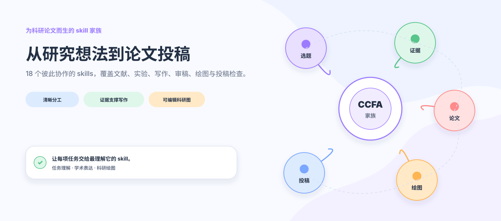
</p>

## 快速开始

选择你正在使用的 Agent：

[Codex 安装](docs/getting-started/CODEX.md) · [Claude Code 安装](docs/getting-started/CLAUDE_CODE.md) · [Cursor 安装](docs/getting-started/CURSOR.md) · [Gemini CLI 安装](docs/getting-started/GEMINI_CLI.md) · [其他 Agent](docs/getting-started/OTHER_AGENTS.md) · [自动更新](docs/getting-started/AUTO_UPDATE.md)

推荐从 [0.13.0 Release](https://github.com/mikubaka88/CCFA-Skills/releases/tag/v0.13.0) 下载轻量安装包并解压。它包含技能、原文文本、绘图库与相邻模板，完整论文 PDF 作为可选离线包单独提供。进入解压目录后，按[安装矩阵](docs/INSTALLATION_MATRIX.zh-CN.md)用本地安装器预览并安装；个人偏好保留，已有个人修改会先被识别；更新同时清理所选范围内未改动的受管退役文件。

也可以从完整 GitHub 仓库一行安装；这条路径仍会获取仓库中的完整论文资源：

```powershell
npx skills add mikubaka88/CCFA-Skills --global --agent codex --skill '*' --yes --copy
```

这条命令安装 18 个 skills。需要内置 LaTeX 模板或只安装部分技能时，请按[安装矩阵](docs/INSTALLATION_MATRIX.zh-CN.md)补齐相邻资源；使用 `--copy` 安装后，更新源码还需要重新复制，步骤见[更新指南](docs/getting-started/AUTO_UPDATE.md)。

安装后，直接说出你正在面对的研究问题：

```text
严格评审这三个选题并排序，指出各自最可能被拒的原因。
检索近三年与时序视觉推理相关的工作、benchmark 和公开 baseline。
根据这篇论文设计主实验、消融和鲁棒性证据，不要虚构结果。
把方法部分改写为 CVPR 风格，并保留公式、术语和引用。
根据论文和参考图绘制方法架构图：整理提示词、GPT Image整图生成、同提示词微调，交付PNG。
```

## 为什么需要一个 skill 家族

论文研究中的困难彼此相连，却不能由同一种思维方式解决。

| 研究者遇到的困境 | CCFA-Skills 如何回应 |
|---|---|
| 检索、实验、写作和审稿挤在同一次对话中，彼此干扰 | 由最适合当前任务的 skill 负责，其他能力按需协助 |
| 文献事实、实验数字和正文结论逐渐脱节 | 分别核对来源、实验设计与全文一致性，让每个 claim 都能找到证据 |
| 论文越改越像审稿回复，充满防御、解释和内部状态 | 写作负责形成正文，Humanization 让语言回到自然、直接的学术表达 |
| 新一轮评审不断更换关注点，难以判断修订是否真正进步 | 同时观察当前稿件的录用准备度与相对上一版的实际改进 |
| 方法图容易变成机械方框，数据图又偏离所选模板 | 流程图由GPT Image三阶段成图；数据图复用原JSON/Python与真实数据 |
| 加载的 skills 越多，结果反而越容易受到无关规则干扰 | 只加载与当前问题直接相关的能力，减少无关上下文 |

## 我们珍视什么

- **让研究问题先于工具。** 评价一个 idea 与发展一个 idea 是两种工作；设计实验与美化图表也需要不同的判断。CCFA-Skills 让每一步都回到它真正要回答的问题。
- **让证据始终有据可查。** 文献、实验协议、数值、结论、图表和引用不会被混成一团。缺失的事实保持缺失，直到它被可靠地找到或验证。
- **让论文听起来像学术，而不是辩护。** Humanization 删除防御性铺垫、机械枚举、过度破折号和内部工程措辞，同时保留真正影响结论的限制、证据与披露。
- **让评审保持独立。** Reviewer 负责判断，Writer 负责修改。先看问题，再决定如何改，避免一边审稿一边替自己解释。
- **让科研图表达清楚，也足够美观。** 数值图保持可复现；方法图先理解科学内容，再完成提示词、整图生成与微调。
- **让范文成为方向，而不是模板。** 用户提供目标论文后，系统学习它的叙事节奏、段落职责和证据组织，但不复制原句，也不把一种写法强加给所有研究。

## 家族架构

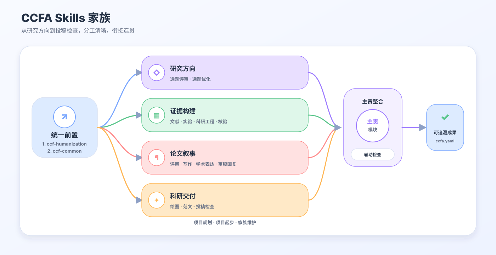

所有 CCFA 任务都先启用 `ccf-humanization`，再启用 `ccf-common`，然后进入具体技能；检索、评审、绘图、实验与维护也遵循这一顺序。前者统一自然、直接且保留真实证据的表达，后者落实协作、范围、证据和文件规则。同一任务交接时复用已生效规则，只刷新变化或丢失的部分；详细改写与实验检查按实际任务执行，不重复生成前置报告。各技能继续负责自己的产物并整合必要协作。

### 18 个核心 skills

| 研究阶段 | Skill | 它能带来什么 |
|---|---|---|
| 家族协调 | `ccf-common` | 理解请求，协调分工，统一证据与隐私规则 |
| 项目推进 | `ccf-pipeline-orchestrator` | 梳理目标、阶段、关键节点与下一步 |
| 项目起步 | `ccf-project-scaffolder` | 准备论文目录、模板与研究材料空间 |
| 选题判断 | `ccf-idea-reviewer` | 判断思路价值、创新与机制逻辑，默认不审核实验 |
| 选题发展 | `ccf-idea-optimizer` | 把模糊方向发展成问题、洞察、方法与证据路径 |
| 文献检索 | `ccf-literature-searcher` | 寻找相关工作、数据集、benchmark 与公开 baseline |
| 前沿追踪 | `ccf-literature-monitor` | 关注新论文、相近工作与研究方向的最新变化 |
| 实验设计 | `ccf-experiment-designer` | 设计主实验、消融、鲁棒性分析与结果表结构 |
| 科研工程 | `ccf-research-engineer` | 选择代码库、实现机制、复现结果并诊断训练 |
| 完整性核验 | `ccf-integrity-auditor` | 核对 claim、数值、术语、图表和引用 |
| 论文评审 | `ccf-paper-reviewer` | 给出独立科学评审、版本比较与录用准备度判断 |
| 论文写作 | `ccf-paper-writer` | 起草、改写、润色与压缩论文内容 |
| 学术表达 | `ccf-humanization` | 去除防御性和机械感，保留自然严谨的学术表达 |
| 审稿回复 | `ccf-rebuttal-writer` | 组织 rebuttal、response letter 与修订记录 |
| 科研绘图 | `ccf-visual-composer` | 复用数值图模板、三阶段生成方法图、修改已有图 |
| 投稿检查 | `ccf-submission-checker` | 检查模板、页数、匿名、PDF 与补充材料 |
| 范文学习 | `ccf-paper-to-exemplar` | 从用户提供的论文中提炼可复用的写作方法 |
| 家族维护 | `ccf-skill-forger` | 改进 skills，消除冲突，完成发布前检查 |

### 每次任务需要用哪些技能

18 项能力按任务使用。思路发展、检索、工程、实验、写作和绘图负责六类科研产出；思路评审、文章评审、完整性核验和投稿检查负责四类判断。监控、范例提炼、项目初始化、流程编排和审稿回复在相应场景出现时介入。`ccf-humanization` 与 `ccf-common` 提供共同前置，`ccf-skill-forger` 用于维护家族。

因此，一次润色可以直接完成，一项研究也可以让多个专业能力围绕同一问题接力。主责智能体负责整合，需要独立探索或检查时才分工。低频能力保留可用，公共规则只建立一次，再按需读取专业内容。

完整职责视图：

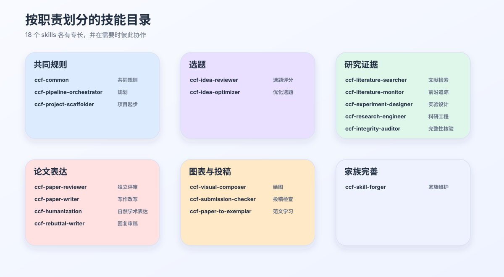

## 日月配置台

改一段摘要时，你可能希望快一点；距离投稿还有三天时，你愿意多花一些时间，让另一位助手再查一遍关键结论。日月配置台把这些选择留给你，也替你记住它们。

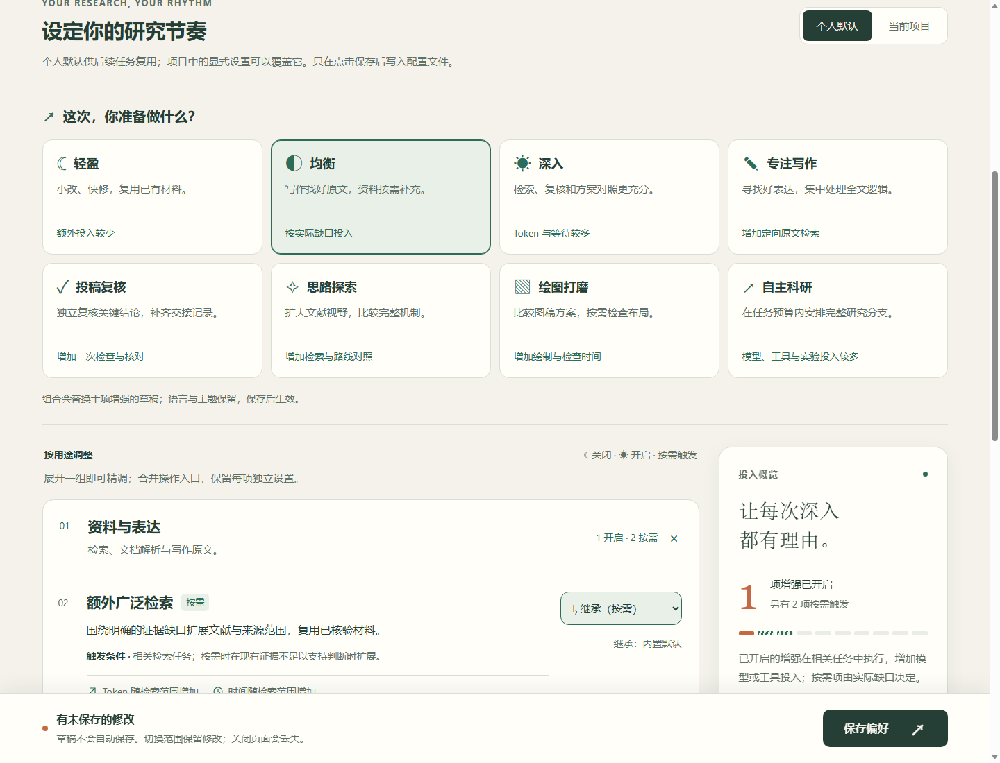

*图为 0.12.0 配置台界面；0.12.1 在资料与表达组新增红色成稿开关。调整选项后，点击“保存偏好”即可应用。*

现在可以直接按正在做的事选择八种模式。十一项设置整理在“资料与表达”“复核与交付”“探索与方案”“策略实验”四组里，需要时再展开。十项常规增强把开关、按需和恢复继承合成一个选择框：**继承 · ☾ 关闭 · ◐ 按需 · ☀ 开启**。每项仍能单独调整，并解释额外工作会花在哪里。页面继续支持简体中文、繁體中文、English，以及日光、夜航和跟随系统主题。

在仓库根目录运行（Python 3.10+，无需额外依赖）：

```bash
python ccf-common/scripts/preferences.py serve
```

浏览器会打开本地配置页。先选一个接近当前任务的模式，再按需要调整：

| 模式 | 适合什么时候用 | Token 与时间会怎样变化 |
|---|---|---|
| **轻盈** | 小改、局部修复，专注完成眼前任务 | 十项额外增强关闭，减少未要求的扩展工作 |
| **均衡** | 日常研究，希望需要时能查深一点 | 保留写作原文检索，扩展检索与复杂文档解析按需增加投入 |
| **深入** | 重要任务，希望多比较、多复核 | 增加独立复核、检索、图稿与报告，通常需要更多 token 和等待 |
| **专注写作** | 起草正文、重写段落、打磨论文逻辑 | 主要投入在好原文的查找和阅读，复杂页面按需解析 |
| **投稿复核** | 投稿前检查关键判断和遗漏 | 独立第二轮复核增加阅读与判断，必要时补充交接记录 |
| **思路探索** | 比较机制、寻找更有价值的问题 | 扩展检索和路线对照增加推理，完整研究分支按需并行 |
| **绘图打磨** | 对比布局、挑选更清楚的表达 | 增加图稿候选；Python 图主要多一次排版和渲染，图像生成另有等待 |
| **自主科研** | 已有明确任务和预算，准备推进研究迭代 | 偏好完整研究分支与扩展检索，可能缩短等待，但总计算投入增加 |

选择模式会替换十一项设置的草稿，保留语言与主题；点击**保存偏好**后才生效。选择“继承”会移除这一项的覆盖：项目设置跟随个人偏好，个人设置跟随内置默认值。“深入”保留原有的维护规则按需迭代；八种模式都将科研策略迭代保持关闭，需要时再单独开启。模式不替你授权训练、预算或材料上传，实际投入取决于任务、材料和工具。

其中三项让投入更有针对性：**优质写作原文检索**默认开启，实质起草或表达重写时复用匹配原文，同时寻找其他写得好的文章。按实际段落质量选用，不为多篇而凑数；同一写作问题已有适用的检索结果就复用，小改不重搜。也可切到“按需”，只在范例不足时搜索；**完整研究分支协作**默认关闭，适合比较不同机制；**科研策略迭代**默认关闭，比较搜索和上下文策略时再单独开启并安排预算。旧配置无需重建，未设置的新项自动继承默认值。

**谨慎开启：结果待填成稿。** 红色选项提供「继承／关闭／开启」，八种预设均关闭它。开启后允许标记清楚的条件式分析和待填结果，可能出现些许幻觉；成稿后的全文一致性检查会增加阅读和修订时间。具体写法见[结果待填的初稿](#结果待填的初稿)。

希望某篇论文有自己的配置，可以这样启动，把路径换成你的论文目录：

```bash
python ccf-common/scripts/preferences.py serve --project "path/to/paper"
```

在页面中选择“个人默认”或“当前项目”后保存。个人默认可用于后续任务，项目里明确设置的选项优先；没有调整的选项继续继承。比如，日常保持轻盈，只给准备投稿的论文开启独立复核。你的偏好保存在 skills 安装目录之外，更新 skills 后仍然保留。

**常规增强决定额外投入，红色开关单独决定结果待填起草方式。** 即使选择“轻盈”，你明确要求的完整评审、多个研究方向，以及必要的核验仍会完成。Humanization → Common 的前置步骤始终生效。打开配置页本身不会调用模型，也不会启动研究任务。

<details>
<summary>查看配置文件位置与离线用法</summary>

个人偏好保存在 `$CODEX_HOME/ccfa/preferences.json`（未设置时为 `~/.codex/ccfa/preferences.json`），项目设置保存在论文目录的 `.ccfa/preferences.json`。已安装副本也可以运行其中的 `ccf-common/scripts/preferences.py`；添加 `--no-browser` 可只打印本地访问地址。

下载仓库后，也可以打开 [静态配置页](ccf-common/assets/configurator/index.html)，导入、编辑并导出 JSON。静态页面只导出文件：请将导出的文件重命名为 `preferences.json`，放到上面对应的配置目录后生效。完整规则见 [偏好契约](ccf-common/references/preferences.md)。

</details>

## 从 idea 到投稿

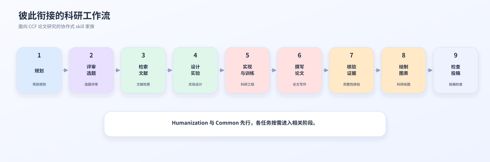

你可以带着一个尚未成形的想法而来，也可以只带来一张难以解释的结果表、一段总被误解的方法，或一份即将提交的 PDF。CCFA-Skills 从当前问题进入，沿用已经完成的工作，再补齐真正影响结果的环节。

### 从机制探索到科研实现

探索从真实困难和尚未解释的现象开始：是信息不足、表示丢掉了区别，还是目标和学习过程出了问题？启发可以来自技术报告、会议、期刊、arXiv，也可以来自较早的基础结果。按机制寻找远近联系，在合适材料中拓展视角，再用不同解释、操作和预测区分候选。一个模块需要说明改变了什么、删掉它会失去什么；走不通的假设及时放下，有价值的基础问题继续探索。

[思路优化](ccf-idea-optimizer/SKILL.md)负责发展机制，[科研工程](ccf-research-engineer/SKILL.md)接住从机制到代码的工作：先看现有项目，按需选择成熟代码库、复用基线、检查模型与梯度路径，再依据实际测量处理训练故障和性能问题。实验围绕能区分解释的比较设计，也支持有明确含义的因素组合与交互消融。

> 在现有项目中实现这个机制，保留训练与评估接口。先检查可复用代码和基线，再定位需要修改的模块；不要用简化模型代替目标方法。训练慢时先测瓶颈。

### 自主科研与实验反馈

一次实验失败后，下一步可能是修代码、调整比较条件，也可能是放弃假设。科研循环先核对基线，围绕具体假设修改候选，再读取真实结果，决定保留、放弃、修复或探索另一种机制。研究目标与比较条件保持清楚，路线随发现调整；实现故障与有效负结果分别记录，当前最佳方案与值得继续探索的方向分别保留。

轻量运行脚本管理实验次数、执行时长、原始日志、受保护文件和受控回退，宿主 agent 负责提出假设、修改候选及调用实际训练命令。恢复时先检查已有记录，同一实验 ID 不会被悄悄重跑。相同候选可以明确复测，多分支共用任务预算，最终确认结果单独记录；未确认实验停止前保留现场，避免进程仍在写入时回滚。

启用科研策略迭代后，可在任务目录中比较检索、上下文和工具调度策略，通过开发、选择与保留测试决定是否继续使用。比较前约定质量下限，质量相当时优先选择成本更低的方案；一项任务中的经验需要经过其他任务检验，才适合成为通用规则。它与只负责技能维护的“维护期规则迭代”分别控制，相关额外投入由[日月配置台](#日月配置台)选择。

> 请围绕检索停止条件自主迭代。沿用项目的评价脚本和数据划分，最多运行 6 次（含基线与失败），每次不超过 60 秒，累计实验执行不超过 240 秒。不使用付费服务。先检查已有结果，再选择能区分机制的实验；保留原始记录，最后交付最佳候选和仍未解决的问题。

[自主科研使用说明与命令](ccf-pipeline-orchestrator/references/autonomous-research.md)给出完整入口。明确的科研任务与预算启动这条循环；普通改稿、思路审核和只要方案的请求按各自范围完成。

## 写作如何保持自然

写作从段落要表达的科学问题开始。先弄清对象、操作和结论，再让句子通过原因、观察、比较和推论接起来。[Humanization](ccf-humanization/SKILL.md)清理没有信息的自辩、审稿人预判、空泛标签和重复限定，保留真实不确定性、适用条件、负结果与必要披露。科学上有含义的技术词、对比、合理长句和句尾的总结与意义继续保留。

实质起草和表达修复默认复用匹配的真实原文，同时定向寻找其他写得好的论文。一篇可以帮助组织动机，另一篇可以帮助解释方法；选择依据是实际段落质量。同题已有适用检索结果就复用，小改直接处理。学习通用搭配与论证组织，保留自己的科学内容和作者声音，具体做法见[原文学习指南](ccf-paper-writer/references/exemplar-style-analysis.md)。

分号、密集的 `rather than`、抽象能力标签和反复比较只作为诊断线索，最终按上下文修改。破折号少用，但没有全文固定数量上限；你明确选择的标点与节奏优先。

> 请润色这一段，先理清句子之间的原因和证据，再调整措辞。保留数字、实验条件和真正影响结论的限制。

### 写作范例怎样真正用起来

同一篇论文里，解释问题、引入机制和讨论结果可能各有值得学习的地方。`ccf-paper-to-exemplar` 把这些写法整理成带原文位置、适用问题和分析范围的范例卡，便于以后的写作找到它们。它既能提炼整篇论文，也能只研究某个章节或段落。

| 当前需要 | 怎样处理 |
|---|---|
| 参考一段原文，马上改好自己的段落 | Writer 直接阅读和改写，分析留在当前任务中 |
| 把一种写作方法整理下来，供以后复用 | Exemplar 提炼卡片，保留来源、位置和适用场景 |
| 让以后写作能找到已完成的卡片 | 登记到项目或个人范例库，Writer 按写作问题查询 |

个人库保存在项目 `.ccfa/exemplars/` 或个人配置目录下的 `ccfa/exemplars/`，与安装文件分开。登记引用已有卡片与原文，保留来源和版本；未完成的骨架不能登记。查询先返回匹配条目与原文位置，再阅读需要的内容，原文变化后相应条目需要刷新。

全文提炼仍保留原有八类分析。明确选定的默认范例也继续支持：可以为项目指定多张卡，未指定时继承个人选择。默认项只在与当前写作问题匹配时优先；登记新卡不会改变默认。

```bash
python ccf-paper-to-exemplar/scripts/personal_library.py query --project . --function motivation
python ccf-paper-to-exemplar/scripts/personal_library.py set-default --project . --id paper-a-motivation
```

例如可以说：“把这篇论文引言中的问题到机制的写法提炼成范例，加入当前项目的个人库。”以后再说：“参考个人库中适合解释计算依赖的段落，改好我的方法部分。”具体登记命令见[范例技能](ccf-paper-to-exemplar/SKILL.md)。

### 长稿修改如何接回全文

修改长稿时，Writer 带着全文主线、当前章节、必要邻段和有位置的原文材料动笔。相关工作按问题和机制展开，结果段落解释观察之间的关系；提示与材料按当前写作任务选取。

[写作执行入口](ccf-paper-writer/references/writing-execution.md)检查稿件版本和修改范围，防止旧版本的局部修改覆盖新工作。数据或方法变化时，沿已登记的依赖定位需要重看的段落、图表和论点。可选复查只复用输入、提示、模型参数与实际覆盖范围都匹配的完成结果；中断调用先恢复，普通改一句话仍然直接改。

> 修改这篇论文的结果与讨论部分。保留全文主线和必要邻段，用真实结果解释差异；先准备当前材料，再局部修改，最后只复查受影响的论点和图表。

### 结果待填的初稿

论文还没跑完，问题与方法已经清楚时，可以明确要求或开启[红色成稿选项](#日月配置台)，先完成连贯初稿和标记清楚的条件式分析，数值后续填写。已有正结果与负结果保留，预期与实测分开；明确要求实验留空时，实验部分继续留空。这一模式会增加全文一致性检查，不启动实验。

写完后自动对照摘要、正文、表格、图注和结论，检查主张与结果状态是否一致。详细约定见[材料到完整稿件](ccf-paper-writer/references/materials-to-manuscript.md)。

## 评审与投稿检查

思路审核与文章审核按判断对象区分：“这个方向值得做吗”由 `ccf-idea-reviewer` 处理，无需指定评分；“稿件结论是否站得住”由 `ccf-paper-reviewer` 处理。即使输入完整 PDF，只看核心思路的请求也保持概念审核。思路评分聚焦问题、创新、洞察、机制、简洁性与受众价值，实验仅在明确要求时单独评估。

结构化审核报告默认输出详细版，明确要求简要时使用简要版。文章审核展开贡献、优缺点、相关工作、方法与证据、多视角意见、评分及修改优先级；思路审核展开问题价值、创新差异、机制逻辑与发展建议，默认不评实验。意见绑定具体位置、依据与稳定编号，复审追踪问题是否解决；不会生成缺乏真实参照集的百分位排名。详见[文章报告模板](ccf-paper-reviewer/references/fixed-output-format.md)与[思路审核协议](ccf-idea-reviewer/references/strict-idea-review.md)。

完整文章评审固定 14 节，写作专项固定 9 节，明确要求简版时使用 5 块。通用科学评分统一为新颖性、正确性、证据、意义、清晰度、可复核性、伦理与局限七维；证据要求按贡献类型解释，置信度与材料覆盖范围分开。生成报告可直接检查 Markdown 的标题顺序、评分字段和问题编号引用；会议或用户明确指定的格式继续优先。

文章复审同时回答两个不同的问题：

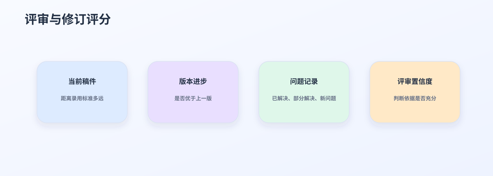

- **当前稿件是否足以投稿。** 它衡量论文距离目标 venue 的录用标准还有多远。
- **这次修订是否真正进步。** 它比较新旧版本解决了什么，又是否引入了新的问题。

### 独立领域审读

独立审读沿用现有“独立复核”开关：让另一位领域评审先看稿件，判断贡献与论证，再由主审核对发现、合并重复问题，形成一份报告。第一遍不携带主审分数、先前结论或写作历史，也不把每条意见都变成补实验的要求。

“关闭”不增加这次调用；“开启”可为实质科学评审或全文评审安排一次阅读；“按需”用于重大争议或投稿前检查，明确请求优先。它会增加一次阅读的等待与输入、输出 token，同用途的独立复核不重复安排。[准备入口与用法](ccf-paper-reviewer/references/plain-expert-review.md)负责整理材料，实际调用由宿主完成，并确认可用的 GPT-6 与全新上下文；准备好的请求与完成的评审分别记录。

> 请让一位独立的领域评审审读这篇论文，先看稿件，再看已有评语。指出真正影响判断的问题，由主审合并成一份报告；宿主支持时实际选用 GPT-6。

### 按年份进入会议适配

投稿检查按会议、年份、track 和阶段选择指南及模板。模板、正文和检查清单采用同一套规则；页数、匿名、声明与附件由本地预检和实际稿件共同核对。

| 会议入口 | 主要用途 |
| --- | --- |
| [CVPR 2027](ccf-paper-writer/references/venue-guides/cvpr.md) | 完整模板、正文页数、匿名与 LLM Usage Statement；注册和作者资格单独核对 |
| [ICLR 2027](ccf-paper-writer/references/venue-guides/iclr.md) | 对应模板、阶段要求与 AI 使用说明 |
| [ACL 2027](ccf-paper-writer/references/venue-guides/acl.md) | 长／短稿、ARR 评审与 ACL commitment 的区分 |
| [ICML 2027](ccf-paper-writer/references/venue-guides/icml.md) | 贡献类型、影响声明与 AI 披露 |
| [ECCV](ccf-paper-writer/references/venue-guides/eccv.md) | 按届次选择模板与投稿预检 |
| [ECOOP](ccf-paper-writer/references/venue-guides/ecoop.md) | 模板依赖与对应阶段检查 |
| [IMC](ccf-paper-writer/references/venue-guides/imc.md) | 模板入口、匿名与投稿材料检查 |
| [ACSAC](ccf-paper-writer/references/venue-guides/acsac.md) | 对应年份模板与投稿材料检查 |

更多会议见[指南索引](ccf-paper-writer/references/venue-guides/index.md)。审稿回复由 [Rebuttal Writer](ccf-rebuttal-writer/SKILL.md)组织，直接回应问题，按实际改动保留致谢、让步与修改承诺。

## 绘图示例

这里展示的是实际科研成图，而不是功能宣传图。不同图面向不同阅读场景，因此使用不同的构图语言。

### 论文方法架构图

下图从 `output/DynTrace.pdf` 中提取计算关系，以分层布局呈现方法机制与信息流。输入与视觉处理位于底部，几何证据和 DTV/DTG 分支构成中层，token 融合、MLLM 与答案位于顶部。各层按计算依赖连接，便于沿信息流阅读完整方法。

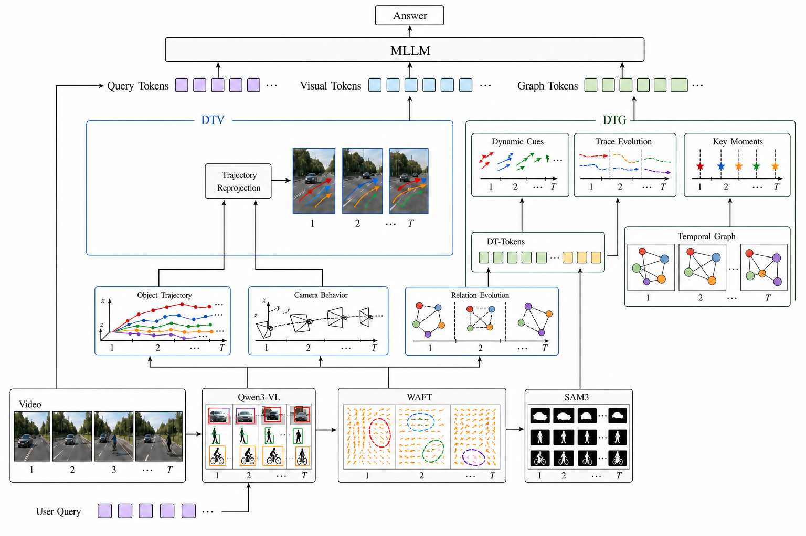

<details>
<summary>查看参考图、出处与构图原则</summary>

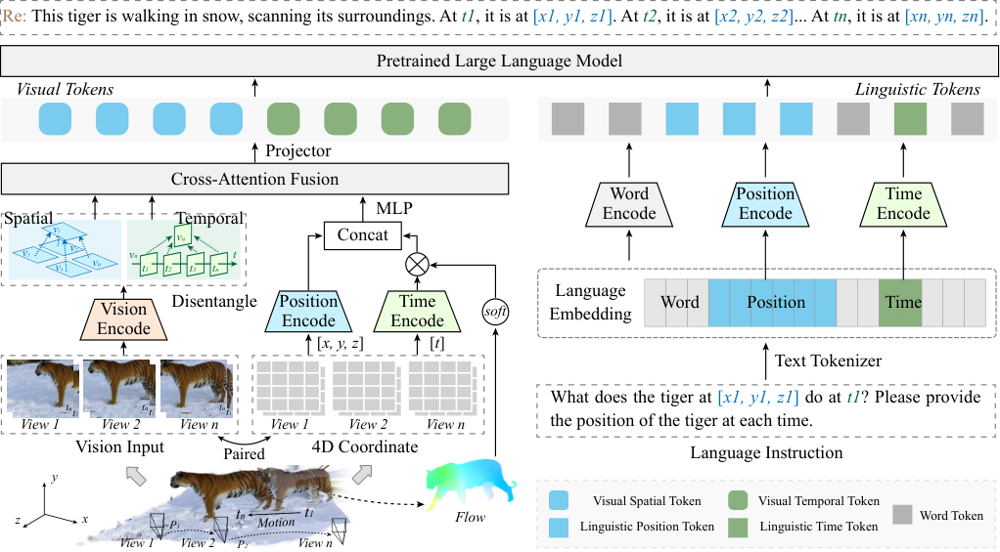

参考出处：Hanyu Zhou and Gim Hee Lee, [*LLaVA-4D: Embedding SpatioTemporal Prompt into LMMs for 4D Scene Understanding*](https://arxiv.org/abs/2505.12253), Figure 2；亦见 [OpenReview 页面](https://openreview.net/forum?id=URpbmVEsqB)。截图仅用于非商业的学术构图研究与风格说明，版权归原作者所有。如涉及侵权，请联系项目维护者删除。

- 论文图应当让输入、表示、操作、分支、融合与输出一目了然。
- 视频帧、光流、掩码、3D 轨迹、DT-Tokens 与 temporal graph 都承担方法含义，而不是装饰。
- 普通英语使用自然大小写；Qwen3-VL、WAFT、SAM3、DTV、DTG、MLLM、3D 与 4D 保持规范缩写。

</details>

### PPT/Poster

下面保留两张早期视觉探索。它们更适合演示文稿、项目海报或 README 概览，因此不作为顶会论文方法图示例。

#### GPT Image 2 概念稿

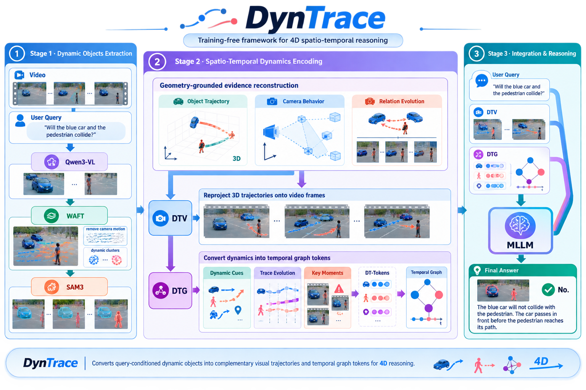

#### 参考驱动的 PPT/Poster

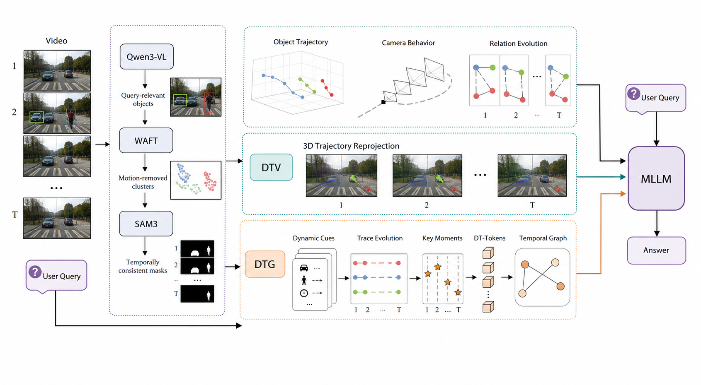

参考图提供标题、色块和视觉锚点的组织方式，适合演示与海报阅读。

### 数据分析图

一张分析图先回答一个研究问题：收益出现在哪里，哪些条件会改变结果，分布、阈值与变化趋势怎样共同解释现象。可以在同一坐标区内组合必要元素，确有阅读需要时再增加关联面板。主图分析、定量结果、消融和生信数据都可以据此选图。

**密度与扰动：**在一组紧凑的关联面板里，联合展示状态密度、区域占比、分位范围与 P95 变化。

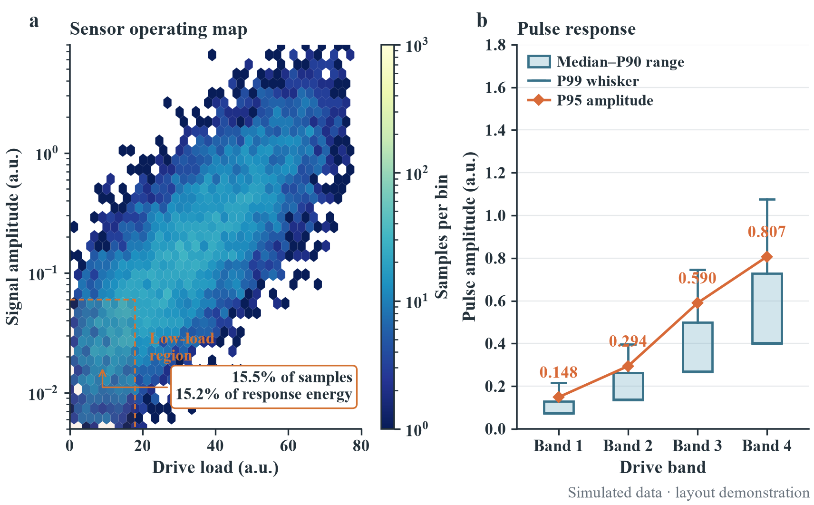

**演化与类别差异：**将状态曲线与分类柱线对照放在一起，保留区间带、关键数值和一致的对象配色。

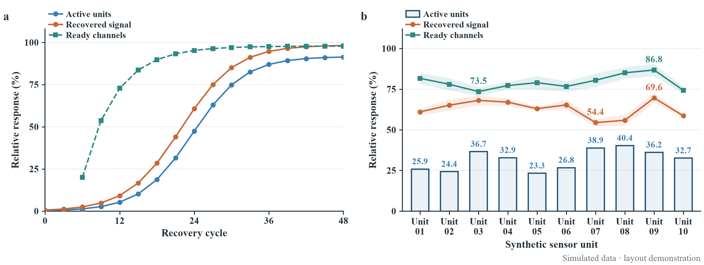

选图按要表达的关系路由。**43 种图形语法、16 类表达目的、16 套组合方案**把分布与长尾、配对收益、误差来源、排名变化、资源取舍等问题分开处理。每种图都写明为什么这样设计、需要哪些数据、容易读错什么，以及还能和哪种图搭配。你可以沿着这些理由继续改版面、换组合，形成适合自己研究的新图。

素材库按论文检索元数据和已检查的图形设计卡分别组织。[设计与融合指南](ccf-visual-composer/references/figure-design-library.md)提供覆盖与来源入口；[版本记录](CHANGELOG.md#v0130)保留对应时间的数量快照。

选图先看这篇文章要讲什么：当前论点、段落用途、观察单位、样本是否配对，以及图放进论文后的尺寸。合适的方案之间自然随机，不需要设置随机数，也不为凑使用次数而选错图。选定后保留实际数据和布局，后续修改沿着这张图继续做。复杂组合共用对象颜色、对齐相关坐标，分箱图保留相同区间和实际分母。

```bash
python ccf-visual-composer/resources/python/ccfa_figure_library.py route "分布与长尾"
python ccf-visual-composer/resources/python/ccfa_figure_library.py explain ecdf
python ccf-visual-composer/resources/python/ccfa_figure_library.py demo --fusion paired_benefit --out ccfa-workfiles/figures/paired-effect/build/figure
```

真实数据可以直接从 CSV、TSV 或 JSON 表接入，筛选和排序后仍保留同一行里的配对关系。联动布局包括三种：联合分布与边缘、共同位置多轨道、热图与行列切片。它们共享同一批观测或网格，各轨道保留自己的单位，不把独立生成的图拼成“相互解释”的结果。

此前的九套模板和你要求的参考图都保留在[完整示例表](ccf-visual-composer/references/figure-examples.md)，包括密度与扰动、状态演化与类别占比两组双面板。可以按示例 ID 直接调用，再用当前文章的数据和消息继续改。

<details>
<summary>九套整图模板及用途</summary>

原有九套模板保留为完整布局的起点，可按当前文章调整组合：

[九套模板总览](assets/analytical-figures-gallery.png) · [完整示例与调用入口](ccf-visual-composer/references/figure-examples.md)

| 模板 | 帮读者看清什么 |
| --- | --- |
| `mechanism_overview` | 方法流程、任务表现与资源收益如何对应 |
| `benchmark_atlas` | 跨任务结果、重复运行分布与成本取舍 |
| `ablation_interactions` | 各组件的贡献，以及它们之间的相互作用 |
| `scaling_robustness` | 规模、训练预算与扰动变化后的表现 |
| `representation_diagnostics` | 表示空间、注意力与特征关系 |
| `biological_atlas` | 细胞分组、表达分布与差异筛选 |
| `paired_effects` | 同一样本前后变化与不同亚组的效应 |
| `calibration_errors` | 置信度校准、混淆矩阵与错误结构 |
| `sensitivity_dynamics` | 密度与阈值占比、箱线与 P95、状态演化，以及同轴分类柱线对照；也可拆成两张横向双面板图 |

</details>

九套模板使用区间比较、趋势带、热图、点阵、分布、嵌入散点、密度图、分箱汇总和分类对照等基础组件；原有 13 类与补充的 30 类共同接入 43 种图法的路由。新组合可以换面板继续制作。可比较的数据共用坐标或色阶，不同单位保留独立标注；版面、字体与线条规则统一见[绘图交付](#让图既好看也能继续修改)。

配色包括原有 14 套及 AAAS、NEJM、Lancet、JCO、Tol bright、Tol muted 六套扩展，按对象角色保持颜色一致；这些名称用于区分方案，不代表期刊指定要求。数值由 Python 绘制，需要插画或机制组件时再局部补充，数据层保持不变。

预览中的数值都是模拟数据。只有明确选择 `--demo` 才生成示例；真实任务用 `--data` 读取提供的数据，不补造缺失结果，也不会为了出图悄悄修改数值。工具继续区分 p 值、校正 p 值和 q 值，检查区间、概率、轴范围与标签。

在仓库根目录试画一遍：

```powershell
python -m pip install numpy matplotlib
python ccf-visual-composer/resources/python/ccfa_analysis_templates.py --demo all --out ccfa-workfiles/figures/analysis-demo
```

Python 数值绘图使用 NumPy 和 Matplotlib；早期 SVG 数值示例作为已有源文件保留。[绘图调用说明](ccf-visual-composer/references/python-plot-recipes.md)提供模板选择、真实数据接入和字号配色参数。重复运行更新同一任务目录，额外候选图与独立复核沿用原有开关。

只想看敏感性分析的两个面板，把上面命令中的 `--demo all` 换为 `--demo sensitivity_dynamics --panel-pair sensitivity`；将 `sensitivity` 改为 `dynamics` 则输出状态演化与分类对照，保留原来的 `--out` 路径即可。

> 请把这些结果整理成一张多面板分析图，先判断哪些关系需要并排比较，再选模板。按论文最终宽度安排字号，对齐相关面板，同一方法保持同色，保留必要的不确定性，输出 PNG 和可复用的 Python／JSON 源。

[早期数值图及原始源文件](ccf-visual-composer/references/figure-examples.md#早期-svg-与展示图保留原文件)保留在素材库中。

## 让图既好看，也能继续修改

数据图选中了哪个模板，就沿用它的 JSON 和 Python 绘制代码。换真实数据时保留原来的布局、字号、配色、图层和统计定义；不再重新跑 demo、重选一个相似基础图来代替。新设计才按输入数据类型、图类型和文章要说明的关系选择组合。

论文流程图、方法图和架构图的新绘／重绘采用固定的三阶段：先用用户提示词、参考图和文章整理 P；再带着 P、参考图和文章让 GPT Image 生成整图 G0；最后用同一个 P 和 G0 做微调，交付 G1。微调属于同一候选的必需阶段，关闭额外图稿候选也会执行。整体构图交给图像模型，保留紧凑、对齐、清楚连线与高信息量，不先搭矢量骨架，也不把成图重建为 SVG 或 PPT 形状。

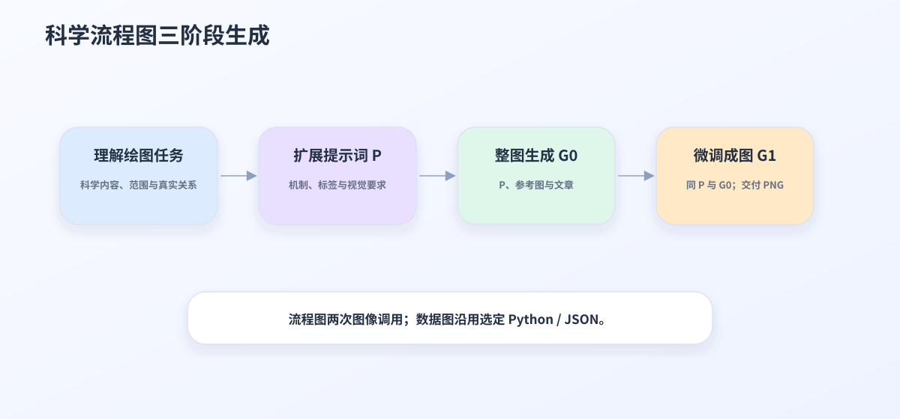

已有图的局部修改和调优沿用当前图像或原始源文件，无须重跑全部三阶段。流程图默认交付 PNG，放进 PPTX／PDF 时仍是原图，交付时说明实际可编辑程度。数值图默认 PNG，明确要求时可导出 PDF 或 SVG，并保留 Python／JSON 源。

字体默认 Times New Roman，也可选择 Comic Sans MS，中文使用可用的 CJK 后备字体。标题、图例和坐标文字按层级加粗，柱箱边沿使用配对的深色与足够线宽，相关元素对齐、版面紧凑。最终纸面尺寸决定字号与线宽，图例保持统一，参考预设按内容选择。

## 各司其职，彼此接力

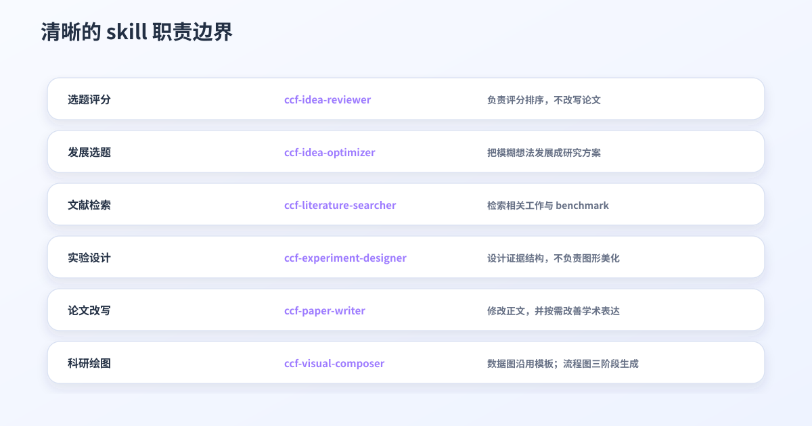

每个产物有一位负责整合与交付的主责，其他技能解决影响结果的前置问题。判断创新性前核对近邻工作，写作前厘清主张、结果和引用，科学绘图前确认数据含义与方法结构。缺失、冲突或过期的材料交给对应技能补齐，已有且仍适用的工作直接复用；改动后检查受影响的关系，解决具体问题后结束这一轮。

### 长任务如何保持方向

最初的目标可能是“在现有算力下找到值得做的新方向”，几轮讨论后却变成不断加模块、加实验的超预算计划。长任务按需要保留目标、重要限制、当前路线与下一步，在换路线、接收助手结果和恢复上下文时核对。回答错位时回到实际文件与结果，保留有效工作，再从一个能检查的步骤继续。新发现支持改路时，记录改变的原因。

这项反降智设计作用于目标延续和错误恢复，具体做法见[连续性规则](ccf-common/references/continuity.md)。

### 多智能体围绕完整问题分工

探索不同机制、核对引用或检查数值可以独立分工；同一条论证里的问题、洞察和方法由同一位作者贯穿。助手带回具体发现、必要条件和来源位置，主责再核对结果之间的关系。局部缺口交回原助手补齐，已经拆散的工作重新归拢；推理档位高也不需要把任务拆得更碎。

外部 skills 可以提供文档、检索、编码或评测工具，工作仍沿用同一个研究目标、文件位置和负责人。共享文件按单一写入者协调，旧版本上的结论先核对再采用。节省 token 优先减少重复检索、报告、询问和无关上下文，同时完成必要前置。详见[协作路由](ccf-common/references/routing.md)、[任务模式](ccf-common/references/task-modes.md)与[交接规则](ccf-common/references/handoff-modes.md)。

## 仓库结构

```text
CCFA-Skills/
├── ccf-common/                 # 家族共享规则
├── ccf-*/SKILL.md              # 18 个 skill 入口
├── ccf-*/references/           # 按需阅读的参考资料
├── ccf-*/scripts/              # 可复现操作
├── assets/                     # README 图片与绘图示例
├── evaluation/                 # 回归与消融结果
├── tools/build_ccfa_diagrams.py
└── 实验结果.md
```

较长的规则放在 `references/`，可重复执行的操作放在 `scripts/`。迭代过程中沿用固定文件名，由新版本覆盖旧版本，避免堆积难以辨认的过程文件。

文件约束已前置到全部 18 个 skill 入口。中间文件优先沿用用户指定路径、该产物的 `ccfa.yaml` 映射和已有任务目录；新任务使用项目根目录下独立的 `ccfa-workfiles/<任务用途>/<具体产物>/`，不嵌套在通用 `output/` 中。例如 `figures/method-overview/`、`reviews/paper-short-title/`、`literature/retrieval-memory/` 分别存放方法图、论文评审和主题检索的工作文件。若同名目录已被其他用途占用，采用稳定的 `ccfa-workfiles-<项目名>/`，不混用或覆盖。

需要时才创建 `source/`（可复用源文件）、`assets/`（参考与图标）、`cache/`（下载与提取缓存）、`build/`（当前预览与构建日志）。同一产物跨 skill 共用目录，普通迭代更新原文件，不使用含义不明的 `temp`、`misc` 或 `final-final`。完成后清理本任务产生且已确认可丢弃的过程文件，保留原始数据、可编辑源文件、最终产物及必要对比证据；失败生成不覆盖可用结果。已有目录不因新命名规则被搬迁，完整规则见[产物合约](ccf-common/references/artifact-contracts.md)。

中文输出采用显式 UTF-8 读写，兼容带 BOM 的输入；终端管道、中文文件名和图形字体分别检查。家族校验已加入中文与生僻字回归，解码错误会明确报出，避免用替换字符掩盖问题。图中的中文使用可用的 CJK 后备字体，保留原定的西文字体。

反复构图或转换文件时，可按需使用[临时产物追踪](ccf-common/references/artifact-contracts.md#optional-tracking-for-repeated-builds)，记录本任务生成的临时文件，检查后只清理已经释放且没有被改动的文件。普通改稿沿用现有目录即可。

<a id="latest-updates"></a>

## 最新更新

当前版本 **0.13.0**。完整用法已并入对应章节，更新历史见 [CHANGELOG](CHANGELOG.md#v0130)。

| 日期 | 变更摘要 | 使用入口 |
| --- | --- | --- |
| 2026-11-27 | 更新数据分析成图，合并重复文档并整理阅读路径 | 本页目录 |
| 2026-11-26 | 精简技能前置，打通范例提炼、外部个人库与默认选择 | [写作范例](#写作范例怎样真正用起来) |
| 2026-11-25 | 补充 ACL、ICML、ECCV、ECOOP、IMC、ACSAC 适配与参考集合 | [会议适配](#按年份进入会议适配) |
| 2026-11-14 | 修复所选模板复用、数据替换和显式尺寸交付链路 | [数据分析图](#数据分析图) |
| 2026-11-12 | 加入 CVPR 2027 模板与检查，统一当前绘图交付规则 | [投稿检查](#评审与投稿检查) · [绘图交付](#让图既好看也能继续修改) |

## 维护与验证

文档或技能更新后，可先运行基础检查：

```powershell
python ccf-common/scripts/check_v04.py
python ccf-common/scripts/check_path_privacy.py
python ccf-common/scripts/check_markdown_links.py
python ccf-common/scripts/check_sources.py
```

完整的脚本回归与跨平台检查以 [CI 配置](.github/workflows/validate.yml)为统一入口，覆盖绘图、配置、连续性、写作执行、范例库、审读、科研循环和安装更新。[行为测试说明](evaluation/behavioral/README.md)提供内容与自然请求路由试跑方法，只在维护时执行。

结构与脚本检查、实际内容试跑分别记录结果。[0.12.0 四类内容小样](evaluation/behavioral/results/0.12.0-smoke.md)与 [0.9.0 历史实验](实验结果.md)保留各自的模型、版本和比较条件；当前能力与成本以当前任务的实际执行为准。

## 我们坚持的底线

- 不虚构实验结果、引用、模块或 venue 规则。
- 私有论文和未公开结果只读取完成任务所需的内容。
- 外部检索与图像生成只在用户授权后进行，并且只传递完成任务所需的信息。
- 用户可以停用任意 skill，其他 skills 不会绕过这一选择。
- 自动评分必须说明量表、比较对象、依据与不确定性。

## 致谢

感谢 [Research-Paper-Writing-Skills](https://github.com/Master-cai/Research-Paper-Writing-Skills) 对学术写作 skill 开源生态的贡献。

## Star 旅程

[](https://github.com/mikubaka88/CCFA-Skills/stargazers)

<a href="https://www.star-history.com/?repos=mikubaka88%2FCCFA-Skills&amp;type=date">
  <picture>
    <source media="(prefers-color-scheme: dark)" srcset="https://api.star-history.com/svg?repos=mikubaka88/CCFA-Skills&amp;type=Date&amp;theme=dark" />
    <source media="(prefers-color-scheme: light)" srcset="https://api.star-history.com/svg?repos=mikubaka88/CCFA-Skills&amp;type=Date" />
    
  </picture>
</a>

曲线由 Star History 自动更新，计数徽章由 Shields.io 自动更新。服务及 GitHub 图片缓存可能延迟显示，曲线通常缓存约 24 小时，因此不是秒级实时；点击图表可打开交互页面。

[查看 2026-08-13 历史快照（离线可用）](assets/ccfa-skills-star-history.zh-CN.svg)
