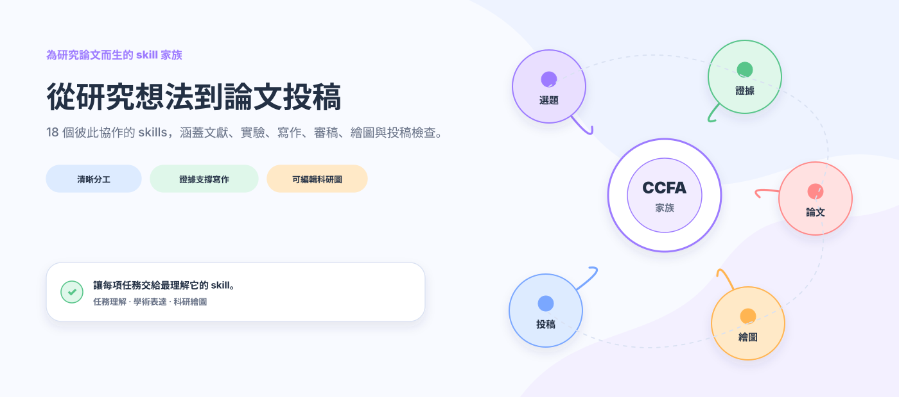
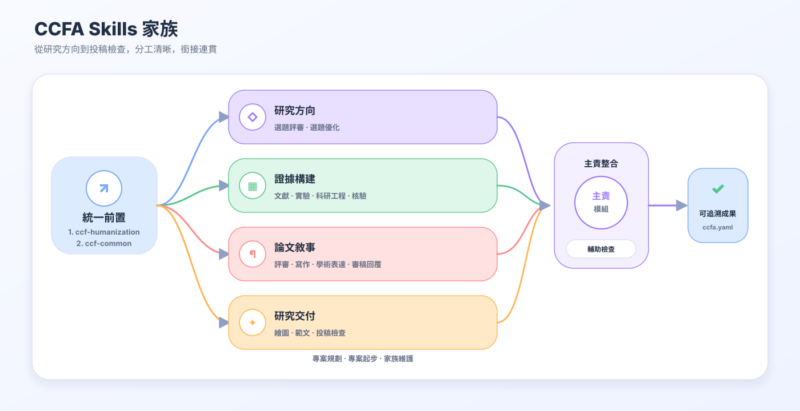
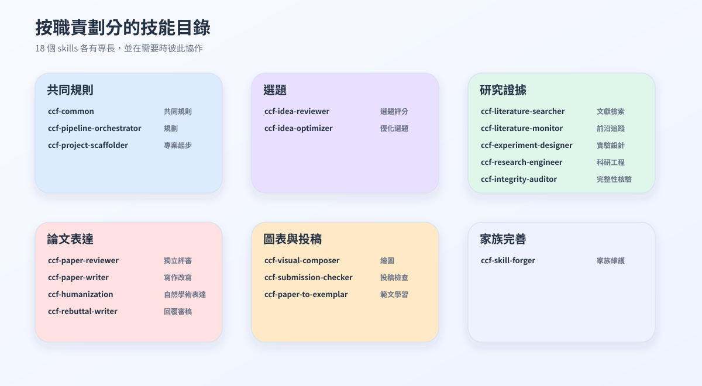
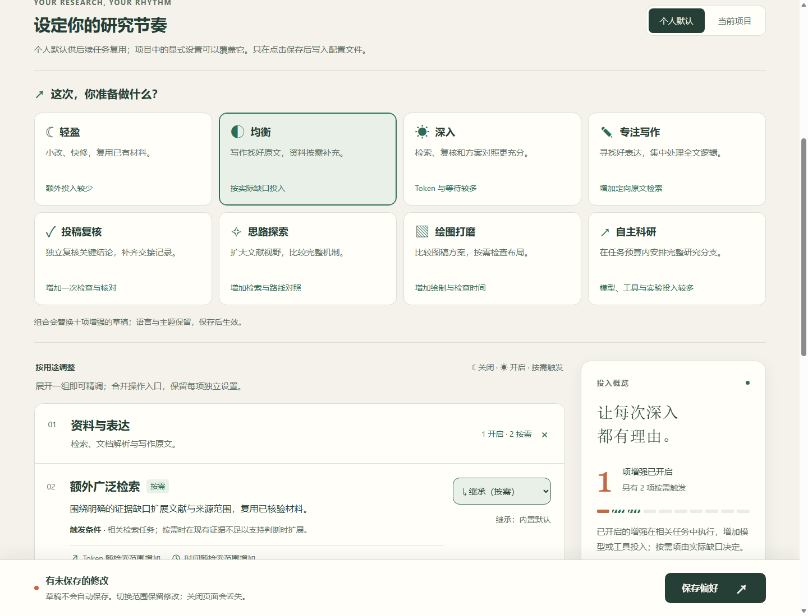
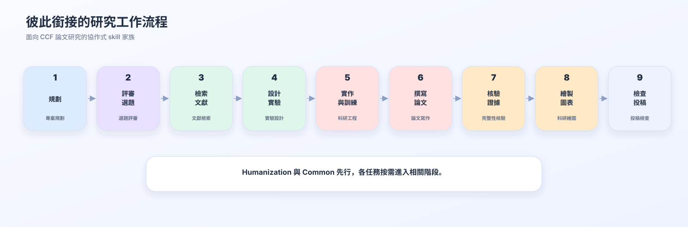
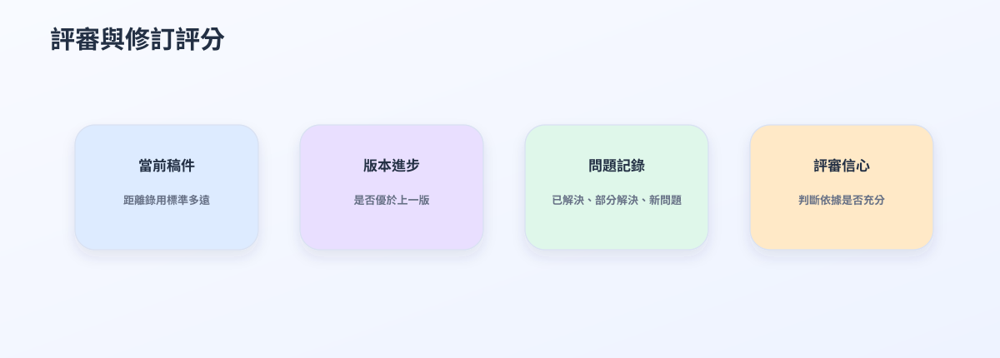
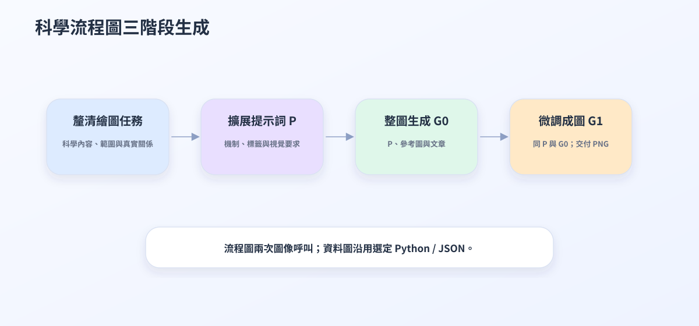
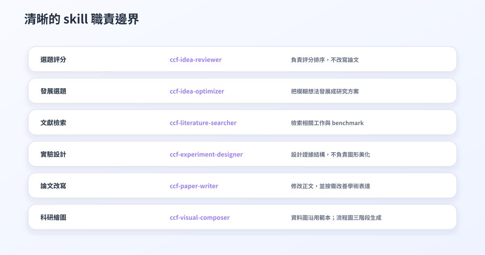
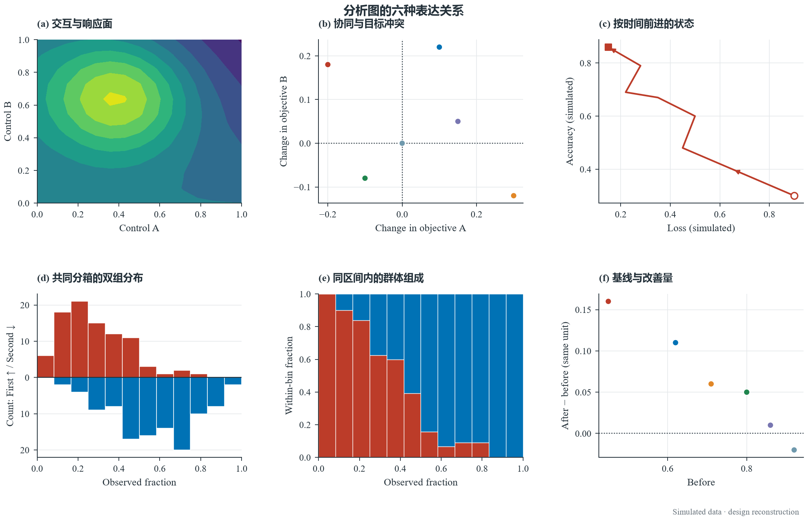
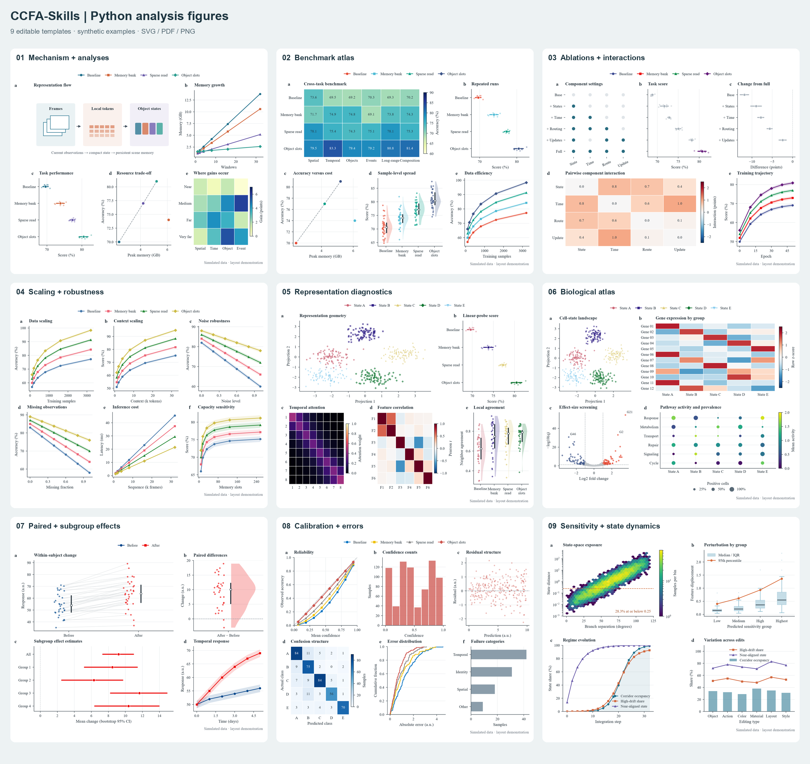

<p align="center">
  <a href="https://trendshift.io/repositories/151023?utm_source=trendshift-badge&amp;utm_medium=badge&amp;utm_campaign=badge-trendshift-151023" target="_blank" rel="noopener noreferrer"></a> <a href="https://trendshift.io/repositories/151023?utm_source=trendshift-badge&amp;utm_medium=badge&amp;utm_campaign=badge-trendshift-151023" target="_blank" rel="noopener noreferrer"></a>
</p>

<div align="center">

<h1>CCFA-Skills</h1>

**A skill family for shaping the research storyline of CCF-A papers.**

[简体中文](README.md) · [English](README.en.md) · [繁體中文](README.zh-TW.md)

**[最新更新 · v0.12.1](#latest-updates)**


---

*“The structure of the prose becomes the structure of the scientific argument.”*<br>
George D. Gopen and Judith A. Swan, [*The Science of Scientific Writing*](https://www.cs.tufts.edu/comp/150FP/archive/george-gopen/sci.html)

*“The very process of science is centered around communication.”*<br>
Yann LeCun and James M. Manyika, [*Learning Abstractions*](https://www.amacad.org/publication/daedalus/learning-abstractions-conversation-yann-lecun)

</div>

## 目錄

- [快速開始](#快速開始)
- [為什麼需要一個 skill 家族](#為什麼需要一個-skill-家族)
- [家族架構與核心 skills](#家族架構)
- [日月設定台](#日月設定台)
- [從 idea 到投稿](#從-idea-到投稿)
- [繪圖示例](#繪圖示例)
- [寫作如何保持自然](#寫作如何保持自然)
- [讓圖既好看，也能繼續修改](#讓圖既好看也能繼續修改)
- [各司其職，彼此接力](#各司其職彼此接力)
- [安裝、維護與驗證](#倉庫結構)
- [最新更新](#latest-updates)
- [Star 旅程](#star-旅程)

凌晨兩點，實驗終於結束，新的結果比預期更好。可是重新打開稿件時，真正棘手的問題才顯現出來：最初那個清晰而有力的研究問題已經埋進冗長的 related work，方法描述與程式中的實際機制出現偏差；新補的實驗回應了上一輪審稿意見，卻讓論證分成幾條彼此疏離的線索。每個局部似乎都更完善了，整篇論文反而更難讀懂。

許多有潛力的研究最終未能充分展現價值，並不是因為 idea 不夠好，而是因為它在漫長的推進中逐漸失去了清晰的輪廓。文獻愈積愈多，實驗表格不斷擴張，作者還要在研究、寫作和審稿視角之間反覆切換。一個無所不包的長 prompt 很難同時做好這些事情，因為檢索需要忠於來源，實驗需要遵循協議，寫作需要圍繞論證展開，審稿則必須保持獨立判斷。

我們因此設計了 CCFA-Skills。論文不是等待逐項填充的文件，而是一條需要在反覆修改中保持連貫的研究故事線。18 個分工明確的 skills 從 idea、文獻和實驗出發，幫助論證逐漸成形，並貫穿寫作、繪圖、評審、rebuttal 與投稿。當任務從一個 skill 交給另一個 skill 時，研究問題、證據和結論之間的聯繫仍然會被保留下來。

<p align="center">
  
</p>

## 快速開始

選擇你正在使用的 Agent：

[Codex 安裝](docs/getting-started/CODEX.md) · [Claude Code 安裝](docs/getting-started/CLAUDE_CODE.md) · [Cursor 安裝](docs/getting-started/CURSOR.md) · [Gemini CLI 安裝](docs/getting-started/GEMINI_CLI.md) · [其他 Agent](docs/getting-started/OTHER_AGENTS.md) · [自動更新](docs/getting-started/AUTO_UPDATE.md)

建議從 [0.12.1 Release](https://github.com/mikubaka88/CCFA-Skills/releases/tag/v0.12.1) 下載輕量安裝包並解壓縮。它包含技能、原文文字、繪圖素材庫與相鄰範本，完整論文 PDF 以可選離線包另行提供。進入解壓目錄後，依[安裝矩陣](docs/INSTALLATION_MATRIX.zh-TW.md)使用本機安裝器預覽並安裝；個人偏好保留，既有個人修改會先被識別。

也可以從完整 GitHub 倉庫一行安裝；這條路徑仍會取得倉庫中的完整論文資源：

```powershell
npx skills add mikubaka88/CCFA-Skills --global --agent codex --skill '*' --yes --copy
```

這條命令安裝 18 個 skills。需要內建 LaTeX 範本或只安裝部分技能時，請按[安裝矩陣](docs/INSTALLATION_MATRIX.zh-TW.md)補齊相鄰資源；使用 `--copy` 安裝後，更新原始碼還需要重新複製，步驟見[更新指南](docs/getting-started/AUTO_UPDATE.md)。

安裝後，直接說出你正在面對的研究問題：

```text
嚴格評審這三個選題並排序，指出各自最可能被拒的原因。
檢索近三年與時序視覺推理相關的工作、benchmark 和公開 baseline。
根據這篇論文設計主實驗、消融和穩健性證據，不要虛構結果。
把方法部分改寫為 CVPR 風格，並保留公式、術語和引用。
根據論文繪製方法架構圖，先生成審美稿，再詢問是否重建為 PPTX。
```

## 為什麼需要一個 skill 家族

論文研究中的困難彼此相連，卻不能由同一種思考方式解決。

| 研究者遇到的困境 | CCFA-Skills 如何回應 |
|---|---|
| 檢索、實驗、寫作和審稿擠在同一次對話中，彼此干擾 | 由最適合當前任務的 skill 負責，其他能力按需協助 |
| 文獻事實、實驗數字和正文結論逐漸脫節 | 分別核對來源、實驗設計與全文一致性，讓每個 claim 都能找到證據 |
| 論文愈改愈像審稿回覆，充滿防禦、解釋和內部狀態 | 寫作負責形成正文，Humanization 讓語言回到自然、直接的學術表達 |
| 新一輪評審不斷更換關注點，難以判斷修訂是否真正進步 | 同時觀察當前稿件的錄用準備度與相對上一版的實際改進 |
| 架構圖要麼只是方框流程，要麼漂亮卻無法繼續編輯 | 先探索適合內容的視覺語言，再按需要重建為 SVG、PDF 或 PPTX |
| 載入的 skills 愈多，結果反而愈容易受到無關規則干擾 | 只載入與當前問題直接相關的能力，減少無關上下文 |

## 我們珍視什麼

- **讓研究問題先於工具。** 評價一個 idea 與發展一個 idea 是兩種工作；設計實驗與美化圖表也需要不同的判斷。CCFA-Skills 讓每一步都回到它真正要回答的問題。
- **讓證據始終有據可查。** 文獻、實驗協議、數值、結論、圖表和引用不會被混成一團。缺失的事實保持缺失，直到它被可靠地找到或驗證。
- **讓論文聽起來像學術，而不是辯護。** Humanization 刪除防禦性鋪墊、機械枚舉、過度破折號和內部工程措辭，同時保留真正影響結論的限制、證據與披露。
- **讓評審保持獨立。** Reviewer 負責判斷，Writer 負責修改。先看問題，再決定如何改，避免一邊審稿一邊替自己解釋。
- **讓科研圖表達清楚，也足夠美觀。** 數值圖保持可重現；方法圖先尋找與內容相稱的構圖，再由使用者決定是否轉成可編輯版本。
- **讓範文成為方向，而不是模板。** 使用者提供目標論文後，系統學習它的敘事節奏、段落職責和證據組織，但不複製原句，也不把一種寫法強加給所有研究。

## 家族架構



所有 CCFA 任務都先啟用 `ccf-humanization`，再啟用 `ccf-common`，然後進入具體技能；檢索、評審、繪圖、實驗與維護也遵循此順序。前者統一自然、直接且保留真實證據的表達，後者落實協作、範圍、證據和檔案規則。同一任務交接時重用已生效規則，只更新變化或遺失的部分；詳細改寫與實驗檢查依實際任務執行，不重複產生前置報告。各技能繼續負責自己的產物並整合必要協作。

### 18 個核心 skills

| 研究階段 | Skill | 它能帶來什麼 |
|---|---|---|
| 家族協調 | `ccf-common` | 理解請求，協調分工，統一證據與隱私規則 |
| 專案推進 | `ccf-pipeline-orchestrator` | 梳理目標、階段、關鍵節點與下一步 |
| 專案起步 | `ccf-project-scaffolder` | 準備論文目錄、模板與研究材料空間 |
| 選題判斷 | `ccf-idea-reviewer` | 判斷思路價值、創新與機制邏輯，預設不審核實驗 |
| 選題發展 | `ccf-idea-optimizer` | 把模糊方向發展成問題、洞察、方法與證據路徑 |
| 文獻檢索 | `ccf-literature-searcher` | 尋找相關工作、資料集、benchmark 與公開 baseline |
| 前沿追蹤 | `ccf-literature-monitor` | 關注新論文、相近工作與研究方向的最新變化 |
| 實驗設計 | `ccf-experiment-designer` | 設計主實驗、消融、穩健性分析與結果表結構 |
| 科研工程 | `ccf-research-engineer` | 選擇程式庫、實作機制、重現結果並診斷訓練 |
| 完整性核驗 | `ccf-integrity-auditor` | 核對 claim、數值、術語、圖表和引用 |
| 論文評審 | `ccf-paper-reviewer` | 給出獨立科學評審、版本比較與錄用準備度判斷 |
| 論文寫作 | `ccf-paper-writer` | 起草、改寫、潤飾與壓縮論文內容 |
| 學術表達 | `ccf-humanization` | 去除防禦性和機械感，保留自然嚴謹的學術表達 |
| 審稿回覆 | `ccf-rebuttal-writer` | 組織 rebuttal、response letter 與修訂記錄 |
| 科研繪圖 | `ccf-visual-composer` | 生成數值圖、視覺表格、方法圖及可編輯版本 |
| 投稿檢查 | `ccf-submission-checker` | 檢查模板、頁數、匿名、PDF 與補充材料 |
| 範文學習 | `ccf-paper-to-exemplar` | 從使用者提供的論文中提煉可重用的寫作方法 |
| 家族維護 | `ccf-skill-forger` | 改進 skills，消除衝突，完成發布前檢查 |

完整職責視圖：



## 日月設定台

修改摘要時，你可能希望快一點；距離投稿只剩三天時，你願意多花一些時間，讓另一位助手再查一遍關鍵結論。日月設定台把這些選擇留給你，也替你記住它們。



*圖為 0.12.0 設定台介面；0.12.1 在資料與表達組新增紅色成稿開關。調整後點選「儲存偏好」即可套用。*

現在可以直接按正在做的事選擇八種模式。十一項設定整理在「資料與表達」「複核與交付」「探索與方案」「策略實驗」四組裡，需要時再展開。十項常規增強把開關、按需與恢復繼承合成一個選擇框：**繼承 · ☾ 關閉 · ◐ 按需 · ☀ 開啟**。每項仍可單獨調整，並說明額外工作會花在哪裡。頁面繼續支援簡體中文、繁體中文、English，以及日光、夜航和跟隨系統主題。

在倉庫根目錄執行（Python 3.10+，無需額外依賴）：

```bash
python ccf-common/scripts/preferences.py serve
```

瀏覽器會開啟本機設定頁。先選一個接近目前任務的模式，再視需要調整：

| 模式 | 適合什麼時候用 | Token 與時間會怎樣變化 |
|---|---|---|
| **輕盈** | 小改、局部修復，專注完成眼前任務 | 十項額外增強關閉，減少未要求的擴展工作 |
| **均衡** | 日常研究，希望需要時能查深一點 | 保留寫作原文檢索，擴展檢索與複雜文件解析按需增加投入 |
| **深入** | 重要任務，希望多比較、多複核 | 增加獨立複核、檢索、圖稿與報告，通常需要更多 token 與等待 |
| **專注寫作** | 起草正文、重寫段落、打磨論文邏輯 | 主要投入在好原文的查找與閱讀，複雜頁面按需解析 |
| **投稿複核** | 投稿前檢查關鍵判斷與遺漏 | 獨立第二輪複核增加閱讀與判斷，需要時補充交接紀錄 |
| **思路探索** | 比較機制、尋找更有價值的問題 | 擴展檢索與路線對照增加推理，完整研究分支按需並行 |
| **繪圖打磨** | 對比版面、挑選更清楚的表達 | 增加圖稿候選；Python 圖主要多一次排版與渲染，圖像生成另有等待 |
| **自主科研** | 已有明確任務與預算，準備推進研究迭代 | 偏好完整研究分支與擴展檢索，可能縮短等待，但總運算投入增加 |

選擇模式會替換十一項設定的草稿，保留語言與主題；點選**儲存偏好**後才生效。選擇「繼承」會移除這一項的覆寫：專案設定跟隨個人偏好，個人設定跟隨內建預設值。「深入」保留原有的維護規則按需迭代；八種模式都將科研策略迭代保持關閉，需要時再單獨開啟。模式不替你授權訓練、預算或材料上傳，實際投入取決於任務、材料與工具。

新增三項讓投入更有針對性：**優質寫作原文檢索**預設開啟，實質起草或表達重寫時沿用匹配原文，同時尋找其他寫得好的文章。按實際段落品質選用，不為多篇而湊數；同一寫作問題已有適用的檢索結果就沿用，小改不重搜。也可切到「按需」，只在範例不足時搜尋；**完整研究分支協作**預設關閉，適合比較不同機制；**科研策略迭代**預設關閉，比較搜尋與上下文策略時再單獨開啟並安排預算。舊設定無需重建，新項繼承預設值。

**謹慎開啟：結果待填成稿。** 紅色選項只提供「繼承／關閉／開啟」，沒有按需模式；八種預設均關閉它。開啟後允許標記清楚的條件式分析與待填結果，可能出現些許幻覺。成稿後自動做一輪全文一致性檢查，增加閱讀與修訂的 token 和時間，不會啟動實驗。明確要求實驗留空時，仍按留空處理。

希望某篇論文有自己的設定，可以這樣啟動，把路徑換成你的論文目錄：

```bash
python ccf-common/scripts/preferences.py serve --project "path/to/paper"
```

在頁面中選擇「個人預設」或「目前專案」後儲存。個人預設可用於後續任務，專案裡明確設定的選項優先；沒有調整的選項繼續繼承。例如，日常保持輕盈，只為準備投稿的論文開啟獨立複核。你的偏好儲存在 skills 安裝目錄之外，更新 skills 後仍然保留。

**常規增強決定額外投入，紅色開關單獨決定結果待填起草方式。** 即使選擇「輕盈」，你明確要求的完整評審、多個研究方向，以及必要的核驗仍會完成。Humanization → Common 的前置步驟始終生效。開啟設定頁本身不會呼叫模型，也不會啟動研究任務。

<details>
<summary>查看設定檔位置與離線用法</summary>

個人偏好儲存在 `$CODEX_HOME/ccfa/preferences.json`（未設定時為 `~/.codex/ccfa/preferences.json`），專案設定儲存在論文目錄的 `.ccfa/preferences.json`。已安裝副本也可以執行其中的 `ccf-common/scripts/preferences.py`；加入 `--no-browser` 可只印出本機存取位址。

下載倉庫後，也可以開啟 [靜態設定頁](ccf-common/assets/configurator/index.html)，匯入、編輯並匯出 JSON。靜態頁面只匯出檔案：請將匯出的檔案重新命名為 `preferences.json`，放到上述對應的設定目錄後生效。完整規則見 [偏好契約](ccf-common/references/preferences.md)。

</details>

## 從 idea 到投稿



這不是一條必須從頭走到尾的流水線。你可以帶著一個尚未成形的想法而來，也可以只帶來一張難以解釋的結果表、一段總被審稿人誤解的方法，或一份即將提交的 PDF。CCFA-Skills 會從你所在的位置開始，只調用真正有幫助的部分。

## 繪圖示例

這裡展示的是實際科研成圖，而不是功能宣傳圖。不同圖面向不同閱讀場景，因此使用不同的構圖語言。

### 論文方法架構圖

下圖從 `output/DynTrace.pdf` 中提取計算關係，以分層版面呈現方法機制與資訊流。輸入與視覺處理位於底部，幾何證據和 DTV/DTG 分支構成中層，token 融合、MLLM 與答案位於頂部。各層按計算依賴連接，便於沿資訊流閱讀完整方法。


**成圖方式：** 先從 DynTrace 論文中提煉機制關係，梳理每種表示及其對應操作，由 GPT Image 2 生成分層架構圖，並核對方法資訊是否完整。目前展示的是 PNG 視覺稿；構圖確認後，可繼續重建為 SVG、向量 PDF 或由原生物件組成的 PPTX。

<details>
<summary>查看參考圖、出處與構圖原則</summary>


參考出處：Hanyu Zhou and Gim Hee Lee, [*LLaVA-4D: Embedding SpatioTemporal Prompt into LMMs for 4D Scene Understanding*](https://arxiv.org/abs/2505.12253), Figure 2；亦見 [OpenReview 頁面](https://openreview.net/forum?id=URpbmVEsqB)。截圖僅用於非商業的學術構圖研究與風格說明，版權歸原作者所有。如涉及侵權，請聯絡專案維護者刪除。

- 論文圖應當讓輸入、表示、操作、分支、融合與輸出一目了然。
- 影片幀、光流、遮罩、3D 軌跡、DT-Tokens 與 temporal graph 都承擔方法含義，而不是裝飾。
- 普通英語使用自然大小寫；Qwen3-VL、WAFT、SAM3、DTV、DTG、MLLM、3D 與 4D 保持規範縮寫。

</details>

### PPT/Poster

下面保留兩張早期視覺探索。它們更適合簡報、專案海報或 README 概覽，因此不作為頂會論文方法圖示例。

#### GPT Image 2 概念稿


**成圖方式：** 從 DynTrace 的三階段方法出發，把影片、軌跡和圖結構轉化為鮮明的視覺敘事，再由 GPT Image 2 完成概念探索。

#### 參考驅動的 PPT/Poster


**成圖方式：** 在三階段內容之上加入參考構圖原則，讓標題、色塊和視覺錨點更適合簡報與海報閱讀。

### 資料分析圖

以下圖形由 `ccf-visual-composer` 的可重現繪圖方案生成。圖中數值僅用於展示圖形語言，不代表論文實驗結論。

| 組合圖 | 熱圖 |
|---|---|
|  |  |
| **火山圖** | **柱狀圖** |
|  |  |
| **坡度圖** | **徑向圖** |
|  |  |

更多示例位於 [`assets/visual-showcase/`](assets/visual-showcase/)。

## 寫作如何保持自然

`ccf-paper-writer` 可以學習使用者指定的範文。它關注優秀論文如何提出問題、展開方法、安排證據和控制節奏，但不會複製原句，也不會把某一篇論文變成所有研究的固定模板。

`ccf-humanization` 逐句判斷表達承載了什麼科學資訊：有事實就直接陳述，有真實不確定性就準確限定，沒有資訊的自辯直接刪除。它清理審稿人預判、貢獻自我降格、重複 caveat、機械結尾和內部版本旁白，不再要求每段補局限性或未來工作。實際失敗、適用條件、重現資訊與必要披露仍保留；僅對證據無法解決的具體科研決策單獨提醒。

思路審核與文章審核依判斷對象區分：「這個方向值得做嗎」由 `ccf-idea-reviewer` 處理，無需指定評分；「稿件結論是否站得住」由 `ccf-paper-reviewer` 處理。即使輸入完整 PDF，只看核心思路的請求也維持概念審核。思路評分聚焦問題、創新、洞察、機制、簡潔性與受眾價值，實驗僅在明確要求時單獨評估。

結構化審核報告預設輸出詳細版，明確要求簡要時使用簡要版。文章審核展開貢獻、優缺點、相關工作、方法與證據、多視角意見、評分及修改優先級；思路審核展開問題價值、創新差異、機制邏輯與發展建議，預設不評實驗。意見綁定具體位置、依據與穩定編號，複審追蹤問題是否解決；不會產生缺乏真實參照集的百分位排名。詳見[文章報告範本](ccf-paper-reviewer/references/fixed-output-format.md)與[思路審核協議](ccf-idea-reviewer/references/strict-idea-review.md)。

完整文章評審固定 14 節，寫作專項固定 9 節，明確要求簡版時使用 5 塊。通用科學評分統一為新穎性、正確性、證據、意義、清晰度、可複核性、倫理與局限七維；證據要求依貢獻類型解釋，置信度與材料覆蓋範圍分開。生成報告可直接檢查 Markdown 的標題順序、評分欄位和問題編號引用；會議或使用者明確指定的格式繼續優先。

文章複審同時回答兩個不同的問題：



- **當前稿件是否足以投稿。** 它衡量論文距離目標 venue 的要求還有多遠。
- **這次修訂是否真正進步。** 它比較新舊版本解決了什麼，又是否引入新的問題。

## 讓圖既好看，也能繼續修改



數值圖優先來自可重現程式和可追溯資料。新的方法圖、系統圖與架構圖通常先由 GPT Image 2 探索與內容相稱的視覺語言，使用者已要求的可編輯 SVG、向量 PDF 或 PPTX 會繼續完成。已有可編輯圖的文字、顏色、間距、數值或匯出修改直接更新來源檔案，並只重新匯出受影響的格式。常見概念使用風格統一的開源圖示，方法特有的科學物件可在初稿中統一繪製，需要重用或編輯時再單獨整理為素材。進入 PPTX 後，文字、框、節點與連接線盡量保留為原生物件，使最終成圖能夠真正修改。

繪圖依內容與論文版面選擇畫布比例，不預設方形。先確定整體分區和重點機制，再安排緊湊的模組、圖示與連線路徑；同類模組跨區域對齊邊緣、文字基線和連接埠，並檢查大塊無效留白。字型依最終論文寬度統一分級，預設 Times New Roman，需要 comic 效果時使用 Comic Sans MS；保留必要科學標註，減少重複解釋和裝飾性數字。

可選預設包括正式機制、柔和機制、視覺證據、幾何流與緊湊漫畫，搭配七套擴充配色。會議情境協助選擇預設，實際模板要求優先；這些是設計建議，不是會議官方風格。預設同時協調字型、線寬、分組和顏色，參考圖各自負責明確的區域或屬性。像素間距是生成目標，精確座標和真實字型在已要求的可編輯版本中校準。局部修改檢查關聯連線和未修改區域，中間檔案仍按圖歸檔並更新目前版本。

如果使用者明確不使用 GPT Image 2，或希望直接從程式生成，`ccf-visual-composer` 會改用純 SVG 路線並清楚標註。

## 各司其職，彼此接力



每個產物有一位負責整合與交付的主責技能，其他技能依前置依賴和品質需要參與。分工不限制必要協作：

| 你的請求 | 負責的 Skill | 明確不負責 |
|---|---|---|
| 思路可靠嗎、值得做嗎、創新夠不夠、評分排序 | `ccf-idea-reviewer` | 預設只審概念，不因缺少實驗扣分 |
| 發展一個模糊 idea | `ccf-idea-optimizer` | 不把排名當成主要目標 |
| 搜 benchmark 與公開結果 | `ccf-literature-searcher` | 不代替實驗結果作出結論 |
| 設計 baseline、指標與消融 | `ccf-experiment-designer` | 不改動或虛構結果 |
| 評審、評分與診斷 | `ccf-paper-reviewer` | 不在評審過程中改寫正文 |
| 改寫、潤飾與壓縮 | `ccf-paper-writer` | 不擅自改變研究問題、方法和結論 |
| 繪製圖表與 PPTX | `ccf-visual-composer` | 不選擇資料集、指標或數字 |

## 倉庫結構

```text
CCFA-Skills/
├── ccf-common/                 # 家族共享規則
├── ccf-*/SKILL.md              # 18 個 skill 入口
├── ccf-*/references/           # 按需閱讀的參考資料
├── ccf-*/scripts/              # 可重現操作
├── assets/                     # README 圖片與繪圖示例
├── evaluation/                 # 回歸與消融結果
├── tools/build_ccfa_diagrams.py
└── 實驗結果.md
```

較長的規則放在 `references/`，可重複執行的操作放在 `scripts/`。迭代過程沿用固定檔名，由新版本覆蓋舊版本，避免堆積難以辨認的過程文件。

協作從最終結果回推前置條件：判斷創新性前核對近鄰工作，實質性寫作前釐清主張、證據和引用，科學繪圖前確認資料含義與方法結構。缺失、衝突或過期的依據交給相應技能補齊；既有且仍適用的證據直接重用。實質性改寫後檢查受影響的論證，解決問題後再交付；思路審核仍不要求實驗完成。內部協作回傳相關發現，正式審稿保留固定模板和必要的全文涵蓋。節省 token 的重點是重複檢索、重複報告、無關參考和重複詢問，不是省略前置工作。詳見[協作路由](ccf-common/references/routing.md)與[交接規則](ccf-common/references/handoff-modes.md)。

檔案約束已前置到全部 18 個 skill 入口。中間檔案優先沿用使用者指定路徑、該產物的 `ccfa.yaml` 對應和既有任務目錄；新任務使用專案根目錄下獨立的 `ccfa-workfiles/<任務用途>/<具體產物>/`，不嵌套在通用 `output/` 中。例如 `figures/method-overview/`、`reviews/paper-short-title/`、`literature/retrieval-memory/` 分別存放方法圖、論文評審和主題檢索的工作檔案。若同名目錄已被其他用途占用，採用穩定的 `ccfa-workfiles-<專案名>/`，不混用或覆蓋。

需要時才建立 `source/`（可重用來源檔案）、`assets/`（參考與圖示）、`cache/`（下載與提取快取）、`build/`（目前預覽與建置日誌）。同一產物跨 skill 共用目錄，普通迭代更新原檔，不使用含義不明的 `temp`、`misc` 或 `final-final`。完成後清理本任務產生且已確認可丟棄的過程檔案，保留原始資料、可編輯來源、最終產物及必要對比證據；失敗生成不覆蓋可用結果。既有目錄不因新命名規則被搬遷，完整規則見[產物合約](ccf-common/references/artifact-contracts.md)。

中文輸出採用明確的 UTF-8 讀寫，相容帶 BOM 的輸入；終端管道、中文檔名和圖形字型分別檢查。家族校驗已加入中文與生僻字回歸，解碼錯誤會明確回報，避免用替換字元掩蓋問題。圖中的中文使用可用的 CJK 後備字型，保留原定的西文字型。

<a id="latest-updates"></a>

## 最新更新：讓改過的每一段，仍然屬於同一篇論文

**v0.12.1 · 更新於 2026-10-31**

論文還沒跑完，思路卻已經清楚了。現在可以單獨開啟紅色的「結果待填成稿」：先把問題、機制、論證與條件式分析寫成連貫初稿，數值隨後補齊。這個模式可能出現些許幻覺，因此預設關閉，所有預設組合也保持關閉。既有正結果與負結果都要保留；寫完自動對照摘要、正文、表格、圖說和結論，分清預期與實測，再檢查衝突。

本次也修復圖層類別錯位與跨圖變色，補齊單技能安裝依賴，讓中斷的更新可以繼續。科研最終評測會記住整個任務的使用情況，局部審查重用仍有效的來源。寫作上下文的材料選擇與裁剪規則保持不變。

一篇論文改到第五輪，結果換了，方法補了，開頭卻還在回答舊問題。單看每一段都說得通，連起來又像幾篇論文。再請助手潤色，它可能把句子修得更正式，卻沒有找回最初的那條線。

0.12.0 把寫作前的準備和修改後的銜接連在一起：先找回全文要說什麼，再帶著目前章節、必要鄰段和合適的原文動筆；改完之後，沿著受影響的論點繼續檢查。我們希望作者花在措辭上的每一分功夫，最後都能讓同一個研究問題更清楚。

這輪繼續把細節接到實際操作：配對分析依樣本身分對齊，組合圖先檢查資料是否齊全，字級貫通範本與聯動版面。科研任務可以明確複測既有候選，多條分支共用預算，最終確認結果另行記錄。Humanization 與 Common 繼續先啟動，詳細規則在目前任務需要時再讀。真實內容小樣與執行回歸一起驗收，讓檢查涵蓋實際使用流程。

四類內容任務分別交給公開版、精簡前版本和本次候選執行，再匿名比較。12 份回答都保留指定事實，評分沒有拉開差距；本輪測得兩項前置入口文字減少約 47%，沒有據此宣稱模型 token 節省或寫作品質普遍提高。[小樣題目、輸出與結果](evaluation/behavioral/results/0.12.0-smoke.md)可直接查看。

### 反降智：對話再長，也要記得為什麼出發

假設你最初的要求是「在現有算力下，找到一個值得做的新方向」。幾輪討論後，助手卻開始堆模組、加實驗，最後給出一個超出預算的計畫。每一步都有解釋，合起來已經偏離了你的目標。

現在，長任務會視需要保留一份簡短紀錄，把你的目標、重要限制、目前路線和下一步放在一起。在換路線、接收其他助手的結果或恢復上下文時，先對照這些約定。發現回答偏題，就回到實際檔案和證據，保住已經做對的部分，從一個能檢查的小步驟繼續。新證據指出原路線走不通時，仍然可以改路，並交代清楚原因。

這就是我們對「反降智」的實際處理：讓目標更難丟失，讓一次錯誤更難影響後續工作。[連續性規則](ccf-common/references/continuity.md)記錄了具體做法。

### 多智能體：一起工作，也要各自帶回有用的東西

審視一個新方向時，可以讓不同助手先獨立思考機制，再交換相關證據。核對論文時，一位負責引用，一位負責數值與結論，最後由同一位負責人把發現帶回稿件。這樣，每位助手都有一個具體問題要回答，交回來的結果也有可以核對的出處。

分工圍繞完整的問題展開。一條論證裡的問題、洞察和方法由同一位作者貫穿；其他助手接手能獨立完成的查證、機制比較或實作，交回的結果有明確用途。局部缺口交回原助手補齊，已經拆散的工作重新歸攏。共用檔案有明確負責人，舊版本上的結論先核對再採用。支援多智能體的宿主據此安排協作，推理檔位高也不需要把任務拆得更碎。詳見[任務模式](ccf-common/references/task-modes.md)與[交接規則](ccf-common/references/handoff-modes.md)。

### 自主科研：讓下一輪實驗接住上一輪的發現

凌晨的一次實驗失敗了。它可能是程式出了錯，也可能是實驗沒能區分兩個解釋，或者結果確實否定了假設。下一步該回到哪裡，決定了我們是在推進研究，還是繼續花時間打轉。

這次把科研循環接到了實際執行：先跑基線，圍繞具體假設修改研究程式，再讀取真實結果，決定保留、放棄、修復或探索另一種機制。研究目標和比較條件保持清楚，路線可以隨證據改變。指標提升仍要回到原問題判斷價值，執行失敗也不會被寫成科學結論。專業工作繼續由既有 skills 協作，不要求每輪再開一組評審。

有些實驗沒有刷新分數，卻排除了一個錯誤解釋，這樣的發現也值得留下。目前最佳方案與值得繼續探索的方向分別記錄，讓下一步有依據。一次任務裡學到的經驗，經過其他任務檢驗後，才適合寫成通用規則。

新增的輕量執行腳本負責循序實驗、次數與執行時間預算、受保護檔案變化檢查、原始紀錄和受控還原。宿主 agent 負責提出假設、修改候選並繼續研究；腳本不會自行呼叫模型服務或建立背景科研工作，訓練等實際工作由指定命令執行。恢復時先查看已有紀錄，同一實驗 ID 不會被悄悄重跑。目前目標、最佳候選和關鍵失敗條件留在精簡上下文裡，需要時再讀取證據。

> 請圍繞檢索停止條件自主迭代。沿用專案的評價腳本和資料劃分，最多執行 6 次（含基線與失敗），每次不超過 60 秒，累計實驗執行不超過 240 秒。不使用付費服務。先檢查已有結果，再選擇能區分機制的實驗；保留原始紀錄，最後交付最佳候選及尚未解決的問題。

[自主科研使用說明與命令](ccf-pipeline-orchestrator/references/autonomous-research.md)提供完整入口。此能力由明確的科研任務及其預算啟動，可透過十項個人化設定選擇額外投入；「維護期規則迭代」仍只負責維護。一般改稿、思路審核和只要方案的請求維持原本的使用方式。腳本測試檢查執行與恢復規則，開放式科研品質及總 token 收益仍需真實專案比較。

### 個人化：把時間花在你此刻最在意的地方

同一位研究者，在不同階段也會需要不同的幫助。改一句話時，希望乾淨俐落；關鍵結果遲遲解釋不清時，願意再查幾篇論文；投稿前，希望有人獨立看一遍最重要的結論。

[日月設定台](#日月設定台)讓這些偏好可以被看見、調整和記住。十一項設定收進四個用途分組，每項只需一個四態選擇框；八種模式涵蓋日常工作、寫作、投稿、思路探索、繪圖與自主科研。先挑接近目前任務的組合，再微調並儲存，頁面會說明額外時間與 token 花在哪裡。三語、日夜主題與原有設定的繼承方式都保留。

### 創新與寫作：讓每次修改都有內容上的進展

一個新模組應該解釋它改變了什麼，刪掉它又會失去什麼。已經證實走不通的想法可以及時放下，值得探索的假設也可以先用理論、反例或觀察來區分。我們清理了強制「再救一次」和重複打分的衝突，讓探索有機會跨出小修小補，也讓選定的方向能夠穩定推進。

寫作則從段落想表達什麼開始，檢查句與句之間是原因、證據還是推論，再調整順序和措辭。本版補上了中英文分號與密集 `rather than` 的診斷，但真正要修復的是讀者跟不上的論證。科學上必要的對比和限制繼續保留。詳見[思路最佳化](ccf-idea-optimizer/SKILL.md)、[寫作規則](ccf-paper-writer/references/prose-quality-guardrails.md)與 [Humanization](ccf-humanization/SKILL.md)。

### 寫作接力：別讓剛刪掉的自我辯護又回來

繼續往下查，我們發現一些「AI 味」來自技能之間的要求打架：寫作剛刪去自我辯護，評審範本又要求在結尾補上局限；方向已被文獻涵蓋，檢索仍要求再找挽救路線。我們清理了這些衝突，讓寫作、思路與實驗把研究對象、方法和關係說清楚。實驗計畫回答當前問題，評審指出具體缺口，修復完成就結束這一輪。

「可驗證、可實現」若只是替方案貼標籤，就應補上實質內容；「索引可實現離線增量更新」則表達了技術能力，應當保留。新增診斷會提示密集的抽象標籤、反覆比較及表格中的防禦性措辭，仍須依上下文判斷。你明確選用的個人標點和節奏習慣，也會優先於通用的表面偏好。可以直接說：

> 請潤色這一段，先理清句子之間的原因和證據，再調整措辭。保留數字、實驗條件與真正影響結論的限制。

### 從源頭修正寫作，讓段落接回全文

我們重新讀了一遍模型寫作前會看的材料。問題不只是幾個詞：有些指南要求所有論文套同一種故事，有些連正常學術搭配也禁止重用，還有一些把維護者的建議寫成了原論文的做法。現在，寫作先重用匹配的真實原文，再依需要尋找其他表達好的論文。一篇可幫助組織動機，另一篇可幫助解釋方法；選擇依據是實際段落品質。保留研究內容與合理長句，學習通用搭配和論證組織，不拼貼別人的句子。破折號仍然少用，但不再設定全文數量上限。

這次也把「怎麼寫」接到「寫前能看到什麼」上。修改長稿時，作者會帶著全文主線、目前章節、必要鄰段與有位置的原文材料一起寫；相關工作依問題和機制展開，結果段落解釋觀察之間的關係。每次只載入目前需要的一組寫作提示，正文繼續圍繞研究內容，保留有力量的收束與句尾拔高。

多人一起改稿時，最怕舊版本覆蓋大家的新工作。新增的[寫作執行入口](ccf-paper-writer/references/writing-execution.md)會檢查稿件版本與修改範圍；結果檔案改變後，也能依已登記的關係找到要重看的段落和圖表。可選的昂貴複查只重用輸入、提示、模型參數與實際檢查範圍都符合的完成結果，中斷的呼叫先釐清再繼續。普通改一句話仍然直接改，不增加設定項或模型呼叫。

> 修改這篇論文的結果與討論部分。保留全文主線和必要鄰段，用真實結果解釋差異；先準備目前材料，再局部修改，最後只複查受影響的論點與圖表。

### 獨立審讀：讓另一個領域視角先看論文

投稿前，我們常想再找一位沒看過舊評語的人，從頭讀一遍稿件。這次把這件事接到既有的「獨立複核」：一段樸素提示，請獨立的領域評審先讀論文，判斷貢獻與論證，再由主審核對發現、合併重複問題，收束成原有的一份報告。第一遍不帶主審分數、先前結論或寫作歷史，也不要求每個問題都補一個實驗。

「關閉」不擅自增加呼叫；「開啟」可為實質科學評審或全文評審安排一次獨立閱讀；「按需」用於會影響結論的重大爭議或投稿前檢查。你的明確請求優先。它沿用原有開關，完成這次閱讀後不再疊加一輪同用途的複核，會增加一次閱讀的等待與輸入、輸出 token。[準備入口與用法](ccf-paper-reviewer/references/plain-expert-review.md)負責整理材料，實際呼叫由宿主執行，並確認選用了可用的 GPT-6 與全新上下文；不具備這些能力時繼續完成主審，不把準備好的請求當成已完成的評審。

> 請讓一位獨立的領域評審審讀這篇論文，先看稿件，再看已有評語。指出真正影響判斷的問題，由主審合併成一份報告；宿主支援時實際選用 GPT-6。

### 從值得問的問題，走到可執行的方法

探索從真實困難，也從尚未解釋的現象開始。技術報告、會議、期刊、arXiv 與較早的基礎結果都能提供啟發。依機制尋找遠近聯繫，在合適材料中抽樣拓展視角，再用不同的解釋、操作與預測區分候選。保留既有好路線；基礎問題也不必為了過關而編造即時應用。

新增的 [ccf-research-engineer](ccf-research-engineer/SKILL.md) 接住從機制到程式的工作。它先看既有專案，按需選擇程式庫、重用基線、檢查模型與梯度路徑，再依實際測量處理訓練故障和效能問題。小規模執行用於回答具體診斷問題，完整方法的結果仍由完整條件下的執行說明。

> 在既有專案中實作這個機制，保留訓練與評估介面。先檢查可重用程式和基線，再定位需要修改的模組；不要用簡化模型取代目標方法。訓練慢時先測瓶頸。

外部 skills 可以提供工具和專業知識，工作仍沿用同一個目標、檔案位置和負責人。反覆繪圖或轉換檔案時，可使用[暫存產物追蹤](ccf-common/references/artifact-contracts.md#optional-tracking-for-repeated-builds)：記錄本任務產生的暫存檔案，檢查完成後只清理已經釋放、沒有被改動的檔案。普通改稿無需啟動它。

這輪又沿著入口、參考文件、評審規則和執行腳本往下檢查。Rebuttal 現在直接回答問題，只有確有理由時才致謝、讓步或承諾修改。理論思路與實驗待補的初稿依目前階段檢查，檢索索引不再取代原文，評審也不會僅憑某個句式自動扣分。

研究執行器會核對保留的基線原始結果；停止實驗未獲確認時，保留現場，避免背景程序持續寫入時回復檔案。相同候選的必要複測仍可進行，過去的失敗與有效負結果會留下紀錄，幫助下一輪判斷該修實作還是改假說。

科研紀錄也開始服務下一步判斷：依機制找回舊實驗，區分實作故障與有效負結果，比較前約定品質下限，並在品質相當時選擇成本較低的方案。啟用策略迭代後，宿主在任務目錄中比較搜尋、上下文或工具調度策略，分開使用開發、選擇與保留測試，繼續使用表現較好的版本。

### 繪圖：放進論文後，讀者仍然看得明白

一張複雜分析圖，應該讓讀者順著面板看懂一個問題。方法解決了什麼、收益出現在哪裡、哪些條件下會失效，這些關係需要放在同一張圖裡講清楚。我們為此補上 9 套可執行的 Python 多面板範本：先把資料與版面畫穩，再依需要調整細節；主圖中的分析、定量結果、消融與生物資訊資料都能使用。



現在選圖會先問：這張圖想讓讀者看懂什麼？**43 種圖形語法、16 類表達目的、16 套組合方案**把分布與長尾、配對收益、誤差來源、排名變化、資源取捨等問題分開處理。每種圖都寫明為什麼這樣設計、需要哪些資料、容易讀錯什麼，以及還能和哪種圖搭配。你可以沿著這些理由繼續改版面、換組合，形成適合自己研究的新圖。

素材庫的兩層紀錄也分清了：**54,890 筆論文中繼資料**用於查找近兩年論文；**43 篇論文中的 78 張設計卡**記錄實際看過的圖，其中 累計 75 張有直接視覺檢查紀錄，3 張沿用早期紀錄；本輪新增 25 張。會議屆次、文章範圍與未涵蓋部分寫在涵蓋表裡。示例重建的是分析關係和版面，數值明確標為模擬資料；實際任務接入自己的結果。

選圖先看這篇文章要講什麼：目前論點、段落用途、觀察單位、樣本是否配對，以及圖放進論文後的尺寸。合適的方案之間自然隨機，無須設定隨機數，也不為湊使用次數而選錯圖。選定後保留實際資料和版面，後續修改沿著這張圖繼續做。複雜組合共用對象顏色、對齊相關座標，分箱圖保留相同區間和實際分母。

```bash
python ccf-visual-composer/resources/python/ccfa_figure_library.py route "分布與長尾"
python ccf-visual-composer/resources/python/ccfa_figure_library.py explain ecdf
python ccf-visual-composer/resources/python/ccfa_figure_library.py demo --fusion paired_benefit --out ccfa-workfiles/figures/paired-effect/build/figure
```

實際資料可以直接從 CSV、TSV 或 JSON 表接入，篩選與排序後仍保留同一列裡的配對關係。新增三種真正連動的版面：聯合分布與邊緣、共同位置多軌道、熱圖與行列切片。它們共用同一批觀察或網格，各軌道保留自己的單位。

先前的九套範本和指定參考圖都保留在[完整示例表](ccf-visual-composer/references/figure-examples.md)，包括密度與擾動、狀態演化與類別占比兩組雙面板。可按示例 ID 直接呼叫，再用目前文章的資料與訊息繼續修改。

[圖形設計與融合指南](ccf-visual-composer/references/figure-design-library.md)提供完整分類、實際資料接入、論文圖例與本機論文搜尋命令。原有九套整圖範本也繼續作為完整版面的起點：



| 範本 | 幫讀者看清什麼 |
| --- | --- |
| `mechanism_overview` | 方法流程、任務表現與資源收益如何對應 |
| `benchmark_atlas` | 跨任務結果、重複執行分布與成本取捨 |
| `ablation_interactions` | 各元件的貢獻，以及它們之間的相互作用 |
| `scaling_robustness` | 規模、訓練預算與擾動變化後的表現 |
| `representation_diagnostics` | 表示空間、注意力與特徵關係 |
| `biological_atlas` | 細胞分組、表達分布與差異篩選 |
| `paired_effects` | 同一樣本前後變化與不同亞組的效應 |
| `calibration_errors` | 信心度校準、混淆矩陣與錯誤結構 |
| `sensitivity_dynamics` | 密度與閾值占比、箱線與 P95、狀態演化，以及同軸分類柱線對照；也可拆成兩張橫向雙面板圖 |

這九套範本由區間比較、趨勢帶、熱圖、點陣、分布、嵌入散點、密度圖、分箱彙整和分類對照等原有 13 類基礎元件組成；本輪新增 30 類元件，與它們共同接入 43 種圖法的路由。需要新組合時可以換面板，無須整張圖重寫。圖形依最終紙面寬度設定字級與線寬，統一圖例、對齊相關面板，同一對象始終沿用同一顏色；可比較的資料共用座標或色階，不同單位保留獨立標註。預設使用 Times New Roman，支援中文字型回退與明確指定字型，投稿時以目標期刊的要求為準。

配色保留原有 14 套，新增 AAAS、NEJM、Lancet、JCO、Tol bright 和 Tol muted 六套。它們提供不同的清晰度與冷暖關係，並不等於期刊指定配色；同一組結果不會為了好看而反覆換色。SVG 和 PDF 保留可編輯文字與向量元素，PNG 用於預覽。數值圖先由 Python 生成；需要插畫或機制元件時再局部補充，不交給圖像模型重畫資料。

預覽中的數值都是模擬資料。只有明確選擇 `--demo` 才生成範例；真實任務以 `--data` 讀取提供的資料，不補造缺失結果，也不會為了出圖悄悄修改數值。工具繼續區分 p 值、校正 p 值和 q 值，檢查區間、機率、座標範圍與標籤。

在倉庫根目錄試畫一遍：

```powershell
python -m pip install numpy matplotlib
python ccf-visual-composer/resources/python/ccfa_analysis_templates.py --demo all --out ccfa-workfiles/figures/analysis-demo
```

只有這條多面板路線需要 NumPy 和 Matplotlib；原有純 SVG 繪圖仍只依賴 Python 標準函式庫，既有呼叫繼續可用。[繪圖呼叫說明](ccf-visual-composer/references/python-plot-recipes.md)提供範本選擇、真實資料接入與字級配色參數。重複執行更新同一任務目錄，額外候選圖與獨立複核沿用原有開關。

只想看敏感性分析的兩個面板，將上面指令中的 `--demo all` 換成 `--demo sensitivity_dynamics --panel-pair sensitivity`；把 `sensitivity` 改為 `dynamics` 則輸出狀態演化與分類對照，保留原來的 `--out` 路徑即可。

> 請把這些結果整理成一張多面板分析圖，先判斷哪些關係需要並排比較，再選範本。依論文最終寬度安排字級，對齊相關面板，同一方法保持同色，保留必要的不確定性，匯出 SVG、PDF 和 PNG。

### 檔案與上下文：下次打開，還能接著做

修改一張圖、換一個 skill，應該能繼續找到同一份來源檔案和目前結果。現在，各技能沿用清楚的工作目錄，一般迭代更新目前檔案，交接時附上必要證據的位置。原始材料、可編輯檔案和有用的驗證紀錄會留下，可丟棄的過程檔案依任務清理。詳細規則只在用到時載入，減少把整段歷史一遍遍搬進上下文。目錄示例見[倉庫結構](#倉庫結構)。

家族現在包含 18 個 skills，原有評審結構繼續保留，個人化設定擴充為十一項。希望下次你打開專案時，能夠更快接上思路，把心力留給真正值得解決的問題。

[完整更新紀錄](CHANGELOG.md) · [此前的 ICLR 2027 適配](ccf-paper-writer/references/venue-guides/iclr.md)

## 維護與驗證

```powershell
python ccf-common\scripts\check_v04.py
python ccf-visual-composer\scripts\test_plot_recipes.py
python ccf-visual-composer\scripts\test_analysis_panels.py
python ccf-visual-composer\scripts\test_analysis_templates.py
python ccf-common\scripts\check_path_privacy.py
python ccf-common\scripts\check_markdown_links.py
python ccf-common\scripts\check_sources.py
python ccf-common\scripts\test_preferences.py
python ccf-common\scripts\test_continuity.py
python ccf-common\scripts\test_artifact_scope.py
python ccf-paper-writer\scripts\test_manuscript_patch.py
python ccf-paper-writer\scripts\test_writing_context.py
python ccf-paper-writer\scripts\test_writing_review_cache.py
python ccf-paper-writer\scripts\test_writing_runtime.py
python ccf-paper-reviewer\scripts\test_prepare_expert_review.py
python ccf-pipeline-orchestrator\scripts\test_research_loop.py
node --check ccf-common/assets/configurator/app.js
node ccf-common/scripts/test_configurator.js
```

這些檢查驗證 18 個技能的靜態結構、設定與引用路徑，以及現有腳本的迴歸案例；它們不等同於實際模型品質或 token 消耗的對照實驗。實驗與效率結果見 [實驗結果.md](实验结果.md)。

歷史實驗保留原始版本與條件；結構檢查、情境案例與腳本回歸分別說明檢查了什麼，不據此推算目前模型的品質提升或 token 節省比例。

## 我們堅持的底線

- 不虛構實驗結果、引用、模組或 venue 規則。
- 私有論文和未公開結果只讀取完成任務所需的內容。
- 外部檢索與圖像生成只在使用者授權後進行，並且只傳遞完成任務所需的資訊。
- 使用者可以停用任意 skill，其他 skills 不會繞過這項選擇。
- 自動評分必須說明量表、比較對象、依據與不確定性。

## 致謝

感謝 [Research-Paper-Writing-Skills](https://github.com/Master-cai/Research-Paper-Writing-Skills) 對學術寫作 skill 開源生態的貢獻。

## Star 旅程

[](https://github.com/mikubaka88/CCFA-Skills/stargazers)

<a href="https://www.star-history.com/?repos=mikubaka88%2FCCFA-Skills&amp;type=date">
  <picture>
    <source media="(prefers-color-scheme: dark)" srcset="https://api.star-history.com/svg?repos=mikubaka88/CCFA-Skills&amp;type=Date&amp;theme=dark" />
    <source media="(prefers-color-scheme: light)" srcset="https://api.star-history.com/svg?repos=mikubaka88/CCFA-Skills&amp;type=Date" />
    
  </picture>
</a>

曲線由 Star History 自動更新，計數徽章由 Shields.io 自動更新。服務與 GitHub 圖片快取可能延遲顯示，曲線通常快取約 24 小時，因此不是秒級即時；點擊圖表可開啟互動頁面。

[查看 2026-08-13 歷史快照（離線可用）](assets/ccfa-skills-star-history.zh-TW.svg)
