<p align="center">
  <a href="https://trendshift.io/repositories/151023?utm_source=trendshift-badge&amp;utm_medium=badge&amp;utm_campaign=badge-trendshift-151023" target="_blank" rel="noopener noreferrer"></a> <a href="https://trendshift.io/repositories/151023?utm_source=trendshift-badge&amp;utm_medium=badge&amp;utm_campaign=badge-trendshift-151023" target="_blank" rel="noopener noreferrer"></a>
</p>

<div align="center">

<h1>CCFA-Skills</h1>

**A skill family for shaping the research storyline of CCF-A papers.**

[简体中文](README.md) · [English](README.en.md) · [繁體中文](README.zh-TW.md)

**[最新更新 · v0.13.0](#latest-updates)**


---

*“The structure of the prose becomes the structure of the scientific argument.”*<br>
George D. Gopen and Judith A. Swan, [*The Science of Scientific Writing*](https://www.cs.tufts.edu/comp/150FP/archive/george-gopen/sci.html)

*“The very process of science is centered around communication.”*<br>
Yann LeCun and James M. Manyika, [*Learning Abstractions*](https://www.amacad.org/publication/daedalus/learning-abstractions-conversation-yann-lecun)

</div>

## 目錄

- [快速開始](#快速開始)
- [為什麼需要一個 skill 家族](#為什麼需要一個-skill-家族)
- [家族架構與核心 skills](#家族架構)
- [日月設定台](#日月設定台)
- [從 idea 到投稿](#從-idea-到投稿)
- [寫作如何保持自然](#寫作如何保持自然)
- [評審與投稿檢查](#評審與投稿檢查)
- [繪圖示例](#繪圖示例)
- [讓圖既好看，也能繼續修改](#讓圖既好看也能繼續修改)
- [各司其職，彼此接力](#各司其職彼此接力)
- [檔案與倉庫結構](#倉庫結構)
- [維護與驗證](#維護與驗證)
- [最新更新](#latest-updates)
- [Star 旅程](#star-旅程)

凌晨兩點，實驗終於結束，新的結果比預期更好。可是重新打開稿件時，真正棘手的問題才顯現出來：最初那個清晰而有力的研究問題已經埋進冗長的 related work，方法描述與程式中的實際機制出現偏差；新補的實驗回應了上一輪審稿意見，卻讓論證分成幾條彼此疏離的線索。每個局部似乎都更完善了，整篇論文反而更難讀懂。

許多有潛力的研究最終未能充分展現價值，並不是因為 idea 不夠好，而是因為它在漫長的推進中逐漸失去了清晰的輪廓。文獻愈積愈多，實驗表格不斷擴張，作者還要在研究、寫作和審稿視角之間反覆切換。一個無所不包的長 prompt 很難同時做好這些事情，因為檢索需要忠於來源，實驗需要遵循協議，寫作需要圍繞論證展開，審稿則必須保持獨立判斷。

我們因此設計了 CCFA-Skills。論文不是等待逐項填充的文件，而是一條需要在反覆修改中保持連貫的研究故事線。18 個分工明確的 skills 從 idea、文獻和實驗出發，幫助論證逐漸成形，並貫穿寫作、繪圖、評審、rebuttal 與投稿。當任務從一個 skill 交給另一個 skill 時，研究問題、證據和結論之間的聯繫仍然會被保留下來。

<p align="center">
  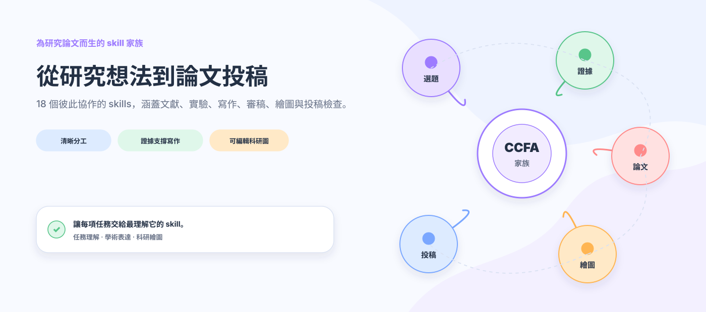
</p>

## 快速開始

選擇你正在使用的 Agent：

[Codex 安裝](docs/getting-started/CODEX.md) · [Claude Code 安裝](docs/getting-started/CLAUDE_CODE.md) · [Cursor 安裝](docs/getting-started/CURSOR.md) · [Gemini CLI 安裝](docs/getting-started/GEMINI_CLI.md) · [其他 Agent](docs/getting-started/OTHER_AGENTS.md) · [自動更新](docs/getting-started/AUTO_UPDATE.md)

建議從 [0.13.0 Release](https://github.com/mikubaka88/CCFA-Skills/releases/tag/v0.13.0) 下載輕量安裝包並解壓縮。它包含技能、原文文字、繪圖素材庫與相鄰範本，完整論文 PDF 以可選離線包另行提供。進入解壓目錄後，依[安裝矩陣](docs/INSTALLATION_MATRIX.zh-TW.md)使用本機安裝器預覽並安裝；個人偏好保留，既有個人修改會先被識別；更新也會清理所選範圍內未改動的受管退役檔案。

也可以從完整 GitHub 倉庫一行安裝；這條路徑仍會取得倉庫中的完整論文資源：

```powershell
npx skills add mikubaka88/CCFA-Skills --global --agent codex --skill '*' --yes --copy
```

這條命令安裝 18 個 skills。需要內建 LaTeX 範本或只安裝部分技能時，請按[安裝矩陣](docs/INSTALLATION_MATRIX.zh-TW.md)補齊相鄰資源；使用 `--copy` 安裝後，更新原始碼還需要重新複製，步驟見[更新指南](docs/getting-started/AUTO_UPDATE.md)。

安裝後，直接說出你正在面對的研究問題：

```text
嚴格評審這三個選題並排序，指出各自最可能被拒的原因。
檢索近三年與時序視覺推理相關的工作、benchmark 和公開 baseline。
根據這篇論文設計主實驗、消融和穩健性證據，不要虛構結果。
把方法部分改寫為 CVPR 風格，並保留公式、術語和引用。
根據論文和參考圖繪製方法架構圖：整理提示詞、GPT Image整圖生成、同提示詞微調，交付PNG。
```

## 為什麼需要一個 skill 家族

論文研究中的困難彼此相連，卻不能由同一種思考方式解決。

| 研究者遇到的困境 | CCFA-Skills 如何回應 |
|---|---|
| 檢索、實驗、寫作和審稿擠在同一次對話中，彼此干擾 | 由最適合當前任務的 skill 負責，其他能力按需協助 |
| 文獻事實、實驗數字和正文結論逐漸脫節 | 分別核對來源、實驗設計與全文一致性，讓每個 claim 都能找到證據 |
| 論文愈改愈像審稿回覆，充滿防禦、解釋和內部狀態 | 寫作負責形成正文，Humanization 讓語言回到自然、直接的學術表達 |
| 新一輪評審不斷更換關注點，難以判斷修訂是否真正進步 | 同時觀察當前稿件的錄用準備度與相對上一版的實際改進 |
| 方法圖容易變成機械方框，資料圖又偏離所選範本 | 流程圖由GPT Image三階段成圖；資料圖重用原JSON/Python與真實資料 |
| 載入的 skills 愈多，結果反而愈容易受到無關規則干擾 | 只載入與當前問題直接相關的能力，減少無關上下文 |

## 我們珍視什麼

- **讓研究問題先於工具。** 評價一個 idea 與發展一個 idea 是兩種工作；設計實驗與美化圖表也需要不同的判斷。CCFA-Skills 讓每一步都回到它真正要回答的問題。
- **讓證據始終有據可查。** 文獻、實驗協議、數值、結論、圖表和引用不會被混成一團。缺失的事實保持缺失，直到它被可靠地找到或驗證。
- **讓論文聽起來像學術，而不是辯護。** Humanization 刪除防禦性鋪墊、機械枚舉、過度破折號和內部工程措辭，同時保留真正影響結論的限制、證據與披露。
- **讓評審保持獨立。** Reviewer 負責判斷，Writer 負責修改。先看問題，再決定如何改，避免一邊審稿一邊替自己解釋。
- **讓科研圖表達清楚，也足夠美觀。** 數值圖保持可重現；方法圖先理解科學內容，再完成提示詞、整圖生成與微調。
- **讓範文成為方向，而不是模板。** 使用者提供目標論文後，系統學習它的敘事節奏、段落職責和證據組織，但不複製原句，也不把一種寫法強加給所有研究。

## 家族架構

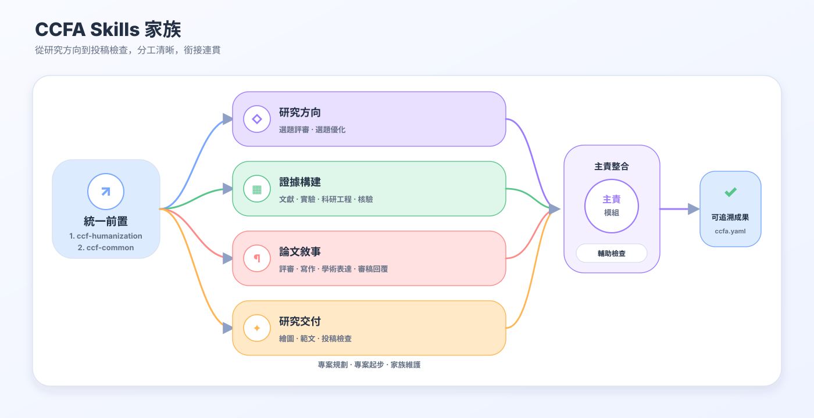

所有 CCFA 任務都先啟用 `ccf-humanization`，再啟用 `ccf-common`，然後進入具體技能；檢索、評審、繪圖、實驗與維護也遵循此順序。前者統一自然、直接且保留真實證據的表達，後者落實協作、範圍、證據和檔案規則。同一任務交接時重用已生效規則，只更新變化或遺失的部分；詳細改寫與實驗檢查依實際任務執行，不重複產生前置報告。各技能繼續負責自己的產物並整合必要協作。

### 18 個核心 skills

| 研究階段 | Skill | 它能帶來什麼 |
|---|---|---|
| 家族協調 | `ccf-common` | 理解請求，協調分工，統一證據與隱私規則 |
| 專案推進 | `ccf-pipeline-orchestrator` | 梳理目標、階段、關鍵節點與下一步 |
| 專案起步 | `ccf-project-scaffolder` | 準備論文目錄、模板與研究材料空間 |
| 選題判斷 | `ccf-idea-reviewer` | 判斷思路價值、創新與機制邏輯，預設不審核實驗 |
| 選題發展 | `ccf-idea-optimizer` | 把模糊方向發展成問題、洞察、方法與證據路徑 |
| 文獻檢索 | `ccf-literature-searcher` | 尋找相關工作、資料集、benchmark 與公開 baseline |
| 前沿追蹤 | `ccf-literature-monitor` | 關注新論文、相近工作與研究方向的最新變化 |
| 實驗設計 | `ccf-experiment-designer` | 設計主實驗、消融、穩健性分析與結果表結構 |
| 科研工程 | `ccf-research-engineer` | 選擇程式庫、實作機制、重現結果並診斷訓練 |
| 完整性核驗 | `ccf-integrity-auditor` | 核對 claim、數值、術語、圖表和引用 |
| 論文評審 | `ccf-paper-reviewer` | 給出獨立科學評審、版本比較與錄用準備度判斷 |
| 論文寫作 | `ccf-paper-writer` | 起草、改寫、潤飾與壓縮論文內容 |
| 學術表達 | `ccf-humanization` | 去除防禦性和機械感，保留自然嚴謹的學術表達 |
| 審稿回覆 | `ccf-rebuttal-writer` | 組織 rebuttal、response letter 與修訂記錄 |
| 科研繪圖 | `ccf-visual-composer` | 重用數值圖範本、三階段生成方法圖、修改已有圖 |
| 投稿檢查 | `ccf-submission-checker` | 檢查模板、頁數、匿名、PDF 與補充材料 |
| 範文學習 | `ccf-paper-to-exemplar` | 從使用者提供的論文中提煉可重用的寫作方法 |
| 家族維護 | `ccf-skill-forger` | 改進 skills，消除衝突，完成發布前檢查 |

### 按目前任務使用能力

18 項技能服務不同場景。思路發展、檢索、工程、實驗、寫作和繪圖負責六類科研產出；思路評審、文章評審、完整性核驗和投稿檢查負責四類判斷。監控、範例提煉、專案初始化、流程編排和審稿回覆在相應階段介入。Humanization 與 Common 提供共同前置，Forger 用於維護家族。公共規則建立一次，再按需讀取專業內容；主責智能體整合結果，獨立問題才交由其他智能體處理。

完整職責視圖：

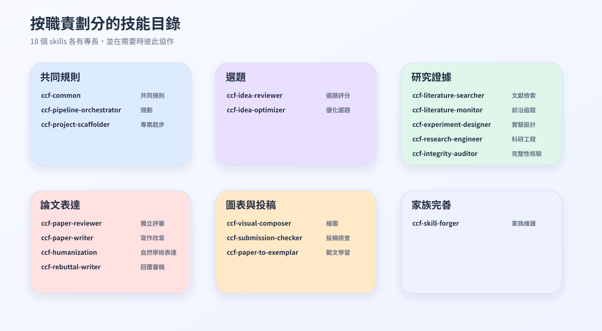

## 日月設定台

修改摘要時，你可能希望快一點；距離投稿只剩三天時，你願意多花一些時間，讓另一位助手再查一遍關鍵結論。日月設定台把這些選擇留給你，也替你記住它們。

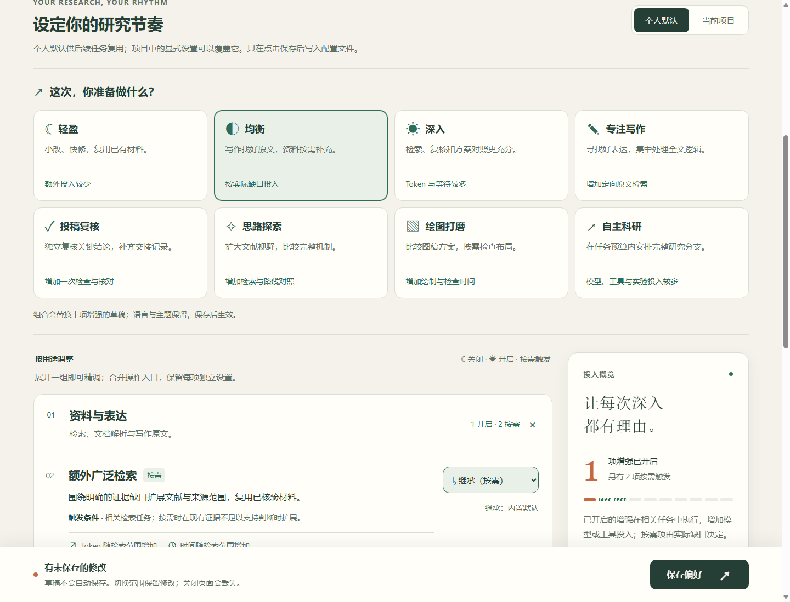

*圖為 0.12.0 設定台介面；0.12.1 在資料與表達組新增紅色成稿開關。調整後點選「儲存偏好」即可套用。*

現在可以直接按正在做的事選擇八種模式。十一項設定整理在「資料與表達」「複核與交付」「探索與方案」「策略實驗」四組裡，需要時再展開。十項常規增強把開關、按需與恢復繼承合成一個選擇框：**繼承 · ☾ 關閉 · ◐ 按需 · ☀ 開啟**。每項仍可單獨調整，並說明額外工作會花在哪裡。頁面繼續支援簡體中文、繁體中文、English，以及日光、夜航和跟隨系統主題。

在倉庫根目錄執行（Python 3.10+，無需額外依賴）：

```bash
python ccf-common/scripts/preferences.py serve
```

瀏覽器會開啟本機設定頁。先選一個接近目前任務的模式，再視需要調整：

| 模式 | 適合什麼時候用 | Token 與時間會怎樣變化 |
|---|---|---|
| **輕盈** | 小改、局部修復，專注完成眼前任務 | 十項額外增強關閉，減少未要求的擴展工作 |
| **均衡** | 日常研究，希望需要時能查深一點 | 保留寫作原文檢索，擴展檢索與複雜文件解析按需增加投入 |
| **深入** | 重要任務，希望多比較、多複核 | 增加獨立複核、檢索、圖稿與報告，通常需要更多 token 與等待 |
| **專注寫作** | 起草正文、重寫段落、打磨論文邏輯 | 主要投入在好原文的查找與閱讀，複雜頁面按需解析 |
| **投稿複核** | 投稿前檢查關鍵判斷與遺漏 | 獨立第二輪複核增加閱讀與判斷，需要時補充交接紀錄 |
| **思路探索** | 比較機制、尋找更有價值的問題 | 擴展檢索與路線對照增加推理，完整研究分支按需並行 |
| **繪圖打磨** | 對比版面、挑選更清楚的表達 | 增加圖稿候選；Python 圖主要多一次排版與渲染，圖像生成另有等待 |
| **自主科研** | 已有明確任務與預算，準備推進研究迭代 | 偏好完整研究分支與擴展檢索，可能縮短等待，但總運算投入增加 |

選擇模式會替換十一項設定的草稿，保留語言與主題；點選**儲存偏好**後才生效。選擇「繼承」會移除這一項的覆寫：專案設定跟隨個人偏好，個人設定跟隨內建預設值。「深入」保留原有的維護規則按需迭代；八種模式都將科研策略迭代保持關閉，需要時再單獨開啟。模式不替你授權訓練、預算或材料上傳，實際投入取決於任務、材料與工具。

三項常規設定讓投入更有針對性：**優質寫作原文檢索**預設開啟，實質起草或表達重寫時沿用匹配原文，同時尋找其他寫得好的文章。按實際段落品質選用，不為多篇而湊數；同一寫作問題已有適用的檢索結果就沿用，小改不重搜。也可切到「按需」，只在範例不足時搜尋；**完整研究分支協作**預設關閉，適合比較不同機制；**科研策略迭代**預設關閉，比較搜尋與上下文策略時再單獨開啟並安排預算。舊設定無需重建，新項繼承預設值。

**謹慎開啟：結果待填成稿。** 紅色選項只提供「繼承／關閉／開啟」，沒有按需模式；八種預設均關閉它。開啟後允許標記清楚的條件式分析與待填結果，可能出現些許幻覺。成稿後自動做一輪全文一致性檢查，增加閱讀與修訂的 token 和時間，不會啟動實驗。起草用法見[結果待填的初稿](#結果待填的初稿)。

希望某篇論文有自己的設定，可以這樣啟動，把路徑換成你的論文目錄：

```bash
python ccf-common/scripts/preferences.py serve --project "path/to/paper"
```

在頁面中選擇「個人預設」或「目前專案」後儲存。個人預設可用於後續任務，專案裡明確設定的選項優先；沒有調整的選項繼續繼承。例如，日常保持輕盈，只為準備投稿的論文開啟獨立複核。你的偏好儲存在 skills 安裝目錄之外，更新 skills 後仍然保留。

**常規增強決定額外投入，紅色開關單獨決定結果待填起草方式。** 即使選擇「輕盈」，你明確要求的完整評審、多個研究方向，以及必要的核驗仍會完成。Humanization → Common 的前置步驟始終生效。開啟設定頁本身不會呼叫模型，也不會啟動研究任務。

<details>
<summary>查看設定檔位置與離線用法</summary>

個人偏好儲存在 `$CODEX_HOME/ccfa/preferences.json`（未設定時為 `~/.codex/ccfa/preferences.json`），專案設定儲存在論文目錄的 `.ccfa/preferences.json`。已安裝副本也可以執行其中的 `ccf-common/scripts/preferences.py`；加入 `--no-browser` 可只印出本機存取位址。

下載倉庫後，也可以開啟 [靜態設定頁](ccf-common/assets/configurator/index.html)，匯入、編輯並匯出 JSON。靜態頁面只匯出檔案：請將匯出的檔案重新命名為 `preferences.json`，放到上述對應的設定目錄後生效。完整規則見 [偏好契約](ccf-common/references/preferences.md)。

</details>

## 從 idea 到投稿

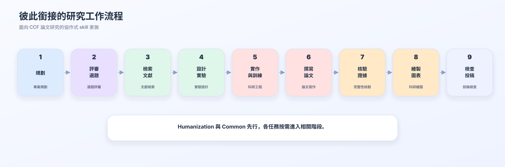

你可以從尚未成形的想法開始，也可以帶來一張結果表、一段方法描述或即將提交的 PDF。CCFA-Skills 從目前問題進入，沿用已有成果，按需要銜接下一步。

### 從問題與現象發展機制

探索先看缺失的是資訊、表徵、目標還是計算能力。技術報告、會議、期刊、arXiv 與較早的基礎結果都能提供啟發；依機制尋找遠近聯繫，在合適材料中抽樣拓展視角，再用不同解釋、操作與預測區分候選。基礎問題也有探索價值，不必為了過關編造即時應用。

一個新模組需要說清楚改變了什麼、刪掉它會失去什麼。理論、反例、觀察與能區分解釋的實驗，都可以幫助作出判斷；有明確含義的因素組合與交互消融仍然可用。已經證實走不通的想法及時放下，選定的好路線則繼續推進。具體方法見[思路最佳化](ccf-idea-optimizer/SKILL.md)。

### 接到既有程式與訓練流程

[ccf-research-engineer](ccf-research-engineer/SKILL.md) 先看既有專案，再按需要選擇成熟程式庫、重用基線、檢查模型與梯度路徑，依實際測量處理訓練故障和效能問題。小規模執行用於回答具體診斷問題，完整方法的結論使用完整條件下的結果。

> 在既有專案中實作這個機制，保留訓練與評估介面。先檢查可重用程式和基線，再定位需要修改的模組；不要用簡化模型取代目標方法。訓練慢時先測瓶頸。

### 自主科研與實驗迭代

科研循環從基線開始，圍繞具體假設修改研究程式，讀取真實結果後決定保留、放棄、修復或探索另一種機制。研究目標與比較條件保持清楚，路線可以隨證據改變。指標提升要回到原問題判斷價值，執行故障與有效負結果分開記錄；排除錯誤解釋的實驗同樣能推進研究。

輕量執行腳本管理次數、執行時間、受保護檔案、原始紀錄和受控還原；宿主 agent 提出假設、修改候選，再透過指定命令執行訓練。恢復時先核對已有紀錄與基線原始結果，同一實驗 ID 不會被悄悄重跑。停止尚未確認時保留現場，避免背景程序持續寫入時還原檔案。

目前最佳方案與值得探索的方向分別記錄。需要時可複測既有候選，多條研究分支共用任務預算，最終確認結果單獨保留。比較前約定品質下限，品質相當時再選成本較低的方案。啟用科研策略迭代後，宿主還可比較搜尋、上下文或工具調度策略，分開使用開發、選擇與保留測試；一次任務的經驗經跨任務檢驗後，才適合沉澱為通用規則。

> 請圍繞檢索停止條件自主迭代。沿用專案的評價腳本和資料劃分，最多執行 6 次（含基線與失敗），每次不超過 60 秒，累計實驗執行不超過 240 秒。不使用付費服務。先檢查已有結果，再選擇能區分機制的實驗；保留原始紀錄，最後交付最佳候選及尚未解決的問題。

[自主科研使用說明與命令](ccf-pipeline-orchestrator/references/autonomous-research.md)提供完整入口。此能力由明確的科研任務與預算啟動，額外投入由[日月設定台](#日月設定台)選擇；維護期規則迭代仍用於維護。一般改稿、思路審核及只要方案的請求依原本範圍完成。

## 寫作如何保持自然

寫作先釐清段落要表達的科學內容，再檢查句子之間的原因、觀察與推論。`ccf-paper-writer` 預設重用匹配的真實原文，並定向尋找其他寫得好的論文；一篇可以幫助組織動機，另一篇可以幫助解釋方法。選擇依據是實際段落品質，學習通用搭配和論證組織，保留自己的科學內容與合理長句。同一問題已有適用材料就沿用，小改不重搜。

`ccf-humanization` 清理沒有科學資訊的自我辯護、審稿預判、貢獻自我降格、重複限定與內部版本旁白。實際失敗、適用條件、重現資訊及必要披露繼續保留，句尾的總結與意義也可以保留。分號、密集 `rather than`、抽象能力標籤等診斷只提示需要閱讀的位置，最後依句意判斷；破折號少用，但沒有全文固定數量上限。明確選用的個人標點與節奏習慣優先，詳見[寫作規則](ccf-paper-writer/references/prose-quality-guardrails.md)。

例如，「可驗證、可實現」若只是替方案貼標籤，就需要寫出實質操作；「索引可實現離線增量更新」表達了具體技術能力，應當保留。寫作、評審和實驗共用這一判斷：說清研究對象、方法與關係，修復具體缺口後結束該輪工作。

> 請潤色這一段，先理清句子之間的原因和證據，再調整措辭。保留數字、實驗條件與真正影響結論的限制。

### 讓寫作範例真正用起來

`ccf-paper-to-exemplar` 將論文解釋問題、引入機制和討論結果的方法整理成範例卡，保留原文位置、適用問題與分析範圍。可以提煉整篇論文，也可以只研究某個章節或段落。眼前的段落改寫由 Writer 直接參考原文；需要日後複用時再提煉卡片，明確要求登記時才加入個人庫。

專案範例保存在 `.ccfa/exemplars/`，個人範例保存在個人設定根目錄下的 `ccfa/exemplars/`。登記引用已有卡片與原文，保留來源和版本，拒絕未完成的骨架。Writer 先查詢符合寫作問題的條目，再讀取需要的卡片與原文；來源變動後刷新相關分析。個人登記與技能安裝文件分開，更新時可以繼續保留。

全文提煉保留原有八類分析，也繼續支援明確指定多張預設範例。專案選擇可覆蓋個人選擇，未指定時繼承。預設項僅在符合目前寫作問題時優先，普通登記不改預設。

```bash
python ccf-paper-to-exemplar/scripts/personal_library.py query --project . --function motivation
python ccf-paper-to-exemplar/scripts/personal_library.py set-default --project . --id paper-a-motivation
```

例如：「把這篇論文引言中從問題到機制的寫法提煉成範例，加入目前專案的個人庫。」以後寫作時，再請 Writer 查找解釋同類科學關係的範例。具體登記命令見[範例技能](ccf-paper-to-exemplar/SKILL.md)。

### 長稿修改與寫作接力

修改長稿時，先找回全文主線，帶著目前章節、必要鄰段與有位置的原文材料動筆。相關工作依問題和機制組織，結果段落解釋觀察之間的關係；目前任務只載入需要的寫作指引。完整初稿先把內容講清楚，再按要求適配篇幅。

[寫作執行入口](ccf-paper-writer/references/writing-execution.md)核對稿件版本和修改範圍，避免舊版本覆蓋新工作。結果檔案改變後，依已登記的關係找到受影響的段落與圖表。可選的昂貴複查只沿用輸入、指引、模型參數及實際涵蓋範圍相符的完成結果，中斷的呼叫先釐清再繼續；普通單句修改直接處理。

> 修改這篇論文的結果與討論部分。保留全文主線和必要鄰段，用真實結果解釋差異；先準備目前材料，再局部修改，最後只複查受影響的論點與圖表。

### 結果待填的初稿

問題與機制已清楚、實驗尚待完成時，可以明確要求結果待填起草，或在[日月設定台](#日月設定台)開啟對應紅色選項。先完成連貫論證、標記清楚的條件式分析與待填位置，保留已有的正結果和負結果。明確要求實驗留空時，仍按留空處理。

成稿後自動對照摘要、正文、表格、圖說與結論，分清預期和實測，檢查數字及論述衝突。紅色選項可能出現些許幻覺，因此預設及所有預設組合均關閉；它不啟動實驗，也不把待填數值寫成實測結果。

## 評審與投稿檢查

思路審核與文章審核依判斷對象區分：「這個方向值得做嗎」由 `ccf-idea-reviewer` 處理，無需指定評分；「稿件結論是否站得住」由 `ccf-paper-reviewer` 處理。即使輸入完整 PDF，只看核心思路的請求也維持概念審核。思路評分聚焦問題、創新、洞察、機制、簡潔性與受眾價值，實驗僅在明確要求時單獨評估。

結構化審核報告預設輸出詳細版，明確要求簡要時使用簡要版。文章審核展開貢獻、優缺點、相關工作、方法與證據、多視角意見、評分及修改優先級；思路審核展開問題價值、創新差異、機制邏輯與發展建議，預設不評實驗。意見綁定具體位置、依據與穩定編號，複審追蹤問題是否解決；不會產生缺乏真實參照集的百分位排名。詳見[文章報告範本](ccf-paper-reviewer/references/fixed-output-format.md)與[思路審核協議](ccf-idea-reviewer/references/strict-idea-review.md)。

完整文章評審固定 14 節，寫作專項固定 9 節，明確要求簡版時使用 5 塊。通用科學評分統一為新穎性、正確性、證據、意義、清晰度、可複核性、倫理與局限七維；證據要求依貢獻類型解釋，置信度與材料覆蓋範圍分開。生成報告可直接檢查 Markdown 的標題順序、評分欄位和問題編號引用；會議或使用者明確指定的格式繼續優先。

文章複審同時回答兩個不同的問題：

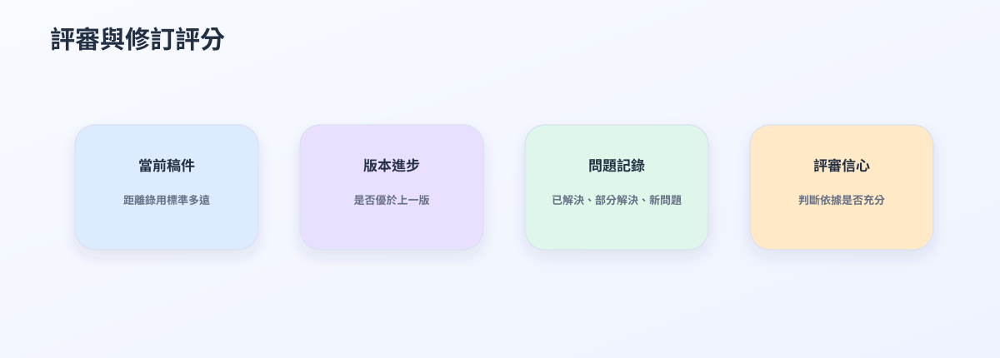

- **當前稿件是否足以投稿。** 它衡量論文距離目標 venue 的要求還有多遠。
- **這次修訂是否真正進步。** 它比較新舊版本解決了什麼，又是否引入新的問題。

### 獨立領域審讀

「獨立複核」可安排另一位領域評審先讀稿件，判斷貢獻與論證。首次閱讀不帶主審分數、舊結論或寫作歷史，再由主審核對發現、合併重複問題，形成原有的一份報告。評審按研究目前階段判斷，不因每個疑問都要求新增實驗；rebuttal 直接回應問題，確有理由時才致謝、讓步或承諾修改。

現有選項中，「關閉」不增加呼叫，「開啟」為實質科學或全文評審安排一次獨立閱讀，「按需」用於重大爭議或投稿前檢查，明確請求優先。這會增加一次閱讀的等待與輸入、輸出 token；同用途的獨立複核不再重複疊加。[準備入口與用法](ccf-paper-reviewer/references/plain-expert-review.md)整理材料，實際呼叫由宿主確認可用的 GPT-6 與全新上下文後執行，準備請求本身不等於完成審讀；能力不可用時仍完成主審。

> 請讓一位獨立的領域評審審讀這篇論文，先看稿件，再看已有評語。指出真正影響判斷的問題，由主審合併成一份報告；宿主支援時實際選用 GPT-6。

### 依會議年份與階段檢查

投稿時先確定會議、年份、track 和階段，再使用對應範本、指南與本機檢查。模板依年份保留完整依賴，作者註冊、資格等需人工確認的事項另行列出。

| 會議 | 指南與檢查重點 |
|---|---|
| [CVPR 2027](ccf-paper-writer/references/venue-guides/cvpr.md) | 官方範本、紙張與匿名資訊、正文頁數、LLM Usage Statement |
| [ICLR 2027](ccf-paper-writer/references/venue-guides/iclr.md) | 對應模板、投稿階段、篇幅與 AI 使用說明 |
| [ACL 2027](ccf-paper-writer/references/venue-guides/acl.md) | 長／短稿，以及 ARR 審稿到 ACL commitment 的階段區分 |
| [ICML 2027](ccf-paper-writer/references/venue-guides/icml.md) | 研究稿貢獻類型、影響聲明與 AI 揭露 |
| [ECCV](ccf-paper-writer/references/venue-guides/eccv.md) | 對應屆次的範本與投稿檢查 |
| [ECOOP](ccf-paper-writer/references/venue-guides/ecoop.md) | 對應屆次的範本與投稿檢查 |
| [IMC](ccf-paper-writer/references/venue-guides/imc.md) | 對應屆次的範本與投稿檢查 |
| [ACSAC](ccf-paper-writer/references/venue-guides/acsac.md) | 對應屆次的範本與投稿檢查 |

其他會議由[會議指南索引](ccf-paper-writer/references/venue-guides/index.md)進入。

## 繪圖示例

這裡展示的是實際科研成圖，而不是功能宣傳圖。不同圖面向不同閱讀場景，因此使用不同的構圖語言。

### 論文方法架構圖

下圖從 `output/DynTrace.pdf` 中提取計算關係，以分層版面呈現方法機制與資訊流。輸入與視覺處理位於底部，幾何證據和 DTV/DTG 分支構成中層，token 融合、MLLM 與答案位於頂部。各層按計算依賴連接，便於沿資訊流閱讀完整方法。

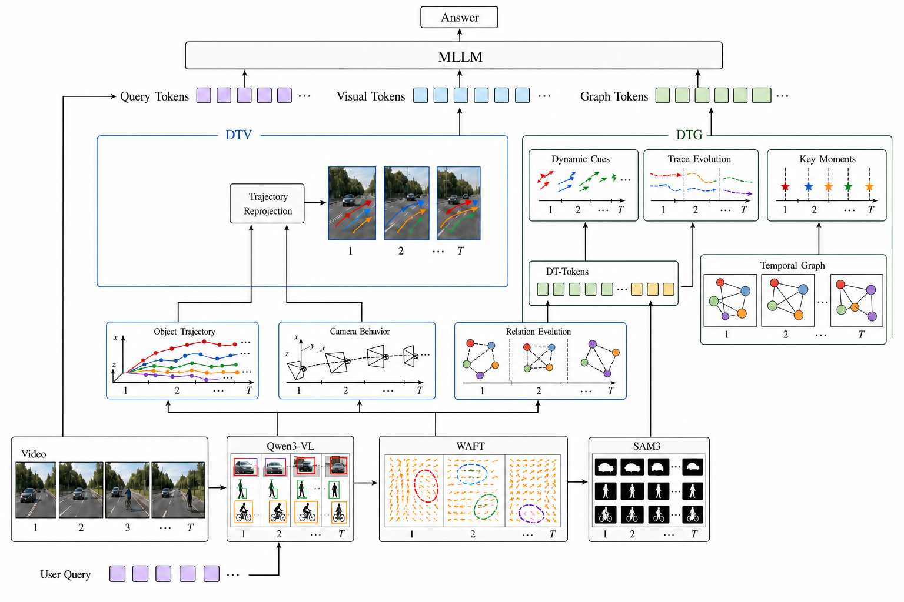

<details>
<summary>查看參考圖、出處與構圖原則</summary>

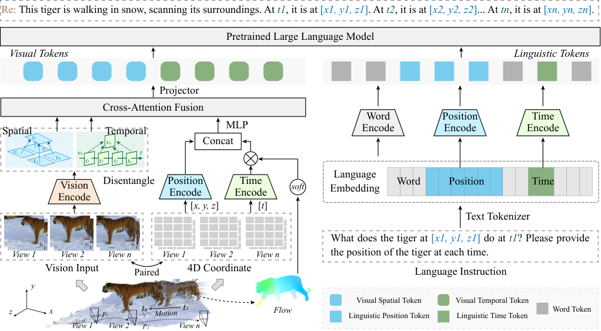

參考出處：Hanyu Zhou and Gim Hee Lee, [*LLaVA-4D: Embedding SpatioTemporal Prompt into LMMs for 4D Scene Understanding*](https://arxiv.org/abs/2505.12253), Figure 2；亦見 [OpenReview 頁面](https://openreview.net/forum?id=URpbmVEsqB)。截圖僅用於非商業的學術構圖研究與風格說明，版權歸原作者所有。如涉及侵權，請聯絡專案維護者刪除。

- 論文圖應當讓輸入、表示、操作、分支、融合與輸出一目了然。
- 影片幀、光流、遮罩、3D 軌跡、DT-Tokens 與 temporal graph 都承擔方法含義，而不是裝飾。
- 普通英語使用自然大小寫；Qwen3-VL、WAFT、SAM3、DTV、DTG、MLLM、3D 與 4D 保持規範縮寫。

</details>

### PPT/Poster

下面保留兩張早期視覺探索。它們更適合簡報、專案海報或 README 概覽，因此不作為頂會論文方法圖示例。

#### GPT Image 2 概念稿

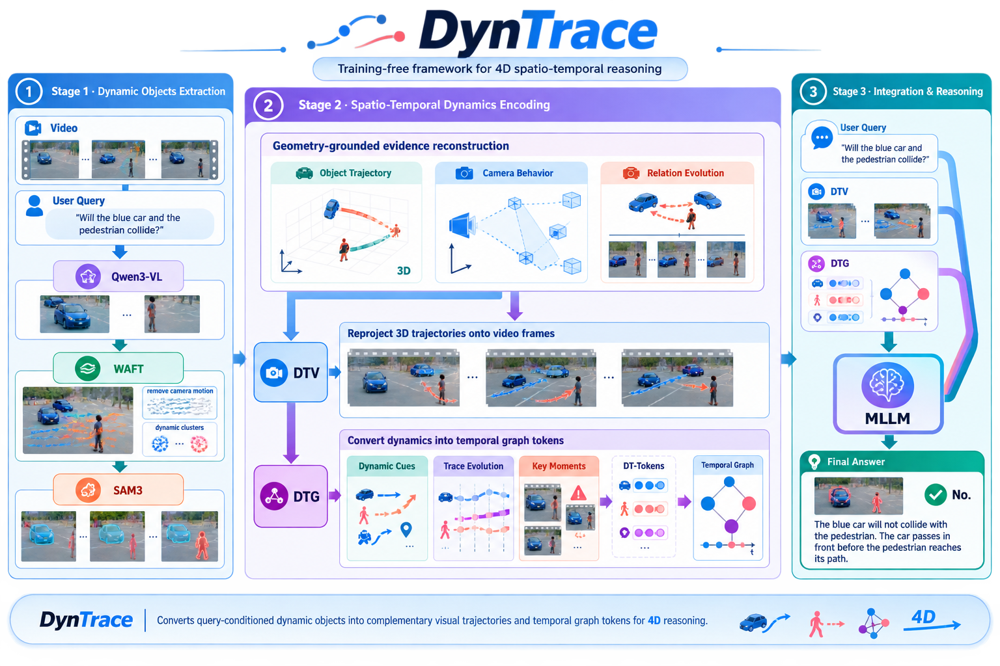

#### 參考驅動的 PPT/Poster

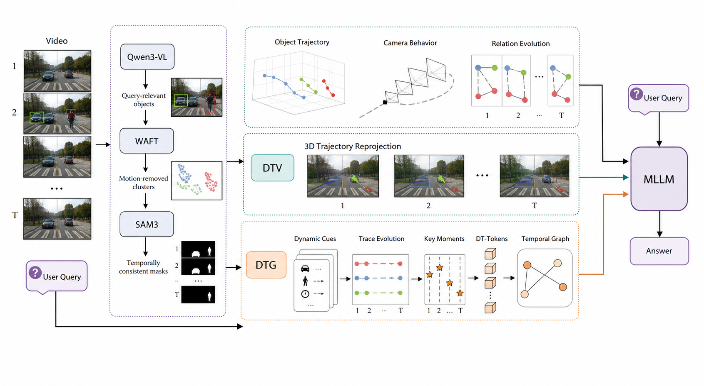

參考構圖讓標題、色塊與視覺錨點適合簡報和海報閱讀；統一流程見[繪圖交付](#讓圖既好看也能繼續修改)。

### 資料分析圖

先確定這張圖要讓讀者理解的關係，再按資料類型、觀察單位、配對條件和紙面尺寸選圖。**43 種圖形語法、16 類表達目的、16 套組合方案**涵蓋分布與長尾、配對收益、誤差來源、排名變化和資源取捨。設計說明記錄所需資料、選圖理由、易誤讀之處與可融合的結構，便於沿著文章內容繼續創作。

**密度與擾動：**在一組緊湊的關聯面板裡，同時呈現狀態密度、區域占比、分位範圍與 P95 變化。

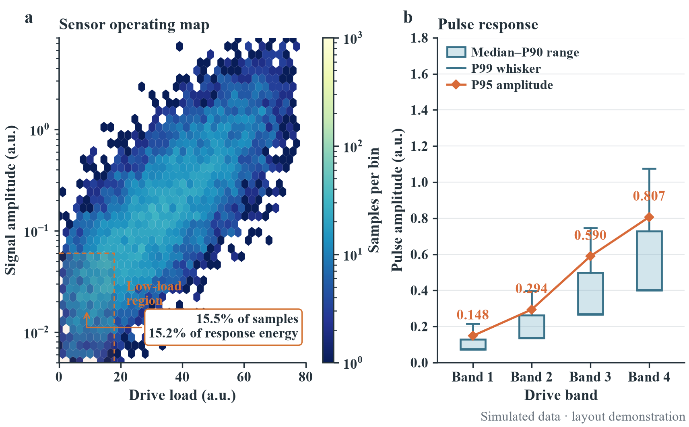

**演化與類別差異：**將狀態曲線與分類柱線對照放在一起，保留區間帶、關鍵數值與一致的對象配色。

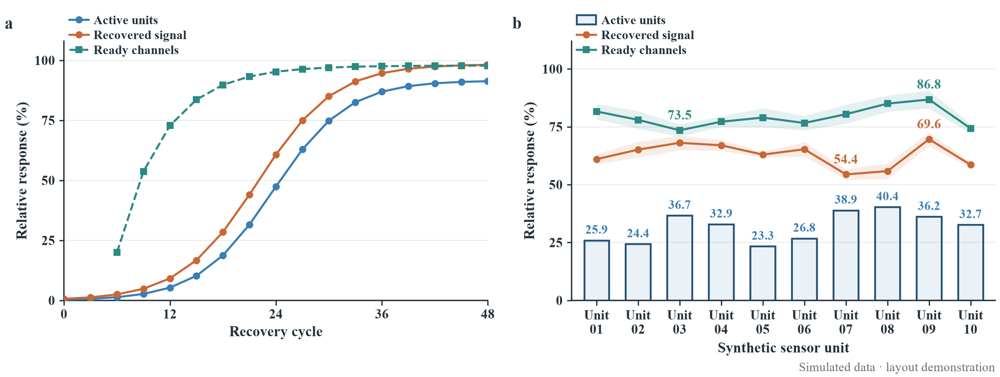

合適方案之間自然選擇，不要求使用者設定隨機數或湊使用次數。選定後沿用具體設計，配對資料按樣本身分對齊；共同對象保留顏色，可比較的座標或色階保持一致，不同單位分別標註，分箱圖保留相同區間與實際分母。

```bash
python ccf-visual-composer/resources/python/ccfa_figure_library.py route "分布與長尾"
python ccf-visual-composer/resources/python/ccfa_figure_library.py explain ecdf
python ccf-visual-composer/resources/python/ccfa_figure_library.py demo --fusion paired_benefit --out ccfa-workfiles/figures/paired-effect/build/figure
```

實際資料可從 CSV、TSV 或 JSON 表接入，篩選和排序後仍保留同列關係。聯合分布與邊緣、共同位置多軌道、熱圖與行列切片三種連動版面，共用同一批觀察或網格，各軌道保留自己的單位。數值預覽明確使用模擬資料；真實任務以 `--data` 讀取提供的結果，工具區分 p 值、校正 p 值和 q 值，檢查區間、機率、座標範圍與標籤。

九套原有整圖範本，以及密度／擾動、狀態演化／類別占比兩組指定參考圖，都保留在[完整示例表](ccf-visual-composer/references/figure-examples.md)，可按示例 ID 直接呼叫。論文素材的範圍、來源與涵蓋紀錄，見[圖形設計與融合指南](ccf-visual-composer/references/figure-design-library.md)；有日期的歷史規模記錄保存在 [CHANGELOG](CHANGELOG.md)。

<details>
<summary>查看九套 Python 分析範本與試畫命令</summary>

[九套範本總覽](assets/analytical-figures-gallery.png) · [完整示例與呼叫入口](ccf-visual-composer/references/figure-examples.md)

| 範本 | 幫讀者看清什麼 |
| --- | --- |
| `mechanism_overview` | 方法流程、任務表現與資源收益如何對應 |
| `benchmark_atlas` | 跨任務結果、重複執行分布與成本取捨 |
| `ablation_interactions` | 各元件的貢獻，以及它們之間的相互作用 |
| `scaling_robustness` | 規模、訓練預算與擾動變化後的表現 |
| `representation_diagnostics` | 表示空間、注意力與特徵關係 |
| `biological_atlas` | 細胞分組、表達分布與差異篩選 |
| `paired_effects` | 同一樣本前後變化與不同亞組的效應 |
| `calibration_errors` | 信心度校準、混淆矩陣與錯誤結構 |
| `sensitivity_dynamics` | 密度與閾值占比、箱線與 P95、狀態演化，以及同軸分類柱線對照；也可拆成兩張橫向雙面板圖 |

範本與基礎元件可按問題組合，統一字級、線寬、圖例和相關面板的對齊。原有 14 套配色之外，還有 AAAS、NEJM、Lancet、JCO、Tol bright 和 Tol muted 六套選擇；這些名稱表示調色盤參考，並非期刊指定配色。

```powershell
python -m pip install numpy matplotlib
python ccf-visual-composer/resources/python/ccfa_analysis_templates.py --demo all --out ccfa-workfiles/figures/analysis-demo
```

只看敏感性分析雙面板時，將 `--demo all` 換成 `--demo sensitivity_dynamics --panel-pair sensitivity`；把 `sensitivity` 改為 `dynamics` 則輸出狀態演化與分類對照，沿用原來的 `--out` 路徑。

[繪圖呼叫說明](ccf-visual-composer/references/python-plot-recipes.md)提供真實資料接入、字級及配色參數。重複執行更新同一任務目錄，額外候選與獨立複核沿用現有開關。

</details>

[早期數值圖及原始來源檔案](ccf-visual-composer/references/figure-examples.md#早期-svg-与展示图保留原文件)保留在素材庫中。

> 請把這些結果整理成一張緊湊的分析圖，先判斷需要表達的關係，再選範本或組合。依論文最終寬度安排字級，對齊相關元素，同一方法保持同色，保留必要的不確定性，輸出 PNG 及可重用的 Python／JSON 來源。

## 讓圖既好看，也能繼續修改

資料圖選中了哪個範本，就沿用它的 JSON 與 Python 繪製程式。替換真實資料時保留原本的版面、字級、配色、圖層與統計定義；不重新執行 demo 或改選近似的基礎圖。新設計才依輸入資料類型、圖類型與文章問題選擇組合。

繪圖先讀文章、資料與參考圖，釐清科學內容、必要對象和真實關係。新繪／重繪論文流程圖、方法圖及架構圖採用三階段：從使用者提示詞、參考圖與文章整理 P；帶著 P 與這些材料交給 GPT Image 生成 G0；再以同一個 P 和 G0 微調為 G1。整圖生成與微調是兩次實際圖像呼叫；微調是同一候選的必需階段，關閉額外候選也會執行。圖像模型負責緊湊、對齊、連線清楚且資訊豐富的整體構圖，不搭向量骨架，也不重建為 SVG 或 PPT 形狀。

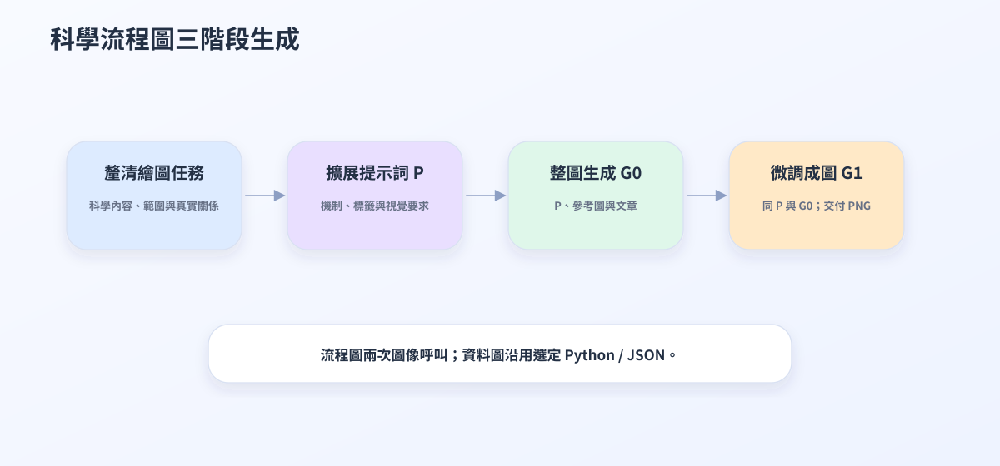

已有圖的局部修改與調優沿用目前圖像或原始來源，不必重跑三階段。流程圖預設交付 PNG；放入 PPTX／PDF 時仍是原圖，應準確說明實際可編輯程度。數值圖由 Python 生成，預設交付 PNG，並保留 Python／JSON 來源；明確要求時再匯出 PDF 或 SVG。需要插畫時可局部補充，圖像模型不重畫資料。Times New Roman 或選定的 Comic Sans MS、加粗標題／圖例／座標、同色系深色柱箱邊沿、配色預設與緊湊對齊均保留。

## 各司其職，彼此接力

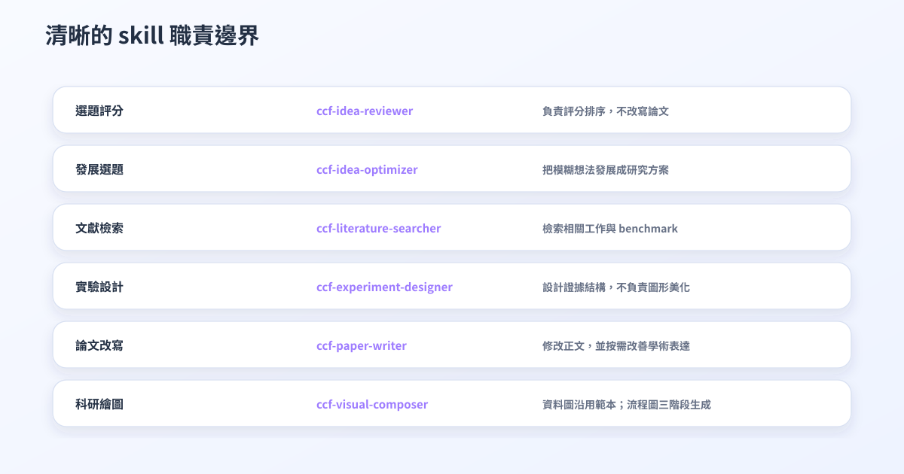

每個產物有一位負責整合和交付的主責技能。協作從結果回推必要條件：判斷創新性前核對近鄰工作，實質寫作前釐清主張與來源，繪圖前確認資料含義與方法結構。已有且仍適用的材料繼續沿用，缺失、衝突或過期部分交給相應技能補齊；改動後只檢查受影響的論證及依賴。內部協作回傳發現，正式評審保留其模板與必要涵蓋範圍。

### 長任務如何保持方向

長任務按需要保留簡短紀錄，將研究目標、重要限制、目前路線和下一步放在一起。在換路線、接收其他助手結果或恢復上下文時先核對這些約定；回答偏題時回到實際檔案與證據，保留有效成果，從能檢查的小步繼續。新證據可以支持改路，目標與原因仍保持清楚。這是[連續性規則](ccf-common/references/continuity.md)對長對話和表現波動的處理方式。

### 多智能體圍繞完整問題分工

審視不同機制時，助手可以先獨立思考，再交換相關證據；核對稿件時，可分別查引用、數值與結論，再由同一位負責人接回論證。問題、洞察和方法等緊密相依的決定由同一位作者貫穿，其他助手接手能獨立完成、且結果有明確用途的工作。推理檔位提高不要求把任務拆得更碎。

局部缺口交回原助手補齊，已經拆散的工作重新歸攏，共用檔案由明確負責人依序整合。採用其他助手的發現前核對來源和版本，避免拼接各自成立、合起來卻矛盾的結論。詳見[任務模式](ccf-common/references/task-modes.md)及[交接規則](ccf-common/references/handoff-modes.md)。

外部 skills 可補足工具和專業知識，工作沿用同一目標、檔案位置及主責。節省 token 的重點是減少重複檢索、重複報告、無關參考與重複詢問，必要的前置工作仍須完成；詳細協作路徑見[協作路由](ccf-common/references/routing.md)。

## 倉庫結構

```text
CCFA-Skills/
├── ccf-common/                 # 家族共享規則
├── ccf-*/SKILL.md              # 18 個 skill 入口
├── ccf-*/references/           # 按需閱讀的參考資料
├── ccf-*/scripts/              # 可重現操作
├── assets/                     # README 圖片與繪圖示例
├── evaluation/                 # 回歸與消融結果
├── tools/build_ccfa_diagrams.py
└── 实验结果.md
```

較長的規則放在 `references/`，可重複執行的操作放在 `scripts/`。迭代過程沿用固定檔名，由新版本覆蓋舊版本，避免堆積難以辨認的過程文件。

檔案約束已前置到全部 18 個 skill 入口。中間檔案優先沿用使用者指定路徑、該產物的 `ccfa.yaml` 對應和既有任務目錄；新任務使用專案根目錄下獨立的 `ccfa-workfiles/<任務用途>/<具體產物>/`，不嵌套在通用 `output/` 中。例如 `figures/method-overview/`、`reviews/paper-short-title/`、`literature/retrieval-memory/` 分別存放方法圖、論文評審和主題檢索的工作檔案。若同名目錄已被其他用途占用，採用穩定的 `ccfa-workfiles-<專案名>/`，不混用或覆蓋。

需要時才建立 `source/`（可重用來源檔案）、`assets/`（參考與圖示）、`cache/`（下載與提取快取）、`build/`（目前預覽與建置日誌）。同一產物跨 skill 共用目錄，普通迭代更新原檔，不使用含義不明的 `temp`、`misc` 或 `final-final`。完成後清理本任務產生且已確認可丟棄的過程檔案，保留原始資料、可編輯來源、最終產物及必要對比證據；失敗生成不覆蓋可用結果。既有目錄不因新命名規則被搬遷，完整規則見[產物合約](ccf-common/references/artifact-contracts.md)。

中文輸出採用明確的 UTF-8 讀寫，相容帶 BOM 的輸入；終端管道、中文檔名和圖形字型分別檢查。家族校驗已加入中文與生僻字回歸，解碼錯誤會明確回報，避免用替換字元掩蓋問題。圖中的中文使用可用的 CJK 後備字型，保留原定的西文字型。

反覆建置或轉換時，可使用[暫存產物追蹤](ccf-common/references/artifact-contracts.md#optional-tracking-for-repeated-builds)標明本任務的可丟棄產物，只清理已釋放且未被改動的檔案。普通改稿不需要額外追蹤檔。

<a id="latest-updates"></a>

## 最新更新

目前版本 **0.13.0**。完整用法已合併到對應章節，更新歷史見 [CHANGELOG](CHANGELOG.md#v0130)。

| 日期 | 變更摘要 | 使用入口 |
| --- | --- | --- |
| 2026-11-27 | 更新資料分析成圖，合併重複文件並整理閱讀路徑 | 本頁目錄 |
| 2026-11-26 | 精簡技能前置，串接範例提煉、外部個人庫與預設選擇 | [寫作範例](#讓寫作範例真正用起來) |
| 2026-11-25 | 補充 ACL、ICML、ECCV、ECOOP、IMC、ACSAC 適配與參考集合 | [會議適配](#依會議年份與階段檢查) |
| 2026-11-14 | 修復所選範本重用、資料替換與明確尺寸交付鏈路 | [資料分析圖](#資料分析圖) |
| 2026-11-12 | 加入 CVPR 2027 範本與檢查，統一目前繪圖交付規則 | [投稿檢查](#評審與投稿檢查) · [繪圖交付](#讓圖既好看也能繼續修改) |

## 維護與驗證

在倉庫根目錄完成基礎檢查：

```powershell
python ccf-common/scripts/check_v04.py
python ccf-common/scripts/check_path_privacy.py
python ccf-common/scripts/check_markdown_links.py
python ccf-common/scripts/check_sources.py
```

各功能的完整回歸命令集中在 [CI 設定](.github/workflows/validate.yml)，包括科研循環、寫作、評審、繪圖、設定、範例庫與安裝恢復；[內容及路由小樣](evaluation/behavioral/README.md)用於維護時檢查實際行為。

[0.12.0 小樣比較](evaluation/behavioral/results/0.12.0-smoke.md)與 [0.9.0 歷史實驗](实验结果.md)保留原版本、材料與模型條件。結構和腳本回歸分別說明其涵蓋範圍，模型品質及 token 效率由相應實測結果解釋。

## 我們堅持的底線

- 不虛構實驗結果、引用、模組或 venue 規則。
- 私有論文和未公開結果只讀取完成任務所需的內容。
- 外部檢索與圖像生成只在使用者授權後進行，並且只傳遞完成任務所需的資訊。
- 使用者可以停用任意 skill，其他 skills 不會繞過這項選擇。
- 自動評分必須說明量表、比較對象、依據與不確定性。

## 致謝

感謝 [Research-Paper-Writing-Skills](https://github.com/Master-cai/Research-Paper-Writing-Skills) 對學術寫作 skill 開源生態的貢獻。

## Star 旅程

[](https://github.com/mikubaka88/CCFA-Skills/stargazers)

<a href="https://www.star-history.com/?repos=mikubaka88%2FCCFA-Skills&amp;type=date">
  <picture>
    <source media="(prefers-color-scheme: dark)" srcset="https://api.star-history.com/svg?repos=mikubaka88/CCFA-Skills&amp;type=Date&amp;theme=dark" />
    <source media="(prefers-color-scheme: light)" srcset="https://api.star-history.com/svg?repos=mikubaka88/CCFA-Skills&amp;type=Date" />
    
  </picture>
</a>

曲線由 Star History 自動更新，計數徽章由 Shields.io 自動更新。服務與 GitHub 圖片快取可能延遲顯示，曲線通常快取約 24 小時，因此不是秒級即時；點擊圖表可開啟互動頁面。

[查看 2026-08-13 歷史快照（離線可用）](assets/ccfa-skills-star-history.zh-TW.svg)
